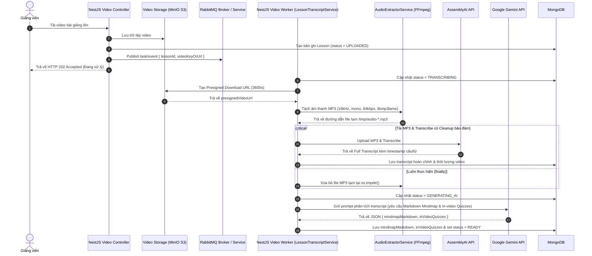

# AI Video Pipeline — Rules & Business Flows

> **Module:** Xử lý video bất đồng bộ qua RabbitMQ, AssemblyAI (Speech-to-Text) và Google Gemini API (sinh Mindmap Markdown & In-video Quiz).

---

## 1. Nghiệp vụ & Luồng Dữ liệu (Processing Flow)

---

## 2. Quy tắc Nghiệp vụ Cốt lõi (Core Business Rules)

1. **Chống nghẽn tiến trình (Non-blocking HTTP)**:
   - Tuyệt đối không gọi AssemblyAI hoặc Gemini đồng bộ bên trong request HTTP của người dùng.
2. **Khả năng chịu lỗi & Thử lại (Idempotency & Retry Strategy)**:
   - Worker chỉ gửi `ack` khi đã lưu dữ liệu thành công vào MongoDB.
   - Khi gặp lỗi mạng tạm thời từ External API (AssemblyAI/Gemini), worker sử dụng cơ chế retry tối đa 3 lần.
   - Nếu vượt quá số lần thử lại, message được chuyển sang Dead Letter Queue (DLQ) và trạng thái bài học được cập nhật là `FAILED` kèm lý do lỗi `failureReason`.
3. **Độ an toàn API Key**:
   - Khóa API của AssemblyAI và Google Gemini được cấu hình qua biến môi trường (`.env`), không hardcode trong mã nguồn.

---

## 3. Quy tắc Sư phạm & Sinh Câu hỏi Trắc nghiệm (Quiz Generation Rules)

1. **Nguyên tắc cốt lõi: Chất lượng hơn số lượng**:
   - Đặt giới hạn trần tối đa câu hỏi (mặc định 10 câu, giảng viên có thể chọn mức trần như 3, 5, 8, 10, 15, 20).
   - Tuyệt đối không ép buộc AI phải sinh đủ số lượng trần. AI tự đánh giá chiều sâu và hàm lượng kiến thức của transcript để quyết định số lượng câu hỏi phù hợp (0 <= N <= maxCount).
   - Nếu bài giảng chỉ có đủ dữ kiện cho 4 câu hỏi thực sự hữu ích, chỉ sinh 4 câu. Nếu có 6 câu, sinh 6 câu. Chỉ sinh đủ trần khi nội dung thực sự phong phú.
   - Nếu nội dung transcript quá ngắn, quá đơn giản hoặc không đủ kiến thức phù hợp, hệ thống chấp nhận trả về ít câu hỏi hơn hoặc trả về 0 câu hỏi (`[]`).
2. **Tiêu chuẩn chọn lọc kiến thức**:
   - Ưu tiên: Kiến thức cốt lõi, khái niệm quan trọng, nguyên lý, quy trình thực hiện, mối quan hệ nhân quả, sự khác biệt giữa các khái niệm hoặc nội dung cần ghi nhớ & vận dụng.
   - Nghiêm cấm: Câu hỏi cho thông tin vụn vặt, ít giá trị, lời chào hỏi/mở đầu, nội dung lặp lại, hoặc chia nhỏ một ý kiến thức thành nhiều câu hỏi tương tự nhau.
   - Mỗi câu hỏi phải kiểm tra một năng lực hiểu bài có ý nghĩa riêng biệt.
3. **Căn cứ xác thực từ Transcript**:
   - Mọi câu hỏi, phương án lựa chọn và giải thích phải có căn cứ rõ ràng từ nội dung transcript, không bịa thông tin bên ngoài.
   - Mốc thời gian (`timestamp`) phải gắn liền với thời điểm xuất hiện kiến thức trong video bài giảng.

