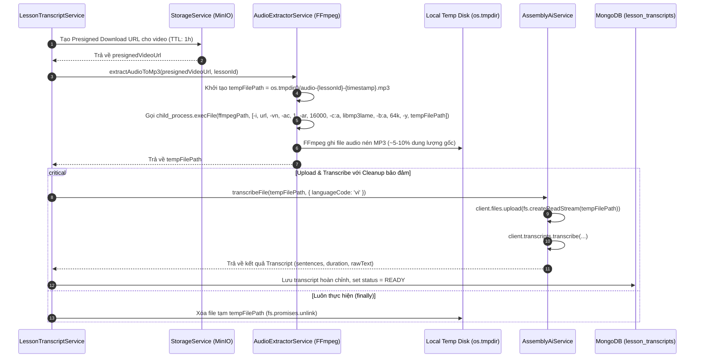

# Kế hoạch Triển khai: Tối ưu Trích xuất Âm thanh MP3 qua FFmpeg cho Tiến trình Lấy Transcript Video

> **File:** `docs/PLAN-ffmpeg-audio-extract.md`  
> **Trạng thái:** COMPLETED (100% Tests Pass, Build Clean)  
> **Agent lập kế hoạch:** `project-planner`  
> **Chuyên gia phụ trách:** `backend-specialist` (Skills: `clean-code`, `api-patterns`, `testing-patterns`, `nodejs-best-practices`)  
> **Dịch vụ mục tiêu:** Video Transcription Pipeline (`backend/src/modules/course/` & `backend/src/modules/assemblyai/`)  

---

## 1. Bối cảnh & Yêu cầu Nghiệp vụ (Context & Requirements)

### 1.1. Hiện trạng & Vấn đề Phát sinh
- Hiện tại, tiến trình lấy transcript bài học được thực hiện trong `LessonTranscriptService.processTranscriptionTask(lessonId, videoKeyOrUrl)`.
- Hệ thống đang lấy stream tệp video gốc (định dạng MP4) trực tiếp từ MinIO thông qua `this.storageService.getObjectStream(videoKeyOrUrl)` và gửi thẳng stream MP4 này lên AssemblyAI qua `this.assemblyAiService.transcribeStream(audioStream)`.
- **Hạn chế & Bất cập nghiêm trọng**:
  1. **Lãng phí băng thông**: Các tệp video bài giảng MP4 thường có dung lượng từ vài trăm MB đến hơn 1GB do chứa luồng hình ảnh độ nét cao (1080p/720p H.264/H.265). Việc truyền tải toàn bộ luồng video qua Internet lên AssemblyAI làm tiêu tốn băng thông máy chủ không cần thiết.
  2. **Độ trễ upload lớn & Rủi ro gián đoạn**: Quá trình upload hàng trăm MB qua mạng quốc tế tới AssemblyAI staging storage làm kéo dài thời gian xử lý và tăng nguy cơ timeout hoặc network socket drop.
  3. **Chưa chuẩn hóa định dạng âm thanh cho AI**: Các mô hình nhận diện giọng nói hiện đại (Whisper, Conformer) có tần số lấy mẫu native là 16.000 Hz và chỉ cần âm thanh đơn kênh (Mono). Video gốc thường có âm thanh Stereo (2 kênh) với sample rate 44.100 Hz hoặc 48.000 Hz, gây dư thừa dữ liệu âm thanh.

### 1.2. Yêu cầu Nghiệp vụ Mới
1. **Chuẩn bị nguồn Video từ MinIO**:
   - Sử dụng Presigned Download URL hoặc stream từ MinIO làm nguồn đầu vào cho FFmpeg.
2. **Trích xuất & Tối ưu hóa Audio thành tệp MP3 qua FFmpeg**:
   - Sử dụng `child_process.execFile` (bọc `promisify`) để tách luồng âm thanh ra tệp tạm tại thư mục hệ điều hành `os.tmpdir()` (ví dụ: `audio-${lessonId}-${Date.now()}.mp3`).
   - Cấu hình các tham số FFmpeg chuyên biệt tối ưu cho AI Speech-to-Text:
     - `-i <input_video_url_or_path>`: Đường dẫn/URL video nguồn từ MinIO.
     - `-vn`: Loại bỏ hoàn toàn luồng hình ảnh (No Video).
     - `-ac 1`: Chuyển đổi âm thanh sang 1 kênh duy nhất (Mono).
     - `-ar 16000`: Hạ tần số lấy mẫu (Sample rate) về 16.000 Hz (chuẩn native của ASR).
     - `-c:a libmp3lame`: Bộ mã hóa định dạng MP3 chất lượng cao.
     - `-b:a 64k`: Bitrate 64 kbps (giữ trọn độ rõ nét giọng nói nhưng file siêu nhẹ, ~28MB/giờ bài giảng).
     - `-y`: Tự động ghi đè nếu trùng tên file tạm.
3. **Gửi file MP3 lên AssemblyAI & Chuẩn hóa dữ liệu**:
   - Tải tệp MP3 nén lên AssemblyAI staging storage và kích hoạt nhận diện văn bản.
4. **Dọn dẹp File Tạm Tuyệt đối**:
   - Ngay sau khi nhận về transcript (hoặc trong trường hợp tiến trình gặp lỗi/ngoại lệ), hệ thống bắt buộc phải dọn dẹp (xóa bỏ) file tạm MP3 trên ổ cứng, không để rò rỉ dung lượng đĩa máy chủ.

---

## 2. Kiến trúc Giải pháp & Sơ đồ Luồng (Architecture & Flow)

### 2.1. Sơ đồ Luồng Xử lý Mới (Sequence Diagram)



### 2.2. Phân tích Quyết định Kỹ thuật

#### A. Tránh phụ thuộc cứng vào FFmpeg môi trường (Dynamic Binary Resolution)
- **Vấn đề thực tế**: Trên môi trường máy chủ Windows hoặc các container tối giản, lệnh `ffmpeg` có thể chưa được thêm vào biến môi trường hệ thống (`PATH`).
- **Giải pháp**:
  1. Cho phép cấu hình biến môi trường `FFMPEG_PATH` trong `.env` để tùy biến đường dẫn binary nếu cần.
  2. Tích hợp `ffmpeg-static` (npm package) để tự động cung cấp binary FFmpeg tương thích đa nền tảng (Windows, macOS, Linux/Docker) mà không cần người dùng cài đặt thủ công ngoài OS.
  3. Cơ chế phân giải thứ tự ưu tiên:
     ```typescript
     const ffmpegPath = this.configService.get<string>('FFMPEG_PATH')?.trim() 
       || ffmpegStaticPath 
       || 'ffmpeg';
     ```

#### B. Nguồn cấp dữ liệu vào FFmpeg: Trực tiếp qua Presigned URL
- **Ưu điểm**:
  - Không cần tải toàn bộ tệp MP4 về đĩa máy chủ backend trước.
  - FFmpeg hỗ trợ đọc HTTP/HTTPS input với giao thức HTTP Range Requests native. Khi chạy `-vn`, FFmpeg chỉ tải phần headers và các packets âm thanh cần thiết từ MinIO, tiết kiệm tối đa thời gian I/O đĩa cứng của máy chủ backend.
- **Cách thực hiện**: Sử dụng `this.storageService.createPresignedDownloadUrl(videoKeyOrUrl, 3600)` để sinh URL truy cập an toàn cho FFmpeg.

#### C. Thiết kế Module độc lập: `AudioExtractorService`
- Thay vì nhồi nhét logic xử lý tiến trình child process và ffmpeg vào `LessonTranscriptService`, tạo một service chuyên trách:
  - File: `backend/src/modules/course/services/audio-extractor.service.ts` (hoặc module `media`).
  - Trách nhiệm duy nhất: Nhận nguồn video -> Thực thi FFmpeg với cờ tối ưu -> Trả về đường dẫn file tạm đã sẵn sàng.
  - Giúp việc viết Unit Test cho `LessonTranscriptService` trở nên rõ ràng (chỉ cần mock `AudioExtractorService`), đồng thời dễ dàng test riêng biệt logic FFmpeg.

#### D. Quản lý Vòng đời Tệp Tạm (Guaranteed Temp File Cleanup)
- Tệp tạm được tạo theo định dạng:
  ```typescript
  const tempFileName = `audio-${lessonId}-${Date.now()}.mp3`;
  const tempFilePath = path.join(os.tmpdir(), tempFileName);
  ```
- **Cleanup Pattern**:
  ```typescript
  let tempAudioPath: string | null = null;
  try {
    tempAudioPath = await this.audioExtractorService.extractMp3FromVideo(videoUrl, lessonId);
    const result = await this.assemblyAiService.transcribeFile(tempAudioPath, { languageCode: 'vi' });
    // xử lý lưu transcript...
  } finally {
    if (tempAudioPath) {
      await fs.promises.unlink(tempAudioPath).catch((err) => {
        this.logger.warn(`Không thể xóa file tạm ${tempAudioPath}: ${err.message}`);
      });
    }
  }
  ```

---

## 3. Kế hoạch Phân rã Công việc Chi tiết (Task Breakdown)

### [x] Task 1: Cài đặt Dependency & Cấu hình Binary FFmpeg
- **Phụ trách:** `backend-specialist`
- **Trạng thái:** ✅ Đã hoàn thành (`ffmpeg-static` đã cài, cấu hình `FFMPEG_PATH` đã thêm vào `.env`, `.env.example`, `env.validation.ts`).

---

### [x] Task 2: Xây dựng `AudioExtractorService` (Service Tách Âm Thanh MP3)
- **Phụ trách:** `backend-specialist`
- **Trạng thái:** ✅ Đã hoàn thành (`AudioExtractorService` với các tham số tối ưu `-vn`, `-ac 1`, `-ar 16000`, `-c:a libmp3lame`, `-b:a 64k`, `-y` và đã đăng ký vào `CourseModule`).

---

### [x] Task 3: Bổ sung Phương thức `transcribeFile` trong `AssemblyAiService`
- **Phụ trách:** `backend-specialist`
- **Trạng thái:** ✅ Đã hoàn thành (Hỗ trợ upload stream từ tệp MP3 đĩa local).

---

### [x] Task 4: Nâng cấp `LessonTranscriptService` Tích hợp FFmpeg & Dọn dẹp File Tạm
- **Phụ trách:** `backend-specialist`
- **Trạng thái:** ✅ Đã hoàn thành (Presigned URL MinIO -> FFmpeg MP3 -> AssemblyAI -> `finally` dọn dẹp file tạm).

---

### [x] Task 5: Viết Unit Tests Toàn Diện (Vitest)
- **Phụ trách:** `backend-specialist` / `test-engineer`
- **Trạng thái:** ✅ Đã hoàn thành (10 tests cho `AudioExtractorService`, 12 tests cho `LessonTranscriptService`, 16 tests cho `AssemblyAiService`. 534/534 tests backend PASS 100%).

---

### [x] Task 6: Đồng bộ Tài liệu Living Docs
- **Phụ trách:** `documentation-writer`
- **Trạng thái:** ✅ Đã hoàn thành (Đã cập nhật `rules-and-flows.md`, `tech-spec.md`, `dependencies.md`, `dev-history.md`).

---

## 4. Kế hoạch Kiểm tra & Xác minh (Verification Plan)

| Bước | Hạng mục kiểm tra | Lệnh thực hiện | Kết quả kỳ vọng |
| :--- | :--- | :--- | :--- |
| 1 | Kiểu dữ liệu & Linting | `pnpm --filter backend lint` | Không có lỗi type / lint, tuân thủ `clean-code` |
| 2 | Unit Tests trích xuất Audio | `pnpm --filter backend test audio-extractor.service.spec.ts` | 100% tests pass |
| 3 | Unit Tests Lesson Transcript | `pnpm --filter backend test lesson-transcript.service.spec.ts` | 100% tests pass, verify xóa file tạm trong mọi kịch bản |
| 4 | Build Backend | `pnpm --filter backend build` | Build thành công không có warning |

---

## 5. Rủi ro & Chiến lược Xử lý (Risks & Mitigations)

1. **Rủi ro đĩa đầy do tích tụ file tạm nếu server crash đột ngột**:
   - *Biện pháp*: Luôn dọn dẹp trong khối `finally`. Ngoài ra, có thể bổ sung một hàm dọn dẹp quét các file `audio-*.mp3` cũ hơn 1 giờ trong `os.tmpdir()` khi ứng dụng khởi động (`onApplicationBootstrap`).
2. **Rủi ro video MinIO quá lớn hoặc đường truyền chậm khiến FFmpeg chạy lâu**:
   - *Biện pháp*: Thiết lập timeout hợp lý (ví dụ: 10 phút) cho lệnh `execFile` để tránh treo process nếu gặp luồng mạng bất thường.
3. **Rủi ro môi trường không có sẵn FFmpeg**:
   - *Biện pháp*: Sử dụng `ffmpeg-static` đóng gói sẵn binary tương thích OS, đồng thời ưu tiên `FFMPEG_PATH` từ biến môi trường.
