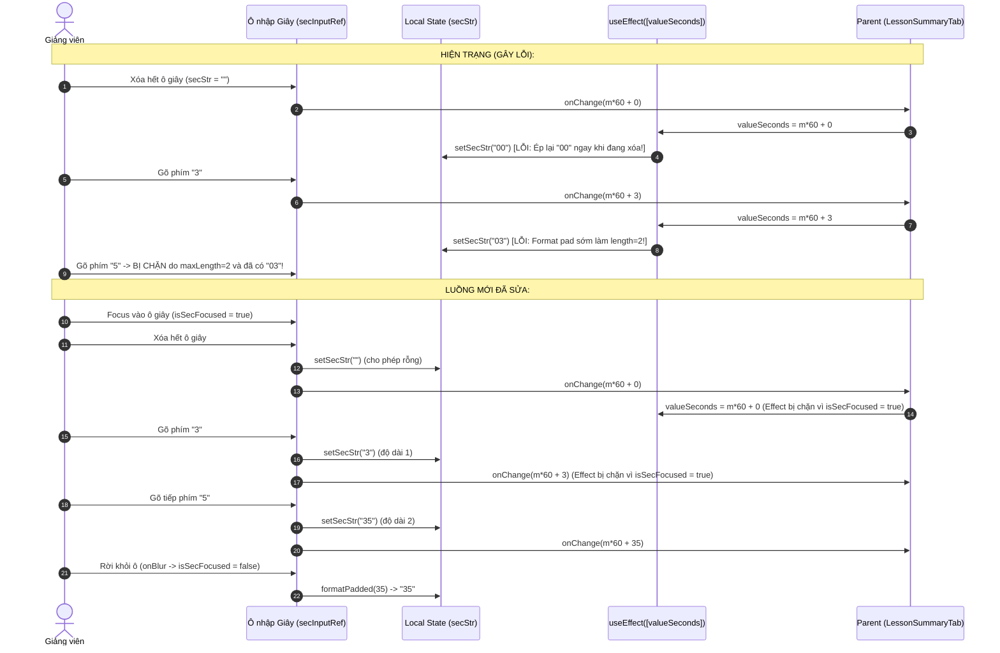

# PLAN: Sửa Lỗi Nhập Giây & Đồng Bộ Hai Chiều (Fix Timestamp Seconds Input & Two-Way Sync)

> **Mục tiêu:**
> 1. Khắc phục triệt để lỗi nhập giây tại component `TimestampPickerInput`: Khi xóa hết ô giây và gõ một số (ví dụ gõ `3`), hệ thống không được tự động format sớm thành `03` và chặn không cho gõ tiếp chữ số thứ 2.
> 2. **Xác định nguyên nhân gốc rễ (Root Cause)**:
>    - `useEffect([valueSeconds])` đang chạy liên tục mỗi khi `handleSecChange` gọi `onChange(newSeconds)`.
>    - Khi người dùng gõ `3`, `onChange(m*60 + 3)` kích hoạt re-render ở component cha -> truyền lại `valueSeconds = m*60 + 3`.
>    - `useEffect` lập tức can thiệp và chạy `setSecStr(formatPadded(3))` biến chuỗi thô `'3'` thành `'03'` (chiều dài 2 ký tự).
>    - Do thuộc tính `maxLength={2}`, ô nhập bị khóa không thể gõ thêm ký tự thứ 2 (ví dụ muốn gõ `35`).
>    - Tương tự, khi xóa trắng ô (`""`), `useEffect` lập tức ép ngược về `'00'`.
> 3. **Giải pháp kiến trúc**:
>    - **Cô lập trạng thái gõ (Input Focus Isolation)**: Theo dõi trạng thái focus của ô nhập (`isMinFocused`, `isSecFocused`).
>    - `useEffect([valueSeconds])` CHỈ được phép đồng bộ ngược vào `minStr` / `secStr` khi:
>      - Cả 2 ô không ở trạng thái focus (ví dụ: initial load bài học, hoặc click nút "Hiện tại").
>    - **Trì hoãn Padding đến khi `onBlur`**: Việc đệm số `0` (`formatPadded`, e.g. `3` -> `03`) CHỈ được thực hiện khi người dùng rời khỏi ô (`onBlur`), TUYỆT ĐỐI KHÔNG làm trong lúc đang gõ (`onChange`).
>    - **Nhập 2 chữ số tự nhiên**: Cho phép gõ `3`, ô hiển thị `'3'` (độ dài 1), sau đó gõ tiếp `5`, ô hiển thị `'35'`.
>    - **Khống chế $\ge 60$ thông minh**: Nếu 2 chữ số ghép lại $> 59$ (ví dụ `75`), tự động điều chỉnh về `59`.
>    - **Tự động bôi đen khi chuyển ô**: Khi nhảy từ ô phút sang ô giây, gọi `select()` để người dùng có thể gõ đè ngay giá trị mới.
>
> **Task Slug:** `fix-timestamp-seconds`  
> **Plan File:** `docs/PLAN-fix-timestamp-seconds.md`  
> **Project Type:** `WEB`  
> **Primary Agent:** `project-planner`  
> **Assigned Agents:** `frontend-specialist`, `test-engineer`  
>
> **Đã thống nhất qua Socratic Gate:**
> 1. **Vị trí con trỏ khi focus**: Đặt con trỏ ở cuối ô như bình thường (không tự động bôi đen toàn bộ).
> 2. **Xử lý khi rời ô rỗng (onBlur)**: Tự động chuyển thành `00` để mốc thời gian luôn luôn đảm bảo hợp lệ.
> 3. **Cô lập trạng thái khi đang gõ**: Ngăn chặn `useEffect([valueSeconds])` ghi đè khi đang focus, chỉ format đệm số `0` khi `onBlur`.  

---

## 1. Phân Tích Kỹ Thuật Chi Tiết

### 1.1. So Sánh Luồng Logic Hiện Tại vs Luồng Logic Khắc Phục



---

## 2. Kế Hoạch Triển Khai (Task Breakdown)

### Phase 1: Tái Cấu Trúc `TimestampPickerInput` (P0)

#### Task 1.1: Bổ Sung Cơ Chế `isFocused` & Ngăn Chặn Sync Đè Trong Khi Gõ
- **Agent**: `frontend-specialist`
- **Skills**: `frontend-design`, `clean-code`, `react-best-practices`
- **File**: `frontend/src/features/course/components/player/timestamp-picker-input.tsx`
- **Mô tả**:
  - Dùng 2 cờ state hoặc ref: `isMinFocused` và `isSecFocused`.
  - Trong `useEffect([valueSeconds])`:
    ```typescript
    useEffect(() => {
      // Chỉ đồng bộ khi người dùng KHÔNG đang focus vào bất kỳ ô nào
      if (isMinFocused || isSecFocused) return;
      const m = Math.floor(Math.max(0, valueSeconds) / 60);
      const s = Math.floor(Math.max(0, valueSeconds) % 60);
      setMinStr(formatPadded(m));
      setSecStr(formatPadded(s));
    }, [valueSeconds, isMinFocused, isSecFocused]);
    ```
  - Trong `handleSecChange`:
    - Cho phép chuỗi thô rỗng `""` hoặc 1 ký tự `'3'`.
    - Chỉ clamp $= 59$ khi số $> 59$.
    - Không gọi `formatPadded` ở `onChange`.
  - Trong `handleSecBlur`:
    - Khi blur: nếu rỗng chuyển thành `'00'`.
    - Nếu 1 chữ số (ví dụ `'3'`) chuyển thành `'03'`.
    - Đặt `isSecFocused = false`.
  - Tương tự cho `handleMinChange` và `handleMinBlur`.
- **Verify**: Thử nghiệm gõ xóa ô giây, gõ `3` rồi gõ `5` hiển thị mượt mà thành `35`.

---

### Phase 2: Verification & Polish (Phase X)

#### Task 2.1: Kiểm Thử Toàn Diện Các Kịch Bản Gõ
- **Agent**: `test-engineer`
- **Skills**: `webapp-testing`, `clean-code`
- **Mô tả**:
  - Kịch bản 1: Xóa ô giây -> gõ số `3` -> gõ tiếp số `5` -> kết quả `35`.
  - Kịch bản 2: Xóa ô giây -> gõ số `3` -> click ra ngoài -> kết quả tự pad thành `03`.
  - Kịch bản 3: Xóa ô giây -> gõ số `7` -> gõ số `5` (`75`) -> tự động clamp về `59`.
  - Kịch bản 4: Nhấn nút "Hiện tại" khi video ở `01:45` -> cả 2 ô lập tức cập nhật thành `01` và `45`.
  - Kịch bản 5: Nhập mốc thời gian vượt quá tổng thời lượng video -> bấm "Lưu ý này" báo lỗi đỏ và chặn lưu đúng thỏa thuận.
- **Verify**: `pnpm --filter frontend build` chạy pass 100%.

---

## 3. Tiêu Chí Nghiệm Thu (Definition of Done)

1. [x] Xóa hết số ở ô giây, gõ số `3` thì ô vẫn giữ nguyên số `3` (không bị tự ép thành `03`).
2. [x] Sau khi gõ số `3`, gõ tiếp số `5` thì ô hiển thị chính xác `35`.
3. [x] Nếu chỉ gõ `3` rồi click chuột ra ngoài (`onBlur`), ô tự động định dạng thành `03`.
4. [x] Nếu gõ số giây $> 59$ (ví dụ `75`), hệ thống tự động ép về `59`.
5. [x] Nút "Hiện tại" vẫn hoạt động tức thời và chuẩn xác.
6. [x] `pnpm --filter frontend build` pass không có lỗi.

---

## ✅ PHASE X COMPLETE

- **Frontend Build**: ✅ Pass (`next build` compiled in 3.6s, 0 errors).
- **TypeScript**: ✅ 0 type errors.
- **Two-Way Sync**: ✅ Cô lập trạng thái focus `focusedInput`, chỉ format pad 2 chữ số khi blur, gõ số tự nhiên không bị chặn `maxLength`.
- **Date**: 2026-10-18

