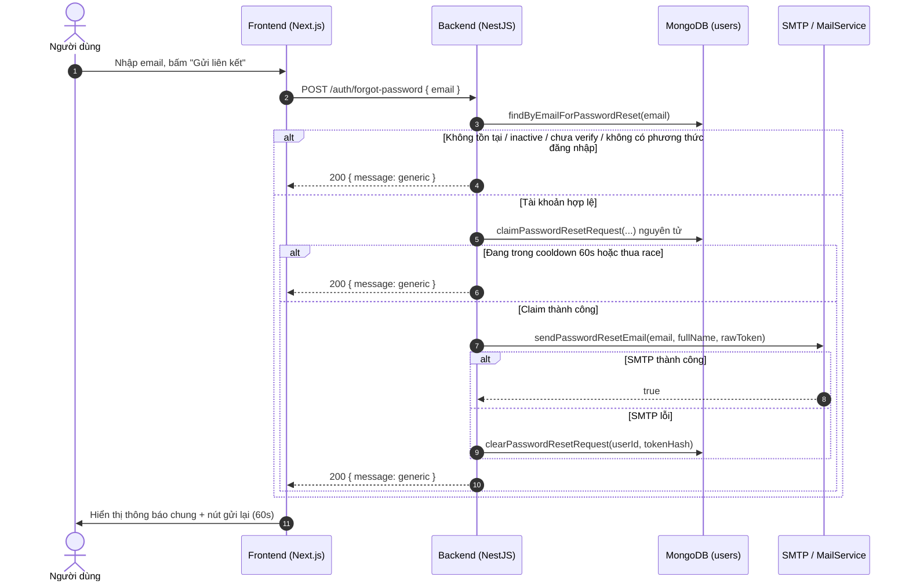
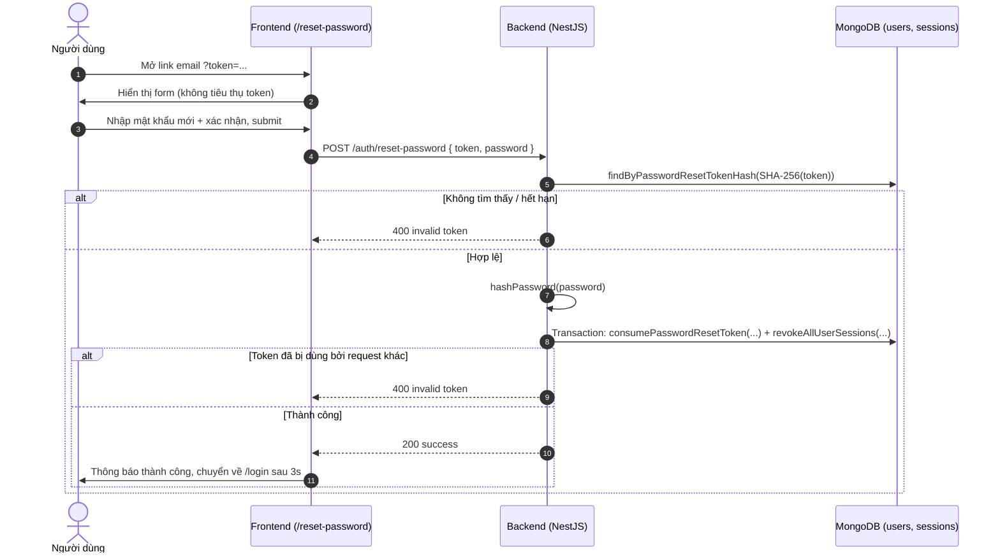

# PLAN: Luồng Quên Mật Khẩu & Đặt Lại Mật Khẩu (Mindly)

> **Mục tiêu:**
> 1. Bổ sung liên kết **“Quên mật khẩu?”** ngay dưới ô mật khẩu tại `/login`, mở modal ngay trên trang đăng nhập (không điều hướng).
> 2. Cho phép người dùng gửi yêu cầu đặt lại mật khẩu qua email; **không tiết lộ email có tồn tại hay không**.
> 3. Tạo liên kết đặt lại mật khẩu ngẫu nhiên, **hết hạn sau 15 phút**, **chỉ sử dụng một lần**, có **cooldown 60 giây/tài khoản** và **rate limit theo IP**.
> 4. Xây dựng trang `/reset-password` cho phép nhập mật khẩu mới + xác nhận, sau đó quay về `/login`.
> 5. Thu hồi toàn bộ phiên đăng nhập cũ sau khi đổi mật khẩu thành công.
> 6. Bổ sung unit test, kiểm tra build/lint và cập nhật Living Docs.
> 7. Cho phép tài khoản đã đăng nhập Google tạo thêm mật khẩu Mindly qua cùng liên kết email, giữ cả hai cách đăng nhập.
>
> **Task Slug:** `forgot-password`
> **Plan File:** `docs/PLAN-forgot-password.md`
> **Trạng thái:** Đã triển khai (automated tests/build/lint pass; manual E2E checklist bên dưới chưa chạy trên môi trường thật).
> **Cập nhật:** 2026-10-30 — đã bổ sung tạo mật khẩu cho Google-only, chạy lại build/lint/tests và kiểm tra tích hợp trên MongoDB replica set riêng; manual browser/SMTP E2E vẫn chờ kiểm tra.

---

## 1. Phạm Vi & Yêu Cầu UX

### 1.1. Trang đăng nhập (`/login`)

- Liên kết **“Quên mật khẩu?”** nằm căn phải ngay dưới ô nhập mật khẩu.
- Bấm liên kết mở **modal căn giữa**, nền mờ nhẹ (`bg-black/10`), trang đăng nhập vẫn hiển thị phía sau.
- Modal đóng được bằng:
  - Nút **X** ở góc trên.
  - Nút **“Hủy”**.
  - Phím **Escape**.
- Không điều hướng khỏi `/login` khi mở/đóng modal.
- Email đang nhập ở form đăng nhập được điền sẵn vào modal (nếu có).
- Chặn email rỗng/sai định dạng ở client trước khi gọi API.
- Trong lúc gửi: hiển thị loading và khóa nút gửi để tránh double-submit.
- Modal có hướng dẫn chung: email từng đăng nhập Google có thể dùng để tạo thêm mật khẩu riêng cho Mindly; không truy vấn/hiển thị loại tài khoản của email vừa nhập.

### 1.2. Trạng thái modal

| Trạng thái | Nội dung | Hành động |
| :--- | :--- | :--- |
| `form` | Ô email + nút “Gửi liên kết” | Validate Zod, gọi `POST /auth/forgot-password` |
| `sent` | Thông báo chung + hướng dẫn kiểm tra Spam + nút “Gửi lại” | Nút gửi lại bị khóa 60 giây kèm đếm ngược |
| `error` | Lỗi mạng / 429 / lỗi validation từ server | Nút “Thử lại” quay về form |

> **Quan trọng:** SMTP lỗi **không** đưa modal về trạng thái `error`; backend vẫn trả HTTP 200 với thông báo chung để chống dò email. Modal hiển thị trạng thái `sent` kèm gợi ý thử lại.

### 1.3. Trang đặt lại mật khẩu (`/reset-password`)

- Nhận token qua query string: `/reset-password?token=<64 hex>`.
- Trang **không** tự động tiêu thụ token khi mở; token chỉ được kiểm tra/tiêu thụ khi người dùng bấm submit.
- Form gồm:
  - Mật khẩu mới (tối thiểu 6 ký tự).
  - Xác nhận mật khẩu mới (phải khớp).
- Tiêu đề **“Thiết Lập Mật Khẩu”**, nút **“Lưu mật khẩu Mindly”** dùng chung cho tạo mật khẩu lần đầu và reset. Nếu đã liên kết Google, người dùng vẫn đăng nhập bằng Google được.
- Có trạng thái:
  - Thiếu token / token không hợp lệ.
  - Đang gửi.
  - Lỗi từ API (token hết hạn, đã dùng, mật khẩu không hợp lệ, 429).
  - Thành công → hiển thị thông báo và tự chuyển về `/login` sau 3 giây.
- Trang đặt `metadata.referrer = 'no-referrer'` để hạn chế rò rỉ token qua header `Referer`.

---

## 2. Mô Hình Dữ Liệu & Hợp Đồng Chia Sẻ

### 2.1. `share-lib`

- `share-lib/src/interfaces/auth.interface.ts`:
  - `IForgotPasswordPayload { email: string }`
  - `IForgotPasswordResponse { message: string }`
  - `IResetPasswordPayload { token: string; password: string }`
  - `IResetPasswordResponse { message: string }`
- `share-lib/src/interfaces/user.interface.ts`:
  - `passwordResetTokenHash?: string | null`
  - `passwordResetExpires?: Date | string | null`
  - `passwordResetRequestedAt?: Date | string | null`
- `share-lib/src/constants/auth.constants.ts`:
  - `PASSWORD_RESET_TOKEN_TTL_MS = 15 * 60 * 1000`
  - `PASSWORD_RESET_COOLDOWN_MS = 60 * 1000`
  - `PASSWORD_RESET_GENERIC_MESSAGE`
  - `PASSWORD_RESET_INVALID_TOKEN_MESSAGE`
  - `PASSWORD_RESET_SUCCESS_MESSAGE`
  - `PASSWORD_RESET_RATE_LIMIT_MESSAGE`

### 2.2. `users` collection (MongoDB)

| Trường | Kiểu | Ghi chú |
| :--- | :--- | :--- |
| `passwordResetTokenHash` | `string \| null` | Chỉ lưu **SHA-256 hash** của token; `select: false` |
| `passwordResetExpires` | `Date \| null` | Hết hạn sau 15 phút; `select: false` |
| `passwordResetRequestedAt` | `Date \| null` | Mốc yêu cầu gần nhất, dùng cho cooldown 60 giây; `select: false` |

**Index:**

```ts
UserSchema.index(
  { passwordResetTokenHash: 1 },
  {
    partialFilterExpression: {
      deletedAt: null,
      passwordResetTokenHash: { $type: 'string' },
    },
  },
);
```

> **Không dùng TTL index cho `passwordResetExpires`.** TTL index trên field này sẽ xóa toàn bộ document `user`, không chỉ xóa token.

---

## 3. Kiến Trúc Backend

### 3.1. Thành phần

- `PasswordResetService` (`backend/src/modules/auth/services/password-reset.service.ts`):
  - `requestReset(dto)` — tìm user, kiểm tra điều kiện, claim nguyên tử, tạo token, gửi email.
  - `resetPassword(dto)` — hash mật khẩu mới, tiêu thụ token nguyên tử trong transaction, thu hồi phiên.
- `ForgotPasswordDto`, `ResetPasswordDto` — validate và chuẩn hóa input.
- `UserRepository` / `UserService`:
  - `findByEmailForPasswordReset(email)`
  - `findByPasswordResetTokenHash(tokenHash)`
  - `claimPasswordResetRequest(...)`
  - `clearPasswordResetRequest(...)`
  - `consumePasswordResetToken(...)`
  - `runInTransaction(...)`
- `MailService.sendPasswordResetEmail(email, fullName, rawToken)`.
- `AuthController`:
  - `POST /auth/forgot-password`
  - `POST /auth/reset-password`
- `AuthModule`:
  - Đăng ký `PasswordResetService`.
  - Import `ThrottlerModule.forRootAsync` (dùng `THROTTLE_TTL`, `THROTTLE_LIMIT`).

### 3.2. Luồng gửi yêu cầu



### 3.3. Luồng đặt lại mật khẩu



---

## 4. Quy Tắc Bảo Mật & Nghiệp Vụ

### 4.1. Chống dò email (Anti-enumeration)

- Mọi trường hợp sau **luôn trả cùng một message**:
  - Email không tồn tại.
  - Tài khoản `inactive` / `banned` / đã xóa mềm.
  - Tài khoản chưa xác thực email.
  - Tài khoản Google-only hợp lệ (có `googleSub`, chưa có `passwordHash`) — **có gửi email** sau khi claim thành công.
  - Tài khoản không có cả mật khẩu local lẫn liên kết Google — không gửi email.
  - Đang trong cooldown 60 giây.
  - SMTP gửi thất bại.
- Message bắt buộc, giữ nguyên chính xác:

```text
Nếu email đã được đăng ký, bạn sẽ nhận được hướng dẫn đặt lại mật khẩu.
```

- Không trả lỗi 404/400 cho email không tồn tại.
- Phạm vi generic response là các trạng thái tài khoản/gửi mail ở trên với input hợp lệ; validation có thể trả 400, throttling trả 429 và lỗi hạ tầng như DB không được đảm bảo trả 200. Response chung chưa xử lý chênh lệch thời gian giữa nhánh có/không gửi SMTP.
- Yêu cầu production: không log raw token ra console/logger. **Code hiện tại chưa đáp ứng khi thiếu cấu hình SMTP**: `MailService` in URL reset đầy đủ ra terminal (xem mục 9).

### 4.2. Token đặt lại mật khẩu

- Sinh bằng `crypto.randomBytes(32).toString('hex')` → 64 ký tự hex.
- Chỉ lưu `SHA-256(rawToken)` trong DB.
- Raw token được đưa vào URL gửi qua email; khi thiếu cấu hình SMTP, code hiện tại còn in URL này ra terminal để dev/test.
- Hết hạn sau **15 phút**.
- **Chỉ sử dụng một lần** nhờ `findOneAndUpdate` nguyên tử với điều kiện:
  - `passwordResetTokenHash` khớp.
  - `passwordResetExpires > now`.
  - `deletedAt: null`, `status: ACTIVE`, `isEmailVerified: true`.
- Request mới **ghi đè** token cũ; link cũ lập tức mất hiệu lực.
- Không tiêu thụ token khi mở trang `/reset-password`.

### 4.3. Cooldown & Rate limiting

- **Cooldown theo tài khoản:** 60 giây giữa hai yêu cầu. Request trong cooldown bị bỏ qua nhưng vẫn nhận generic response.
- **Rate limit theo IP** (dùng `@nestjs/throttler`):
  - `POST /auth/forgot-password`: **5 request / 15 phút / IP**.
  - `POST /auth/reset-password`: **10 request / 15 phút / IP**.
- Vượt rate limit trả `429 Too Many Requests` với message thân thiện.

### 4.4. SMTP failure

- Nếu gửi email thất bại:
  - Rollback `passwordResetTokenHash`, `passwordResetExpires`, `passwordResetRequestedAt` về `null`.
  - Vẫn trả HTTP 200 + generic message.
  - Ghi log lỗi phía server.
- Rollback chỉ xóa cooldown phía backend cho request đó; request tiếp theo vẫn chịu rate limit theo IP.
- Client không biết SMTP gửi lỗi vì nhận cùng HTTP 200 generic, nên vẫn hiển thị `sent`, gợi ý kiểm tra Spam và khóa nút gửi lại trong 60 giây. Không coi đây là retry ngay trên UI.
- Rollback có điều kiện `userId + tokenHash` để không xóa một request mới hơn; không khôi phục token cũ đã bị ghi đè.
- Thiếu `GMAIL_USER` hoặc `GMAIL_APP_PASSWORD` là nhánh fallback khác: in link ra terminal, trả `true`, **không rollback**, token và cooldown vẫn được giữ.

### 4.5. Hoàn tất đặt lại

- Hash mật khẩu mới bằng bcrypt (`LocalAuthService.hashPassword`).
- Cập nhật `passwordHash`, xóa toàn bộ field reset trong cùng transaction.
- Thu hồi **tất cả session** của user (`SessionService.revokeAllUserSessions`).
- Trả message:

```text
Thiết lập mật khẩu thành công. Vui lòng đăng nhập bằng mật khẩu mới.
```

- Frontend xóa token/user khỏi `localStorage`, xóa cache auth và chuyển về `/login`.

### 4.6. Tạo mật khẩu Mindly cho tài khoản Google

- Tài khoản được nhận link khi chưa xóa mềm, `status: ACTIVE`, `isEmailVerified: true` và **có ít nhất một** trong hai trường: `passwordHash` không rỗng hoặc `googleSub` không rỗng sau trim.
- `googleSub` là liên kết đã được backend xác minh trong luồng đăng nhập Google. Không dựa vào cờ provider do client gửi.
- Cả `PasswordResetService` và `UserRepository.claimPasswordResetRequest` phải áp dụng điều kiện mới. Repository kết hợp điều kiện credential và cooldown bằng `$and` với hai nhóm `$or`, tránh vô tình bỏ qua cooldown cho Google.
- Bấm gửi link chỉ tạo token; `passwordHash` vẫn `null` cho đến khi người dùng sở hữu link submit mật khẩu mới.
- Khi submit hợp lệ, lưu bcrypt hash vào **cùng user**, giữ `googleSub`, ID và role. Người dùng có thể đăng nhập bằng email/mật khẩu hoặc Google; không tạo tài khoản thứ hai.
- Không cần endpoint, schema hay biến môi trường mới. Các quy tắc TTL, single-use, cooldown, SMTP rollback và thu hồi session áp dụng giống luồng reset mật khẩu local.

---

## 5. Triển Khai Frontend

### 5.1. API & hooks

`frontend/src/features/auth/api/auth.api.ts`:

- `authApi.forgotPassword(payload)` → `POST /auth/forgot-password`.
- `authApi.resetPassword(payload)` → `POST /auth/reset-password`.
- `useForgotPasswordMutation()`.
- `useResetPasswordMutation()`:
  - Xóa `accessToken`, `refreshToken`, `user` khỏi `localStorage`.
  - Xóa cache `authKeys.all`.
  - Hiển thị toast thành công.

### 5.2. Components & routes

- `frontend/src/features/auth/components/forgot-password-modal.tsx`:
  - Dùng `DialogLayout` (X + Escape + overlay `bg-black/10`).
  - State `form | sent | error`, cooldown 60 giây.
  - Modal được remount theo `key` mỗi lần mở để reset state sạch (tránh `setState` trong `useEffect`).
- `frontend/src/features/auth/components/reset-password-content.tsx`:
  - Đọc token bằng `useSearchParams`.
  - Form React Hook Form + Zod.
  - Các trạng thái thiếu token / thành công / lỗi.
- `frontend/src/app/(auth)/reset-password/page.tsx`:
  - `Suspense` fallback cho `useSearchParams`.
  - `metadata.referrer = 'no-referrer'`.
- `frontend/src/features/auth/components/login-form.tsx`:
  - Liên kết “Quên mật khẩu?” dưới ô mật khẩu.
  - Truyền email hiện tại vào modal.

### 5.3. Zod schemas

- `forgot-password.schema.ts`: email bắt buộc, đúng định dạng, trim.
- `reset-password.schema.ts`: mật khẩu ≥ 6 ký tự, xác nhận khớp, trim.

---

## 6. Danh Sách File Thay Đổi

### `share-lib`

- `src/interfaces/auth.interface.ts`
- `src/interfaces/user.interface.ts`
- `src/constants/auth.constants.ts`

### `backend`

- `src/modules/auth/dto/forgot-password.dto.ts`
- `src/modules/auth/dto/reset-password.dto.ts`
- `src/modules/auth/services/password-reset.service.ts`
- `src/modules/auth/auth.controller.ts`
- `src/modules/auth/auth.module.ts`
- `src/modules/auth/index.ts`
- `src/modules/auth/tests/password-reset.service.spec.ts`
- `test/auth/password-reset.e2e-spec.ts`
- `src/modules/user/schemas/user.schema.ts`
- `src/modules/user/repositories/user.repository.ts`
- `src/modules/user/services/user.service.ts`
- `src/modules/mail/mail.service.ts`

### `frontend`

- `src/features/auth/api/auth.api.ts`
- `src/features/auth/components/forgot-password-modal.tsx`
- `src/features/auth/components/reset-password-content.tsx`
- `src/features/auth/components/login-form.tsx`
- `src/features/auth/schemas/forgot-password.schema.ts`
- `src/features/auth/schemas/reset-password.schema.ts`
- `src/features/auth/tests/password-reset-schema.spec.ts`
- `src/features/auth/index.ts`
- `src/features/auth/types/index.ts`
- `src/app/(auth)/reset-password/page.tsx`

### Tài liệu

- `docs/PLAN-forgot-password.md`
- `docs/GETTING_STARTED.md`
- `docs/PLAN-google-auth.md`
- `docs/PROJECT_STRUCTURE.md`
- `a-agentic/features/auth-identity/tech-spec.md`
- `a-agentic/features/auth-identity/rules-and-flows.md`
- `a-agentic/features/auth-identity/dependencies.md`
- `a-agentic/features/auth-identity/dev-history.md`

> Không thêm biến môi trường mới. Luồng này tái sử dụng `FRONTEND_URL`, `SMTP_*`, `GMAIL_*`, `THROTTLE_TTL`, `THROTTLE_LIMIT`.

---

## 7. Kết Quả Kiểm Thử Tự Động

Kết quả chạy ngày 2026-10-30 sau khi bổ sung Google password setup. Reset service có **17 unit tests**; bộ tích hợp mới có **11 tests** chạy với Mongoose/repository/transaction/bcrypt thật trên replica set test riêng. Google ID Token verification và outgoing mail được mock, nên đây chưa phải browser/SMTP E2E hoặc kiểm tra HTTP throttling.

| Hạng mục | Kết quả |
| :--- | :--- |
| `pnpm --filter share-lib build` | Pass |
| `pnpm --filter backend build` | Pass |
| `pnpm --filter backend test` | **611/611 tests pass** (52 test files) |
| `pnpm --filter backend test:e2e -- test/auth/password-reset.e2e-spec.ts` | **11/11 tests pass** (MongoDB integration) |
| TypeScript check riêng reset unit/integration tests (`noEmit`) | Pass |
| `pnpm --filter backend lint` | Pass (chỉ còn warning cũ không liên quan) |
| Frontend schema tests (`tsx --test`) | **15/15 tests pass** |
| `pnpm --filter frontend lint` | Pass (0 error, 0 warning) |
| `pnpm --filter frontend build` | Pass (có route `/reset-password`) |

Chạy lại kiểm tra chuyên biệt từ thư mục gốc (PowerShell):

```powershell
pnpm --filter share-lib build
pnpm --filter backend test -- src/modules/auth/tests/password-reset.service.spec.ts
```

Kiểm tra tích hợp (từ thư mục gốc, MongoDB replica set phải đang chạy):

```powershell
pnpm --filter backend test:e2e -- test/auth/password-reset.e2e-spec.ts
```

Suite dùng `MONGODB_URI` của process nếu có, mặc định `mongodb://localhost:27017`; tạo/xóa riêng database `mindly_password_setup_test_<pid>`. Bao phủ tạo mật khẩu đầu tiên, cả hai cách đăng nhập trên cùng user, thu hồi refresh session, cooldown đồng thời, resend làm mất hiệu lực token cũ, tài khoản không đủ điều kiện, SMTP failure mô phỏng, expiry, single-use đồng thời và rollback transaction khi thu hồi session lỗi.

Chạy schema tests từ thư mục `frontend` (PowerShell, tái sử dụng `tsx` của backend):

```powershell
& "..\backend\node_modules\.bin\tsx.CMD" --test "src/features/auth/tests/auth-showcase-and-schema.spec.ts" "src/features/auth/tests/password-reset-schema.spec.ts"
```

---

## 8. Checklist Kiểm Thử Thủ Công (Manual E2E)

> Chưa chạy trên môi trường thật tại thời điểm cập nhật tài liệu. Đánh dấu `[x]` sau khi kiểm tra.

### 8.1. Chuẩn bị

- Dùng môi trường local/staging và tài khoản thử nghiệm, không đổi mật khẩu hay thu hồi session của người dùng thật.
- MongoDB phải hỗ trợ transaction (replica set hoặc sharded cluster). Local dùng replica set `rs0` của Docker Compose; xem [GETTING_STARTED.md](GETTING_STARTED.md).
- Dùng tài khoản active, đã verify email; chuẩn bị cả tài khoản có mật khẩu local và Google-only (`googleSub` có giá trị, `passwordHash: null`), thêm email không tồn tại và tài khoản không đủ điều kiện.
- Đăng nhập tài khoản thử nghiệm ở trình duyệt/tab khác trước khi reset để kiểm tra session bị thu hồi.
- Để xác nhận **email thật**, cấu hình SMTP hợp lệ và hộp thư có thể kiểm tra. Terminal fallback không chứng minh email đã được gửi.
- Đường dẫn API đầy đủ mặc định là `http://localhost:8000/api/v1/auth/forgot-password` và `http://localhost:8000/api/v1/auth/reset-password`; `/auth/...` trong tài liệu là đường dẫn sau `API_PREFIX`.

### 8.2. Checklist

- [ ] Mở `/login`, liên kết “Quên mật khẩu?” nằm căn phải dưới ô mật khẩu.
- [ ] Bấm liên kết: modal căn giữa, nền mờ nhẹ, URL vẫn là `/login`.
- [ ] Đóng modal bằng X, “Hủy”, và Escape.
- [ ] Email trống/sai định dạng bị chặn, không gọi API.
- [ ] Gửi email hợp lệ: nút loading/disabled, sau đó hiện thông báo chung + đếm ngược 60 giây.
- [ ] Gửi lại trong 60 giây: nút bị khóa.
- [ ] Email không tồn tại: vẫn nhận đúng thông báo chung.
- [ ] Tài khoản chưa verify / inactive / banned / không có credential: vẫn nhận thông báo chung, không có email.
- [ ] Tài khoản Google-only hợp lệ: nhận email “Thiết lập mật khẩu”, `passwordHash` vẫn null trước khi submit.
- [ ] Tạo mật khẩu cho Google-only xong: đăng nhập bằng email/mật khẩu và Google đều vào cùng user, giữ ID/role, không tạo duplicate.
- [ ] Email hợp lệ: nhận link `/reset-password?token=...`.
- [ ] Mở link: form hiển thị, token **không** bị tiêu thụ.
- [ ] Submit mật khẩu mới: thành công, chuyển về `/login` sau 3 giây.
- [ ] Dùng lại link cũ: báo “Liên kết đặt lại mật khẩu không hợp lệ hoặc đã hết hạn.”
- [ ] Chờ quá 15 phút: link hết hạn.
- [ ] Sau cooldown, gửi yêu cầu mới được claim thành công: link cũ mất hiệu lực (request bị bỏ qua trong cooldown không làm mất hiệu lực link).
- [ ] Đăng nhập bằng mật khẩu mới thành công; mật khẩu cũ thất bại.
- [ ] Session cũ bị thu hồi (tab khác bị đăng xuất/401 khi refresh).
- [ ] Gửi quá 5 yêu cầu/15 phút/IP: nhận 429 với message thân thiện.
- [ ] Gửi quá 10 yêu cầu reset/15 phút/IP: nhận 429; dùng token sai nhưng đúng định dạng để không đổi mật khẩu tài khoản thật.
- [ ] SMTP đã cấu hình nhưng gửi lỗi: backend trả 200 generic, log lỗi, xóa token/cooldown đúng request; UI vẫn `sent` và đếm ngược 60 giây. Gọi lại API trước 60 giây để kiểm tra backend cho claim lại (nếu chưa vượt IP limit).
- [ ] Thiếu cấu hình SMTP: terminal có link reset, không có email thật; token/cooldown vẫn được giữ. Không dùng nhánh này ở production.
- [ ] Hai request reset đồng thời: chỉ một request đổi mật khẩu thành công; xác nhận bằng MongoDB thật, không chỉ mock service.
- [ ] Khi thu hồi session lỗi trong transaction: mật khẩu và token không được commit một phần; kiểm tra trên môi trường thử nghiệm có kiểm soát.
- [ ] Kiểm tra `Referer` không chứa token khi trang reset tải tài nguyên ngoài.

Khi chạy E2E, ghi ngày, môi trường, kết quả thực tế và lỗi còn lại bên cạnh từng mục; không đưa token, mật khẩu hoặc SMTP credentials vào báo cáo.

---

## 9. Ghi Chú Vận Hành

- Không cần migrate DB thủ công; Mongoose sẽ tạo index mới khi khởi động (tùy cấu hình `autoIndex`).
- Nếu chạy production với `autoIndex: false`, cần tạo index `passwordResetTokenHash` thủ công.
- Token reset nằm trong URL; không chia sẻ link qua kênh công khai.
- MongoDB standalone không đáp ứng transaction của reset password; dùng replica set/sharded cluster trước khi kiểm thử hoặc triển khai.
- `THROTTLE_TTL` (mili giây) và `THROTTLE_LIMIT` cấu hình mặc định của module, được chuyển sang số bằng `Number(...)`. Hai endpoint reset có `@Throttle` riêng (5/10 request trong 15 phút); sửa env mặc định không đổi các giới hạn này.
- `ThrottlerGuard` chỉ gắn trên hai endpoint này, không phải global guard cho toàn bộ auth. Storage throttling mặc định nằm trong bộ nhớ từng instance, không phải hạn mức phân tán toàn cụm; khi scale nhiều instance cần đánh giá shared storage.
- Backend hiện chưa cấu hình `trust proxy` trong `main.ts`. Khi đặt sau reverse proxy, cần xác minh IP tracker thực tế; không giả định sẵn rằng header chuyển tiếp đã được tin cậy an toàn.

### 9.1. Rủi ro còn lại trước production

- **Terminal fallback làm lộ raw token:** thiếu `GMAIL_USER`/`GMAIL_APP_PASSWORD` sẽ in URL reset đầy đủ; nhánh này hiện không có điều kiện `NODE_ENV`. Cần chặn/giới hạn fallback cho development và không ghi token vào log production. Vấn đề này chưa được xử lý trong lần bổ sung Google password setup.
- **HTTP 200 không chứng minh email đã được giao:** cùng response được dùng cho email không tồn tại, cooldown, SMTP failure và terminal fallback. Kiểm tra bằng hộp thư và log đã che thông tin nhạy cảm.
- **Anti-enumeration hiện áp dụng cho status/message theo trạng thái tài khoản:** chưa có cơ chế cân bằng thời gian xử lý giữa nhánh không gửi mail và nhánh chờ SMTP; không coi timing side-channel đã được xử lý.
