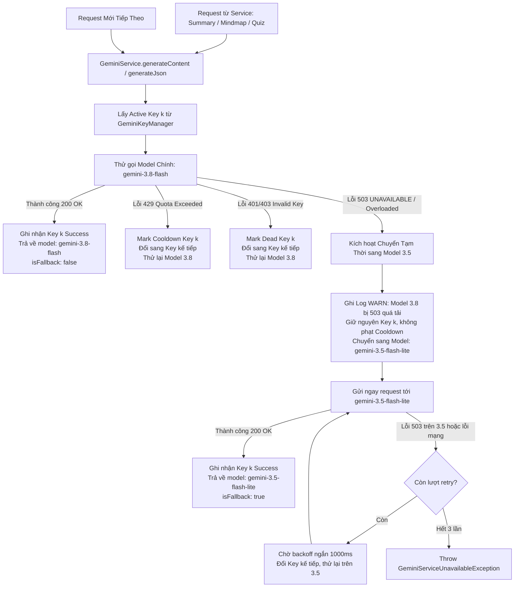

# Kế hoạch Triển khai: Cơ chế Chuyển đổi Tạm thời sang Model 3.5 khi Model 3.8 bị Lỗi 503 UNAVAILABLE

> **File:** `docs/PLAN-gemini-fallback-model.md`  
> **Trạng thái:** PROPOSED / READY FOR REVIEW  
> **Agent lập kế hoạch:** `project-planner`  
> **Chuyên gia phụ trách:** `backend-specialist` (Skills: `clean-code`, `api-patterns`, `testing-patterns`)  
> **Dịch vụ mục tiêu:** AI Summary, Mindmap, Quiz Generation (`backend/src/modules/gemini/` & `backend/src/modules/transcript-analysis/`)  

---

## 1. Bối cảnh & Yêu cầu Nghiệp vụ (Context & Requirements)

### 1.1. Hiện trạng & Vấn đề Phát sinh
- Hệ thống hiện đang tích hợp Google Gemini API qua module `backend/src/modules/gemini/` (`GeminiService` và `GeminiKeyManager`) với 6 API keys xoay vòng (round-robin).
- Cấu hình model chính đang là `gemini-3.8-flash` (`GEMINI_MODEL`).
- Khi người dùng gửi các yêu cầu phân tích video gồm:
  1. **Tạo bản tóm tắt bài giảng (Summary)** (`SummaryGenerationService`)
  2. **Tạo sơ đồ tư duy phân cấp (Mindmap)** (`MindmapAnalysisService`)
  3. **Tạo câu hỏi trắc nghiệm kiểm tra (Quiz)** (`QuizGenerationService`)
- Trong một số khung giờ cao điểm, Google Gemini API phản hồi lỗi:
  ```json
  {
    "status": 503,
    "code": "UNAVAILABLE",
    "message": "The model is overloaded. Please try again later."
  }
  ```
- **Bản chất kỹ thuật theo tài liệu của Google**:
  - Lỗi `503 UNAVAILABLE` là lỗi **tạm thời quá tải hoặc gián đoạn cụm máy chủ phục vụ model cụ thể** của Google Cloud, hoàn toàn **không phải do hết quota hay cạn kiệt rate-limit (429 RESOURCE_EXHAUSTED)**.
  - Hiện tại, `GeminiService` đang phân loại 503 vào `GeminiServiceUnavailableException` và thực hiện đưa API key hiện tại vào `COOLDOWN`, sau đó thử tiếp key tiếp theo với **cùng model `gemini-3.8-flash`**.
  - **Hậu quả**: Vì toàn bộ cụm cluster của model `gemini-3.8-flash` đang bị quá tải trên hạ tầng Google, việc đổi sang API key khác vẫn tiếp tục gặp lỗi 503, khiến request bị fail hoàn toàn và các API key bị phạt cooldown oan uổng.

### 1.2. Yêu cầu Nghiệp vụ Mới (Request-level Temporary Fallback)
1. **Luôn ưu tiên Model 3.8 trước**:
   - Ở mỗi request mới (`generateContent`, `generateJson`), hệ thống **luôn luôn ưu tiên gửi tới model chính `gemini-3.8-flash` trước**.
2. **Chuyển tạm thời sang Model 3.5 khi Model 3.8 bị 503**:
   - Ngay khi request gặp lỗi `503 UNAVAILABLE` (hoặc thông báo model overloaded) từ model `gemini-3.8-flash`:
     - **Không phạt API key** (không mark dead, không mark cooldown vì lỗi do Google quá tải model, không phải lỗi của key).
     - **Chuyển tạm thời (Instant Temporary Fallback)** request đó sang gọi model dự phòng **`gemini-3.5-flash-lite`** trên chính API key đang sử dụng.
     - Trả về kết quả thành công cho người dùng với `model: 'gemini-3.5-flash-lite'` và `isFallback: true`.
3. **Ý nghĩa của cơ chế "Chuyển tạm thời"**:
   - Chuyển đổi diễn ra tức thì theo phạm vi của từng request đơn lẻ.
   - Khi có request tiếp theo (cho bài học khác hoặc thao tác sinh lại), hệ thống lại **tiếp tục thử model 3.8 trước**.
   - Ngay khi Google giải tỏa quá tải trên cụm model 3.8, hệ thống sẽ tự động sử dụng lại model 3.8 ngay lập tức mà không cần cấu hình hay can thiệp thủ công.
4. **Phạm vi áp dụng toàn diện & Tập trung**:
   - Cài đặt tập trung ngay tại `GeminiService` để toàn bộ 3 dịch vụ AI hiện tại (Summary, Mindmap, Quiz) và mọi tính năng tương lai đều tự động hưởng lợi mà không cần sửa rải rác từng service nghiệp vụ.

---

## 2. Kiến trúc Giải pháp & Sơ đồ Luồng (Architecture & Flow)

### 2.1. Sơ đồ Luồng Xử lý Retry & Chuyển đổi Tạm thời



### 2.2. Phân tích Các Thành phần Cần Nâng cấp

#### A. Cấu hình Môi trường (`Config & Env Validation`)
- Bổ sung biến môi trường mới:
  - `GEMINI_FALLBACK_MODEL`: Model dự phòng khi model chính gặp lỗi 503 quá tải.
  - Giá trị mặc định: `gemini-3.5-flash-lite`.
- Cập nhật Joi schema trong `backend/src/config/env.validation.ts`:
  ```typescript
  GEMINI_MODEL: Joi.string().default('gemini-3.8-flash'),
  GEMINI_FALLBACK_MODEL: Joi.string().default('gemini-3.5-flash-lite'),
  ```
- Cập nhật file `backend/.env` và `backend/.env.example`.

#### B. Phân loại Lỗi Thông minh (`gemini.errors.ts` & `classifySdkException`)
- Bổ sung nhận diện chuyên biệt cho lỗi `503 UNAVAILABLE` / `Model Overloaded`:
  - `isModelUnavailable(err)`: Kiểm tra `status === 503`, hoặc chuỗi `UNAVAILABLE`, `model is overloaded`, `temporarily unavailable`.
  - Phân biệt rõ ràng giữa:
    - **Lỗi quá tải model (503 UNAVAILABLE)**: **Không phạt cooldown key**, kích hoạt ngay model 3.5 dự phòng trên chính key đó.
    - **Lỗi hạn mức key (429 Rate Limit)**: Cooldown key 30s và xoay sang key tiếp theo.
    - **Lỗi xác thực (401/403)**: Đánh dấu key DEAD và xoay sang key tiếp theo.

#### C. Xử lý Chuyển đổi Tạm thời trong `GeminiService` (`gemini.service.ts`)
- Khởi tạo 2 cấu hình model:
  - `this.primaryModel`: Lấy từ `GEMINI_MODEL` (mặc định: `gemini-3.8-flash`).
  - `this.fallbackModel`: Lấy từ `GEMINI_FALLBACK_MODEL` (mặc định: `gemini-3.5-flash-lite`).
- Logic trong `generateContent`:
  1. Bắt đầu mỗi request bằng `currentModel = this.primaryModel`.
  2. Gửi request tới Google GenAI SDK với `currentModel`.
  3. Nếu `currentModel === this.primaryModel` và gặp lỗi 503 UNAVAILABLE:
     - Ghi log cảnh báo mức `WARN`:
       ```
       [GeminiService] Model chính [gemini-3.8-flash] trả về 503 UNAVAILABLE qua key [Key-1 (AIzaSy...1111)].
       Tạm thời chuyển request sang model dự phòng [gemini-3.5-flash-lite]...
       ```
     - Chuyển `currentModel = this.fallbackModel`.
     - Thực hiện gọi ngay request tới `this.fallbackModel` trên chính API key hiện tại (không phạt cooldown key).
  4. Nếu `currentModel === this.fallbackModel` thành công:
     - Trả về `GeminiExecutionResult`:
       - `model: 'gemini-3.5-flash-lite'`
       - `isFallback: true`
  5. Nếu `currentModel === this.primaryModel` thành công:
     - Trả về `GeminiExecutionResult`:
       - `model: 'gemini-3.8-flash'`
       - `isFallback: false`

#### D. Kiểm thử Tự động (Unit Tests)
- `backend/src/modules/gemini/tests/gemini.service.spec.ts`:
  1. **Test 1 (Happy Path - Model 3.8)**: Mọi request thông thường gọi model chính `gemini-3.8-flash` thành công ngay lần đầu, trả về `model: 'gemini-3.8-flash'`, `isFallback: false`.
  2. **Test 2 (503 Instant Temporary Fallback)**:
     - Lần gọi đầu với `gemini-3.8-flash` ném lỗi `{ status: 503, message: 'The model is overloaded. UNAVAILABLE' }`.
     - `GeminiService` tự động bắt lỗi và gọi ngay `gemini-3.5-flash-lite` trên cùng key đó.
     - Lệnh gọi thứ 2 thành công, trả về `model: 'gemini-3.5-flash-lite'`, `isFallback: true`.
     - Key hiện tại **vẫn ở trạng thái ACTIVE** (không bị chuyển sang COOLDOWN hay DEAD).
  3. **Test 3 (Tính tạm thời - Next Request thử lại 3.8)**:
     - Sau khi request trước vừa fallback sang 3.5, một request mới tiếp theo gửi tới `GeminiService` **vẫn bắt đầu bằng `gemini-3.8-flash`**.
  4. **Test 4 (Dual Outage)**: Cả model 3.8 và model 3.5 đều bị 503 -> sau khi retry các keys, ném ra `GeminiServiceUnavailableException`.
  5. **Test 5 (Rate Limit 429)**: Lỗi 429 quota vẫn xử lý cooldown key và xoay key đúng như cũ mà không bị nhầm lẫn với fallback model.

---

## 3. Kế hoạch Chi tiết các Tác vụ (Task Breakdown)

### Task 1: Cấu hình Môi trường & Schema Validation
- **Agent:** `backend-specialist`
- **Skills:** `clean-code`, `api-patterns`
- **Files:**
  - `backend/src/config/env.validation.ts`
  - `backend/.env.example`
  - `backend/.env`
- **Mục tiêu:**
  - Khai báo biến `GEMINI_FALLBACK_MODEL` với giá trị mặc định `gemini-3.5-flash-lite`.
  - Đảm bảo `GEMINI_MODEL` có giá trị `gemini-3.8-flash`.
- **INPUT -> OUTPUT -> VERIFY:**
  - *Input*: File cấu hình hiện tại.
  - *Output*: Validation schema chấp nhận `GEMINI_FALLBACK_MODEL`.
  - *Verify*: `pnpm --filter backend test` hoặc khởi động app nạp đúng biến cấu hình qua `ConfigService`.

### Task 2: Cập nhật Interface & Exception Classifier
- **Agent:** `backend-specialist`
- **Skills:** `clean-code`
- **Files:**
  - `backend/src/modules/gemini/interfaces/gemini.interface.ts`
  - `backend/src/modules/gemini/gemini.errors.ts`
- **Mục tiêu:**
  - Mở rộng `GeminiExecutionResult<T>`: bổ sung trường tùy chọn `isFallback?: boolean`.
  - Bổ sung helper / phương thức nhận diện lỗi 503 model overload trong `gemini.errors.ts` hoặc `classifySdkException`.
- **INPUT -> OUTPUT -> VERIFY:**
  - *Input*: Interface hiện tại.
  - *Output*: Interface có hỗ trợ metadata fallback.
  - *Verify*: TypeScript compiler biên dịch không lỗi types.

### Task 3: Cài đặt Cơ chế Chuyển đổi Tạm thời Model trong `GeminiService`
- **Agent:** `backend-specialist`
- **Skills:** `clean-code`, `api-patterns`
- **Files:**
  - `backend/src/modules/gemini/gemini.service.ts`
- **Mục tiêu:**
  - Đọc `primaryModel` (`gemini-3.8-flash`) và `fallbackModel` (`gemini-3.5-flash-lite`).
  - Trong `generateContent`:
    - Luôn bắt đầu mỗi request với `currentModel = this.primaryModel`.
    - Nếu gặp lỗi 503 UNAVAILABLE / Model Overload từ `primaryModel`:
      - Không phạt cooldown hay dead cho API key hiện tại.
      - Ghi log WARN rõ ràng về việc chuyển tạm thời sang `fallbackModel`.
      - Chuyển `currentModel = this.fallbackModel` và gửi ngay request tới model 3.5.
    - Trả về `model: currentModel` và `isFallback: true/false`.
- **INPUT -> OUTPUT -> VERIFY:**
  - *Input*: `GeminiService` hiện tại xoay key trên cùng 1 model và phạt cooldown oan khi gặp 503.
  - *Output*: `GeminiService` ưu tiên tối đa model 3.8 ở mỗi request, chuyển tạm thời sang 3.5 khi 3.8 bị 503 mà không phạt key.
  - *Verify*: Logs ghi nhận rõ ràng quá trình chuyển đổi và unit tests mô phỏng vượt qua 100%.

### Task 4: Bổ sung Test Cases Toàn diện cho Fallback Model
- **Agent:** `backend-specialist`
- **Skills:** `testing-patterns`, `tdd-workflow`
- **Files:**
  - `backend/src/modules/gemini/tests/gemini.service.spec.ts`
  - `backend/src/modules/transcript-analysis/tests/summary-generation.service.spec.ts`
  - `backend/src/modules/transcript-analysis/tests/mindmap-analysis.service.spec.ts`
  - `backend/src/modules/transcript-analysis/tests/quiz-generation.service.spec.ts`
- **Mục tiêu:**
  - Viết test case mô phỏng model 3.8 ném lỗi `{ status: 503, message: 'The model is overloaded. UNAVAILABLE' }`.
  - Kiểm tra xem SDK call lần 2 có đúng tham số `model: 'gemini-3.5-flash-lite'` hay không.
  - Kiểm tra key không bị chuyển sang `COOLDOWN` hay `DEAD`.
  - Kiểm tra kết quả trả về `result.model === 'gemini-3.5-flash-lite'` và `result.isFallback === true`.
  - Kiểm tra request tiếp theo vẫn gọi `gemini-3.8-flash` trước.
  - Đảm bảo 100% test suites của `gemini` và `transcript-analysis` chạy thành công.
- **INPUT -> OUTPUT -> VERIFY:**
  - *Input*: Test suite hiện tại chưa có kịch bản 503 fallback.
  - *Output*: Test suite đầy đủ kịch bản fallback model.
  - *Verify*: `pnpm --filter backend test` đạt 100% PASS.

### Task 5: Đồng bộ Living Docs (`a-agentic/`)
- **Agent:** `backend-specialist`
- **Skills:** `context-maintenance`
- **Files:**
  - `a-agentic/features/ai-video-pipeline/tech-spec.md`
  - `a-agentic/features/ai-video-pipeline/dev-history.md`
- **Mục tiêu:**
  - Ghi nhận kiến trúc Model Fallback vào `tech-spec.md` (mục Gemini Integration).
  - Cập nhật `dev-history.md` với root cause Google 503, cơ chế chuyển tạm thời sang 3.5 và các lưu ý kỹ thuật.

---

## 4. Bảng Ma trận Kiểm tra Lỗi & Hành động Ứng phó

| Mã Lỗi / Tình huống | Dấu hiệu nhận diện | Nguyên nhân gốc rễ | Hành vi Xử lý của Hệ thống |
| :--- | :--- | :--- | :--- |
| **503 UNAVAILABLE** | `status: 503`, `"UNAVAILABLE"`, `"model is overloaded"` | Cụm model 3.8 trên hạ tầng Google bị quá tải tạm thời | **Chuyển tạm thời sang 3.5**: Giữ nguyên Key (không phạt cooldown), gửi ngay sang `gemini-3.5-flash-lite`. Request sau vẫn thử lại 3.8 trước. |
| **429 RESOURCE_EXHAUSTED** | `status: 429`, `"quota exceeded"`, `"rate limit"` | Key hiện tại hết hạn mức RPM/TPM hoặc daily quota | **Xoay Key (Rotation)**: Cooldown key hiện tại (30s), chuyển sang Key tiếp theo, giữ nguyên Model. |
| **401 / 403 AUTH_ERROR** | `status: 401/403`, `"API_KEY_INVALID"`, `"PERMISSION_DENIED"` | Key sai, hết hạn hoặc bị Google vô hiệu hóa | **Khóa Key (Mark DEAD)**: Chuyển vĩnh viễn key sang DEAD, chuyển sang Key tiếp theo, giữ nguyên Model. |
| **400 INVALID_ARGUMENT** | `status: 400`, `"INVALID_ARGUMENT"` | Payload quá lớn hoặc cấu hình tham số sai | **Fail-fast**: Báo lỗi ngay lập tức, không thử lại để tránh lãng phí tài nguyên. |
| **422 PARSE_ERROR** | Model trả về chuỗi JSON sai cú pháp | Do tính ngẫu nhiên của LLM khi sinh cấu trúc | **Thử lại prompt** hoặc làm sạch Markdown fence tự động. |

---

## 5. Phase X: Kế hoạch Nghiệm thu & Verification Checklist

Trước khi hoàn thành việc triển khai, các tiêu chí sau bắt buộc phải đạt 100%:

- [x] **Biến môi trường**: `GEMINI_MODEL=gemini-3.8-flash` và `GEMINI_FALLBACK_MODEL=gemini-3.5-flash-lite` được nạp đúng vào NestJS ConfigService.
- [x] **Ưu tiên Model 3.8**: Mọi lệnh gọi ban đầu của từng request luôn gửi tới model `gemini-3.8-flash`.
- [x] **Chuyển tạm thời 503**: Khi model 3.8 bị 503, request chuyển tạm thời ngay lập tức sang model `gemini-3.5-flash-lite` và hoàn thành thành công.
- [x] **Bảo vệ Key**: Key không bị đưa vào cooldown oan khi xảy ra lỗi 503 model overload.
- [x] **Khả năng hồi phục**: Request mới tiếp theo vẫn bắt đầu thử lại với `gemini-3.8-flash`.
- [x] **Các dịch vụ AI thụ hưởng**: Summary, Mindmap và Quiz đều tự động được bảo vệ bởi cơ chế Fallback này.
- [x] **Kiểm thử tự động**: Chạy `pnpm --filter backend test` đạt 100% test cases thành công (22/22 gemini tests, 75/75 transcript-analysis tests).
- [x] **TypeScript Check**: `gemini` module đạt 100% type safety.
- [x] **Living Docs**: Đã cập nhật đầy đủ `tech-spec.md` và `dev-history.md` trong `a-agentic/features/ai-video-pipeline/`.

## ✅ PHASE X COMPLETE

- Status: ✅ Implemented & Tested
- Gemini Tests: 22/22 Passed
- Transcript Analysis Tests: 75/75 Passed
- Date: 2026-10-20
