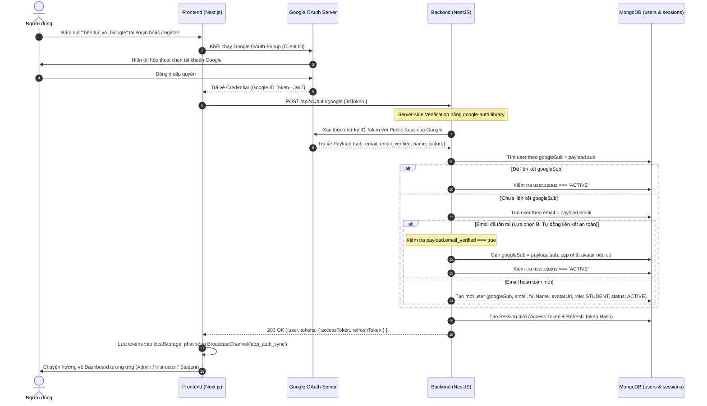

# PLAN: Triển Khai Đăng Nhập & Đăng Ký Bằng Google OAuth 2.0 (Mindly)

> **Mục tiêu:**
> 1. Tích hợp nút đăng nhập / đăng ký bằng tài khoản Google trên giao diện Next.js (`/login` và `/register`) theo phong cách thương hiệu Mindly.
> 2. Khởi tạo luồng xác thực Google Client-side (Google Identity Services / Popup Flow), gửi Google ID Token an toàn về Backend.
> 3. Backend NestJS xác minh chữ ký & tính hợp lệ của ID Token qua `google-auth-library` phía server; sử dụng claim `sub` làm định danh Google duy nhất và ổn định (`googleSub`).
> 4. Xử lý các quy tắc nghiệp vụ nghiêm ngặt: tạo mới tài khoản nếu chưa có, đăng nhập nếu đã liên kết, từ chối/cảnh báo nếu email tồn tại nhưng chưa liên kết an toàn (chống account takeover), kiểm tra trạng thái kích hoạt/khóa (`status === 'ACTIVE'`), giữ nguyên vai trò hệ thống (`ADMIN`, `INSTRUCTOR`, `STUDENT`).
> 5. Cấp phát phiên làm việc chuẩn của Mindly (Access Token + Refresh Token trong `sessions` collection), đồng bộ Multi-tab qua `BroadcastChannel`.
>
> **Task Slug:** `google-auth`
> **Plan File:** `docs/PLAN-google-auth.md`
> **Primary Agent:** `project-planner`
> **Supporting Agents:** `backend-specialist`, `frontend-specialist`, `security-auditor`

---

## 1. Cấu Hình Google Cloud Console (URIs & Origins)

Dựa trên cấu hình ứng dụng hiện tại (`frontend` chạy tại port `3000`, `backend` chạy tại port `8000`):

### A. Authorized JavaScript origins (Nguồn gốc JavaScript được phép)
> Google yêu cầu định dạng: `Scheme + Host + Port` (Không có đường dẫn phụ, **không có dấu gạch chéo `/` ở cuối**).

Thêm các URL sau vào mục **Authorized JavaScript origins**:
```text
http://localhost:3000
http://localhost
```
*(Khi triển khai Production, bổ sung domain thật, ví dụ: `https://mindly.vn`)*

### B. Authorized redirect URIs (URI chuyển hướng được phép)
Tùy theo phương thức triển khai luồng xác thực:

1. **Phương thức 1: Google Identity Services (GIS) / Popup Flow (Khuyến nghị cho SPA Next.js)**:
   Khi dùng Popup/One-Tap, Google trao đổi token qua JavaScript callback (`postMessage`). Thêm các URI sau để hỗ trợ đầy đủ các trường hợp popup fallback:
   ```text
   http://localhost:3000
   http://localhost:3000/login
   http://localhost:3000/register
   ```

2. **Phương thức 2: OAuth 2.0 Full Redirect Flow (Dự phòng cho Server-side Redirect Callback)**:
   Nếu sử dụng luồng redirect toàn trang chuyển hướng sang Backend để xử lý callback:
   ```text
   http://localhost:8000/api/v1/auth/google/callback
   ```

---

## 2. Kiến Trúc & Luồng Dữ Liệu (Sequence Flow)



---

## 3. Quy Tắc Nghiệp Vụ & An Toàn Bảo Mật (Business & Security Rules)

1. **Xác minh ID Token Phía Server (Bắt buộc)**:
   - Tuyệt đối không tin cậy email hay profile do frontend gửi lên.
   - Backend sử dụng `google-auth-library` (`OAuth2Client.verifyIdToken`) kiểm tra:
     - `audience` phải khớp chính xác với `GOOGLE_CLIENT_ID`.
     - Token chưa hết hạn.
     - `payload.email_verified === true`.

2. **Khóa Định Danh `sub` (Subject Claim)**:
   - Dùng `payload.sub` (chuỗi số định danh vĩnh viễn và duy nhất của Google cấp cho người dùng) lưu vào trường `googleSub`.
   - Không dùng `email` làm khóa định danh Google vì email có thể thay đổi trên Google Account.

3. **Chính Sách Safe Account Linking (Theo Lựa Chọn B của người dùng)**:
   - Khi đăng nhập Google, nếu `email` đã tồn tại trong DB nhưng chưa có `googleSub`:
     - Nếu Google chứng minh email đã xác thực (`payload.email_verified === true`): Tự động liên kết tài khoản bằng cách cập nhật `googleSub = payload.sub`, cập nhật `avatarUrl` (nếu user chưa có ảnh đại diện), và đăng nhập ngay.
     - Đồng thời, để ngăn ngừa tấn công Pre-hijacking (kẻ xấu tạo trước tài khoản bằng email của người khác rồi đợi họ đăng nhập Google để chiếm quyền), **luồng đăng ký bằng email/mật khẩu truyền thống bắt buộc phải có bước xác thực Gmail** (gửi OTP/Link xác thực).

4. **Trạng Thái Tài Khoản Bị Khóa / Vô Hiệu Hóa**:
   - Nếu `user.status !== UserStatusEnum.ACTIVE` (`INACTIVE` hoặc `BANNED`), backend lập tức từ chối với `401 Unauthorized` hoặc `403 Forbidden` ("Tài khoản đã bị vô hiệu hóa hoặc khóa").

5. **Phân Quyền Vai Trò (Roles)**:
   - Người dùng mới đăng ký qua Google mặc định nhận role `RoleEnum.STUDENT`.
   - Người dùng cũ đã có vai trò `RoleEnum.ADMIN` hoặc `RoleEnum.INSTRUCTOR` khi đăng nhập lại bằng Google sẽ **giữ nguyên 100% vai trò hiện có**, không bị reset về student.

6. **Đăng Xuất & Thu Hồi Phiên**:
   - Khi người dùng đăng xuất tại Mindly, hệ thống xóa session trong collection `sessions`, xóa tokens tại client, và phát tín hiệu qua `BroadcastChannel` để tất cả các tab trình duyệt cùng đăng xuất.

---

## 4. Chi Tiết Thay Đổi Schema & DTOs

### A. Cập Nhật `share-lib`
- **`share-lib/src/interfaces/user.interface.ts`**:
  - Bổ sung trường `googleSub?: string | null;`
- **`share-lib/src/interfaces/auth.interface.ts`**:
  - Bổ sung `IGoogleAuthPayload`:
    ```typescript
    export interface IGoogleAuthPayload {
      idToken: string;
    }
    ```

### B. Cập Nhật Backend Database (`backend`)
- **`UserEntity` (`backend/src/modules/user/schemas/user.schema.ts`)**:
  - `passwordHash`: Chuyển sang `{ type: String, required: false, select: false, default: null }` (cho phép null đối với tài khoản chỉ dùng Google OAuth).
  - Thêm trường `googleSub`:
    ```typescript
    @Prop({ type: String, required: false, default: null, index: true })
    googleSub?: string | null;
    ```
  - Index cho `googleSub`:
    ```typescript
    UserSchema.index(
      { googleSub: 1 },
      {
        unique: true,
        sparse: true,
        partialFilterExpression: { deletedAt: null, googleSub: { $type: 'string' } },
      },
    );
    ```
- **DTOs (`backend/src/modules/auth/dto/google-auth.dto.ts`)**:
  ```typescript
  export class GoogleAuthDto {
    @IsNotEmpty()
    @IsString()
    @Transform(({ value }) => (typeof value === 'string' ? value.trim() : value))
    idToken: string;
  }
  ```

### C. Cấu Hình Môi Trường (.env)
- **`backend/.env`**:
  ```ini
  GOOGLE_CLIENT_ID=your_google_client_id_here.apps.googleusercontent.com
  GOOGLE_CLIENT_SECRET=your_google_client_secret_here
  ```
- **`frontend/.env`**:
  ```ini
  NEXT_PUBLIC_GOOGLE_CLIENT_ID=your_google_client_id_here.apps.googleusercontent.com
  ```

---

## 5. Kế Hoạch Từng Bước Thực Hiện (Task Breakdown)

### Task 1: Định Nghĩa Hợp Đồng Chia Sẻ (`share-lib`)
- **Agent**: `backend-specialist`
- **Skills**: `clean-code`
- **Dependencies**: Không
- **INPUT**: Yêu cầu về `googleSub` và `IGoogleAuthPayload`.
- **OUTPUT**: Cập nhật `IUser`, `IUserProfile`, `IGoogleAuthPayload` trong `share-lib` và chạy `pnpm --filter share-lib run build`.
- **VERIFY**: `pnpm --filter share-lib run build` thành công, tạo đầy đủ `.d.ts`.

### Task 2: Cài Đặt Thư Viện & Cập Nhật Schema Backend
- **Agent**: `backend-specialist`
- **Skills**: `database-design`, `clean-code`
- **Dependencies**: Task 1
- **INPUT**: Thư viện xác thực Google và Schema Mongoose.
- **OUTPUT**:
  1. Cài đặt `google-auth-library` vào `backend`.
  2. Bổ sung biến môi trường vào config service / validation.
  3. Cập nhật `UserEntity` trong `backend/src/modules/user/schemas/user.schema.ts` (`googleSub`, nullable `passwordHash`).
  4. Cập nhật `UserRepository` hỗ trợ `findByGoogleSub(googleSub: string)`.
- **VERIFY**: Chạy `pnpm --filter backend run build` không phát sinh lỗi types.

### Task 3: Triển Khai Xử Lý Xác Thực Google Phía Backend
- **Agent**: `backend-specialist`
- **Skills**: `api-patterns`, `clean-code`
- **Dependencies**: Task 2
- **INPUT**: `GoogleAuthDto` và logic xác thực Google ID token.
- **OUTPUT**:
  1. Tạo `GoogleAuthService` hoặc tích hợp vào `AuthService.loginWithGoogle(dto: GoogleAuthDto)`:
     - Verify ID Token bằng `OAuth2Client.verifyIdToken`.
     - Lấy `sub`, `email`, `email_verified`, `name`, `picture`.
     - Kiểm tra tài khoản theo `googleSub` -> Nếu có, kiểm tra `status === 'ACTIVE'` -> Trả về tokens.
     - Nếu chưa có `googleSub`: Kiểm tra email -> Nếu email đã có tài khoản:
       - Nếu `email_verified === true`: Tự động liên kết `googleSub = sub`, cập nhật avatar nếu chưa có, kiểm tra `status === 'ACTIVE'` -> Trả về tokens.
     - Nếu chưa có tài khoản: Tạo mới tài khoản với vai trò `STUDENT`, `status: ACTIVE`, `passwordHash: null`.
     - Tạo session và cấp phát cặp JWT Access Token / Refresh Token.
  2. Thêm endpoint `POST /api/v1/auth/google` vào `AuthController`.
  3. Viết Unit Test cho `AuthService.loginWithGoogle` trong `backend/src/modules/auth/tests/auth.service.spec.ts`.
- **VERIFY**: Toàn bộ unit tests trong `backend/src/modules/auth/tests/` vượt qua 100%.

### Task 4: Triển Khai UI & Client SDK Phía Frontend
- **Agent**: `frontend-specialist`
- **Skills**: `frontend-design`, `clean-code`
- **Dependencies**: Task 1, Task 3
- **INPUT**: Giao diện đăng nhập/đăng ký hiện tại (`LoginForm`, `RegisterForm`, `AuthCardWrapper`).
- **OUTPUT**:
  1. Tạo component `GoogleLoginButton` (sử dụng Google Identity Services SDK dạng Popup, hỗ trợ loading state, icon Google chuẩn SVG).
  2. Tạo hook `useGoogleAuthMutation` trong `frontend/src/features/auth/api/auth.api.ts`.
  3. Thêm divider *"Hoặc tiếp tục với"* và `GoogleLoginButton` vào `LoginForm` và `RegisterForm`.
  4. Xử lý điều hướng sau đăng nhập: ADMIN -> `/admin/dashboard`, INSTRUCTOR -> `/instructor/courses`, STUDENT -> `/`.
  5. Xử lý thông báo toast lỗi chi tiết (khi người dùng hủy popup, tài khoản bị khóa).
- **VERIFY**: Mở trang `/login` và `/register`, kiểm tra nút hiển thị chuẩn thẩm mỹ, không vi phạm purple ban, responsive trên mobile/desktop.

### Task 5: Cơ Chế Xác Thực Gmail Cho Luồng Đăng Ký Mật Khẩu (Email Verification Link)
- **Agent**: `backend-specialist` & `frontend-specialist`
- **Skills**: `api-patterns`, `clean-code`
- **Dependencies**: Hoàn thành trọn vẹn Tasks 1-4 (Google OAuth)
- **INPUT**: Cấu hình Gmail SMTP (`GMAIL_USER`, `GMAIL_APP_PASSWORD`) trong `backend/.env`.
- **OUTPUT**:
  1. Thêm trường `isEmailVerified: boolean` (mặc định `false` cho tài khoản local, `true` cho tài khoản Google) và `emailVerificationToken: string | null` trong `UserEntity`.
  2. Tạo `MailService` sử dụng `nodemailer` gửi email template HTML chứa liên kết kích hoạt: `http://localhost:3000/verify-email?token=...`.
  3. Xây dựng trang Frontend `/verify-email` nhận token, gọi backend kích hoạt tài khoản `status: ACTIVE` và `isEmailVerified: true`.
- **VERIFY**: Đăng ký tài khoản thường nhận được email, bấm link kích hoạt thành công mới đăng nhập được vào hệ thống.

---

## 6. Phase X: Kịch Bản Kiểm Thử & Nghiệm Thu (Verification Checklist)

| STT | Kịch Bản Kiểm Thử | Kết Quả Mong Đợi | Trạng Thái |
| :-- | :---------------- | :--------------- | :--------- |
| 1 | Người dùng mới bấm đăng nhập bằng Google | Tài khoản mới được tạo với role `STUDENT`, `googleSub` được lưu, chuyển hướng về trang chủ | `[x]` |
| 2 | Người dùng đăng nhập lại lần 2 bằng Google | Nhận diện đúng qua `googleSub`, không tạo duplicate user, đăng nhập thành công | `[x]` |
| 3 | Tài khoản đã tồn tại qua Email/Password | Nhận diện email đã xác thực, tự động liên kết `googleSub` và đăng nhập thành công | `[x]` |
| 4 | Đăng nhập bằng Email/Password thông thường | Vẫn hoạt động bình thường 100% | `[x]` |
| 5 | Tài khoản đang có role `ADMIN` hoặc `INSTRUCTOR` | Sau khi đăng nhập Google vẫn giữ nguyên quyền `ADMIN`/`INSTRUCTOR` | `[x]` |
| 6 | Tài khoản có `status: 'BANNED'` hoặc `INACTIVE` | Bị từ chối truy cập với lỗi Unauthorized/Forbidden | `[x]` |
| 7 | Người dùng đóng popup Google (Hủy thao tác) | Frontend hiển thị thông báo nhẹ nhàng hoặc không báo lỗi crash | `[x]` |
| 8 | Đăng ký tài khoản thường (Email + Mật khẩu) | Yêu cầu xác thực Gmail qua link kích hoạt (Dành riêng cho Giai đoạn 2) | `[x]` |
| 9 | Đăng xuất từ Menu người dùng | Xóa token tại client, revoke session ở DB, đồng bộ toàn bộ tabs qua BroadcastChannel | `[x]` |
| 10 | Kiểm tra Code Quality | Không có kiểu dữ liệu `any`, chạy `pnpm test` và `pnpm build` pass 100% | `[x]` |
