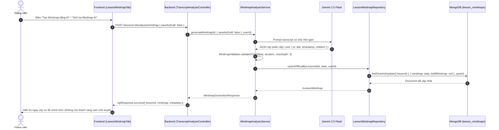
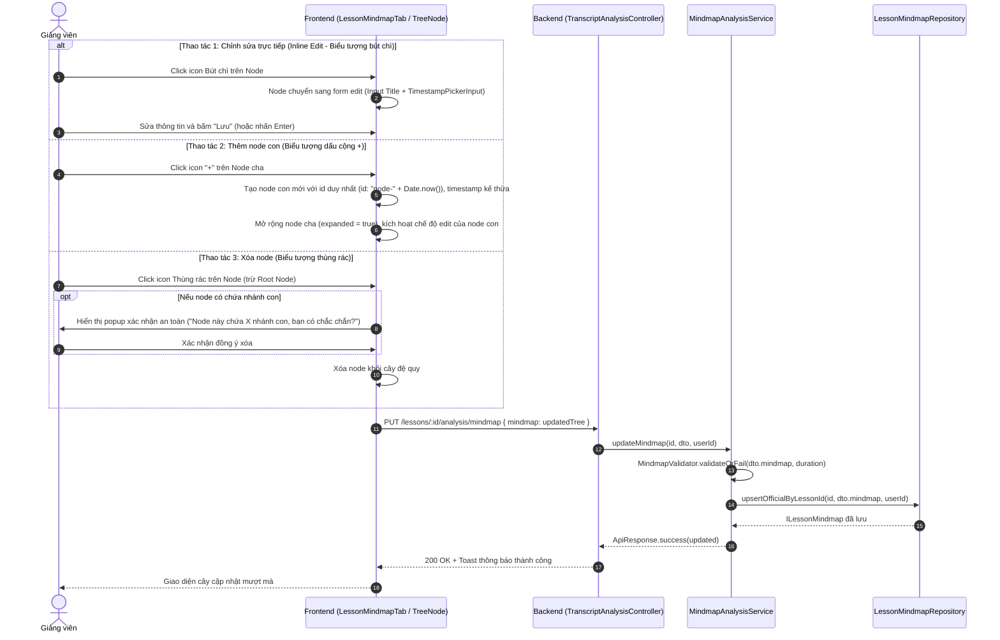

# PLAN: Tái Cấu Trúc Luồng Sơ Đồ Tư Duy Bài Học (Lesson Mindmap Workflow & Direct Editing)

> **Mục tiêu:**
> 1. Chuyển đổi luồng nghiệp vụ của tab **Sơ đồ tư duy (Mindmap)** tại trang `[Chi tiết bài học | DATN Portal](http://localhost:3000/instructor/courses/[courseId]/lessons/[lessonId])`.
> 2. **Bỏ bước duyệt trung gian**: Loại bỏ hoàn toàn thanh thông báo màu vàng cam ("Bản nháp thử nghiệm AI mới đang chờ áp dụng" kèm 2 nút "Xem bản chính thức" và "Áp dụng vào bài học").
> 3. **Tự động áp dụng bản chính thức**: Khi AI tạo xong hoặc khi mở trang, dữ liệu Mindmap được lưu và hiển thị trực tiếp là bản chính thức của bài học (`mindmap`), không lưu trung gian vào `draftMindmap`.
> 4. **Bổ sung cụm công cụ thao tác nhanh trên từng Node (Dạng cây phân cấp)**:
>    - Khi hover chuột vào bất kỳ node nào (trừ trường hợp cấm xóa Root), xuất hiện cụm công cụ thao tác nhanh:
>      - **Biểu tượng cây bút (`lucide:pencil`)**: Bật chế độ chỉnh sửa trực tiếp (Inline Edit) gồm tiêu đề (`title`) và mốc thời gian (`timestamp` với component `TimestampPickerInput`).
>      - **Biểu tượng dấu cộng (`lucide:plus`)**: Thêm ngay 1 node con (`Child Node`) cấp dưới, tự động mở rộng nhánh cha và kích hoạt chế độ sửa.
>      - **Biểu tượng thùng rác (`lucide:trash-2`)**: Xóa node hiện tại khỏi cây phân cấp (kèm modal/alert xác nhận an toàn nếu node đang chứa các nhánh con bên trong).
> 5. **Thanh công cụ đầu trang (Header Actions)**:
>    - Giữ nguyên nút "Mở rộng / Thu gọn tất cả".
>    - Nút "Sinh lại Mindmap AI" (ghi đè snapshot mới nhất làm bản chính thức sau khi AI phân tích lại transcript).
> 6. **Backend API Cập Nhật Mindmap**: Bổ sung endpoint `PUT /lessons/:id/analysis/mindmap` với DTO và validator cấu trúc cây chặt chẽ theo kiến trúc dự án (NestJS, BaseService, LessonMindmapRepository `upsertOfficialByLessonId`).
>
> **Task Slug:** `lesson-mindmap`  
> **Plan File:** `docs/PLAN-lesson-mindmap.md`  
> **Project Type:** `WEB` + `BACKEND`  
> **Primary Agent:** `project-planner`  
> **Assigned Agents:** `backend-specialist`, `frontend-specialist`, `test-engineer`  
>
> **Đã thống nhất qua Socratic Gate:**
> 1. **Cơ chế lưu (Save UX)**: Lưu tức thì ngay khi hoàn thành thao tác (bấm Lưu node, thêm node con, xóa node). Lưu ngầm mượt mà (silent auto-save), **không hiển thị toast phản hồi** khi lưu thành công để tránh làm phiền người dùng (chỉ hiển thị toast khi phát sinh lỗi kết nối/hợp lệ).
> 2. **Độ sâu phân nhánh linh hoạt**: Giảng viên có toàn quyền thêm các nhánh con tại cấp 4 và sâu hơn nếu muốn. Không vô hiệu hóa hoặc ẩn nút `+` ở bất kỳ cấp nào; backend hỗ trợ validate linh hoạt cấu trúc cây sâu theo nhu cầu của giảng viên.
> 3. **Mốc thời gian khi thêm node con mới (`+`)**: Mặc định là `00:00` (0 giây) và hiển thị input nhập số phút:giây để giảng viên tự gõ số thủ công linh hoạt.


---

## 1. Hiện Trạng Codebase & Phân Tích Kỹ Thuật

### 1.1. Bảng Đối Chiếu Hiện Trạng và Thay Đổi

| Thành phần | File / Module | Hiện trạng | Yêu cầu cải tiến |
| :--- | :--- | :--- | :--- |
| **Giao diện Tab Mindmap** | `frontend/src/features/course/components/player/tabs/lesson-mindmap-tab.tsx` | - Có banner vàng cam `isInstructor && hasDraft`.<br>- Có state switch `viewMode: 'draft' \| 'official'`.<br>- Các node cây chỉ hỗ trợ xem và tua video.<br>- Nút sinh AI mặc định gửi `{ saveAsDraft: true }`. | - Xóa banner vàng cam, xóa state `viewMode`, luôn hiển thị dữ liệu chính thức.<br>- Thêm hover actions cho từng node (`lucide:pencil`, `lucide:plus`, `lucide:trash-2`).<br>- Hỗ trợ inline edit node (sửa title, sửa timestamp qua `TimestampPickerInput`).<br>- Thêm node con, mở rộng cây và focus tự động.<br>- Xóa node an toàn (xác nhận khi có node con).<br>- Tự động lưu lên server qua mutation `updateMindmap`. |
| **Frontend API Client & React Query Hooks** | `frontend/src/features/course/api/transcript-analysis.api.ts` | - Có `getMindmap`, `generateMindmap` (mặc định `{ saveAsDraft: true }`), `applyMindmapDraft`.<br>- Chưa có `updateMindmap` mutation. | - Đổi payload mặc định của `generateMindmap` thành `{ saveAsDraft: false }`.<br>- Bổ sung `updateMindmap(lessonId, payload)` và hook `useUpdateLessonMindmapMutation(lessonId)`.<br>- Dọn dẹp/deprecate `applyMindmapDraft`. |
| **Share-lib Type Definitions** | `share-lib/src/interfaces/lesson-mindmap.interface.ts` | Đã có `ILessonMindmapNode`, `ILessonMindmapData`, `ILessonMindmap`. Chưa có `IUpdateLessonMindmapPayload`. | Bổ sung interface `IUpdateLessonMindmapPayload { mindmap: ILessonMindmapData }`. Build lại `share-lib`. |
| **Backend Mindmap DTOs** | `backend/src/modules/transcript-analysis/dto/` | - `GenerateMindmapDto` mặc định `saveAsDraft: true`.<br>- Chưa có `update-mindmap.dto.ts`. | - Chuyển default của `saveAsDraft` thành `false`.<br>- Tạo mới `UpdateLessonMindmapDto` với class-validator và recursive validation cho node cây. |
| **Backend AI Generation Service** | `backend/src/modules/transcript-analysis/services/mindmap-analysis.service.ts` | - Chỉ gọi `saveDraftByLessonId` nếu `saveAsDraft: true`.<br>- Chưa có hàm `updateMindmap`. | - Khi `saveAsDraft: false` (mặc định), gọi trực tiếp `lessonMindmapRepo.upsertOfficialByLessonId`.<br>- Bổ sung hàm `updateMindmap(lessonId, dto, userId)` kiểm tra bài học, validate cây bằng `MindmapValidator`, và lưu vào MongoDB. |
| **Backend Controller & Unit Tests** | `backend/src/modules/transcript-analysis/transcript-analysis.controller.ts` | - Endpoint `POST :id/analysis/mindmap` và `POST :id/analysis/mindmap/apply`.<br>- Thiếu endpoint `PUT :id/analysis/mindmap`. | - Thêm `@Put(':id/analysis/mindmap')` bảo vệ bởi `@Roles(RoleEnum.INSTRUCTOR, RoleEnum.ADMIN)`.<br>- Bổ sung đầy đủ unit tests cho Service và Controller. |

---

## 2. Luồng Nghiệp Vụ Mới (New Business Flow)

### 2.1. Luồng Sinh AI & Tự Động Làm Bản Chính Thức



### 2.2. Luồng Biên Tập Trực Tiếp Trên Từng Node (Node Tree Mutations)



---

## 3. Kiến Trúc & Thiết Kế Chi Tiết

### 3.1. Share-lib Contracts (`share-lib`)

```typescript
// share-lib/src/interfaces/lesson-mindmap.interface.ts
export interface ILessonMindmapNode {
  id: string;
  title: string;
  timestamp: number;
  children?: ILessonMindmapNode[];
}

export interface ILessonMindmapData {
  root: ILessonMindmapNode;
}

export interface IUpdateLessonMindmapPayload {
  mindmap: ILessonMindmapData;
}
```

### 3.2. Backend DTO & Validation (`backend`)

```typescript
// backend/src/modules/transcript-analysis/dto/update-mindmap.dto.ts
export class LessonMindmapNodeDto {
  @IsNotEmpty({ message: 'ID của node không được để trống' })
  @IsString()
  id: string;

  @IsNotEmpty({ message: 'Tiêu đề node không được để trống' })
  @IsString()
  @Transform(({ value }) => (typeof value === 'string' ? value.trim() : value))
  title: string;

  @IsNumber({}, { message: 'Timestamp phải là số giây hợp lệ' })
  @Min(0, { message: 'Timestamp không được âm' })
  timestamp: number;

  @IsOptional()
  @IsArray()
  @ValidateNested({ each: true })
  @Type(() => LessonMindmapNodeDto)
  children?: LessonMindmapNodeDto[];
}

export class LessonMindmapDataDto {
  @IsNotEmptyObject()
  @ValidateNested()
  @Type(() => LessonMindmapNodeDto)
  root: LessonMindmapNodeDto;
}

export class UpdateLessonMindmapDto {
  @IsNotEmptyObject()
  @ValidateNested()
  @Type(() => LessonMindmapDataDto)
  mindmap: LessonMindmapDataDto;
}
```

### 3.3. Các Thao Tác Biến Đổi Cây Đệ Quy (Immutable Tree Helpers)

Để đảm bảo hiệu năng và tính toàn vẹn trạng thái React, xây dựng bộ helper thao tác cây bất biến (Pure Functions):
1. `updateNodeInTree(root: ILessonMindmapNode, nodeId: string, updates: Partial<ILessonMindmapNode>): ILessonMindmapNode`
2. `addChildNodeToTree(root: ILessonMindmapNode, parentId: string, newNode: ILessonMindmapNode): ILessonMindmapNode`
3. `deleteNodeFromTree(root: ILessonMindmapNode, targetId: string): ILessonMindmapNode | null`
4. `countDescendants(node: ILessonMindmapNode): number` (tính số lượng node con cháu để cảnh báo xác nhận xóa)

### 3.4. Thiết Kế UI/UX Cụm Công Cụ Hover Trên Node

1. **Giao diện Hover Node**:
   - Khi chuột di vào một nhánh cây (`group hover`), ở góc phải hiển thị cụm nút nhỏ gọn:
     - **Bút chì (`lucide:pencil`)**: Kích thước 26x26px, hover đổi màu nền sky, tooltip "Chỉnh sửa node".
     - **Dấu cộng (`lucide:plus`)**: Nổi bật, tooltip "Thêm nhánh con" (ẩn hoặc disabled nếu node đã đạt cấp 4 tối đa).
     - **Thùng rác (`lucide:trash-2`)**: Hover đổi màu đỏ rose-500, tooltip "Xóa node" (ẩn đối với Node Root).
2. **Chế độ Inline Edit của Node**:
   - Khi ở trạng thái edit:
     - Ô input tiêu đề trực tiếp với viền sky, tự động focus.
     - Component `TimestampPickerInput` nhỏ gọn hiển thị phút:giây kèm nút "Lấy giây video hiện tại".
     - Nút Lưu (`lucide:check`) và Hủy (`lucide:x`). Hỗ trợ phím tắt `Enter` để lưu và `Escape` để hủy.
3. **Modal / Popover Xác Nhận Xóa**:
   - Nếu node là lá (không có node con): Cho phép xóa ngay kèm toast thông báo hoàn tác hoặc xác nhận nhẹ.
   - Nếu node có các nhánh con: Hiển thị dialog xác nhận "Nhánh này chứa {count} nhánh con bên trong. Bạn có chắc chắn muốn xóa không?".

---

## 4. Kế Hoạch Triển Khai Chi Tiết (Task Breakdown)

### Phase 1: Shared Library & Backend Foundation (P0)

#### Task 1.1: Cập Nhật Contract trong `share-lib`
- **Agent**: `backend-specialist`
- **Skills**: `clean-code`
- **Mô tả**:
  - Bổ sung `IUpdateLessonMindmapPayload` vào `share-lib/src/interfaces/lesson-mindmap.interface.ts`.
  - Export interface trong `share-lib/src/index.ts`.
  - Build `share-lib` (`pnpm --filter share-lib build`).
- **Input**: `share-lib/src/interfaces/lesson-mindmap.interface.ts`
- **Output**: Types đã export và build thành công.
- **Verify**: Lệnh `pnpm --filter share-lib build` chạy thành công không có lỗi.

#### Task 1.2: DTO & Validation Backend
- **Agent**: `backend-specialist`
- **Skills**: `clean-code`, `api-patterns`
- **Mô tả**:
  - Điều chỉnh `GenerateMindmapDto`: mặc định `saveAsDraft: boolean = false`.
  - Tạo mới `backend/src/modules/transcript-analysis/dto/update-mindmap.dto.ts`.
  - Đảm bảo `MindmapValidator` có hàm kiểm tra cấu trúc cây tái sử dụng được cả khi update thủ công.
- **Input**:
  - `backend/src/modules/transcript-analysis/dto/generate-mindmap.dto.ts`
  - `backend/src/modules/transcript-analysis/validators/mindmap.validator.ts`
- **Output**: File `update-mindmap.dto.ts` hoàn chỉnh với class-validator và transform.
- **Verify**: Type check NestJS compile không lỗi.

#### Task 1.3: Cập Nhật Service `MindmapAnalysisService`
- **Agent**: `backend-specialist`
- **Skills**: `clean-code`, `database-design`
- **Mô tả**:
  - Cập nhật `generateMindmap`: Khi `saveAsDraft` là false (mặc định), gọi `this.lessonMindmapRepo.upsertOfficialByLessonId` để lưu trực tiếp làm bản chính thức.
  - Viết hàm mới `updateMindmap(lessonId: string, dto: UpdateLessonMindmapDto, userId?: string)`:
    - Kiểm tra bài học tồn tại (`lessonRepo.findById`).
    - Lấy thời lượng video để validate mốc timestamp không vượt quá thời lượng bài học.
    - Gọi `MindmapValidator.validateOrFail(dto.mindmap, durationSeconds, 3)`.
    - Gọi `lessonMindmapRepo.upsertOfficialByLessonId(trimmedLessonId, dto.mindmap, userId)`.
    - Ghi log audit và trả về `ILessonMindmap`.
- **Input**: `backend/src/modules/transcript-analysis/services/mindmap-analysis.service.ts`
- **Output**: Phương thức `updateMindmap` hoàn chỉnh.
- **Verify**: Viết unit test cho `updateMindmap` trong `mindmap-analysis.service.spec.ts`.

#### Task 1.4: Endpoint Controller & Unit Tests
- **Agent**: `backend-specialist`
- **Skills**: `clean-code`, `api-patterns`
- **Mô tả**:
  - Thêm endpoint `@Put(':id/analysis/mindmap')` trong `TranscriptAnalysisController` với decorator `@Roles(RoleEnum.INSTRUCTOR, RoleEnum.ADMIN)`.
  - Nhận `@Param('id', ParseObjectIdPipe) id: string`, `@Body() dto: UpdateLessonMindmapDto`, `@CurrentUser('id') userId?: string`.
  - Bổ sung unit tests cho Controller và Service.
- **Input**: `backend/src/modules/transcript-analysis/transcript-analysis.controller.ts`
- **Output**: Endpoint PUT hoạt động và có test đầy đủ.
- **Verify**: Chạy `pnpm --filter backend test -- mindmap-analysis.service.spec.ts` pass 100%.

---

### Phase 2: Frontend API & UI Implementation (P1)

#### Task 2.1: Cập Nhật API Client & React Query Mutations
- **Agent**: `frontend-specialist`
- **Skills**: `clean-code`, `react-best-practices`
- **Mô tả**:
  - Cập nhật `transcriptAnalysisApi.generateMindmap`: default `saveAsDraft: false`.
  - Thêm `transcriptAnalysisApi.updateMindmap(lessonId, payload)`.
  - Tạo hook `useUpdateLessonMindmapMutation(lessonId)`:
    - Tự động invalidate query key `mindmap(lessonId)`.
    - **Lưu ngầm mượt mà (Silent)**: Không bắn toast khi lưu thành công để trải nghiệm biên tập không bị ngắt quãng. Chỉ bắn toast lỗi khi xảy ra sự cố mạng hoặc validate thất bại.
- **Input**: `frontend/src/features/course/api/transcript-analysis.api.ts`
- **Output**: Hook `useUpdateLessonMindmapMutation` sẵn sàng sử dụng.
- **Verify**: Type check frontend `npx tsc --noEmit` pass.

#### Task 2.2: Xây Dựng Tree Manipulation Utilities
- **Agent**: `frontend-specialist`
- **Skills**: `clean-code`
- **Mô tả**:
  - Viết module tiện ích quản lý cây: `findNode`, `updateNode`, `addChildNode`, `deleteNode`, `countDescendants`.
  - Đảm bảo các hàm là pure function, trả về cây mới bất biến.
- **Input**: `frontend/src/features/course/utils/lesson-mindmap-tree.util.ts`
- **Output**: Module tiện ích cây có unit tests hoặc type safe rõ ràng.
- **Verify**: Kiểm tra các case thêm vào root, thêm vào lá, xóa nhánh con.

#### Task 2.3: Thiết Kế Lại Component `LessonMindmapTab` & `TreeNode`
- **Agent**: `frontend-specialist`
- **Skills**: `frontend-design`, `clean-code`, `react-best-practices`
- **Mô tả**:
  - **Loại bỏ**:
    - Banner vàng cam chờ duyệt ("Bản nháp thử nghiệm AI mới đang chờ áp dụng" / nút Áp dụng).
    - Biến state `viewMode: 'draft' | 'official'`.
  - **Cập nhật Header Actions**:
    - Nút "Mở rộng tất cả" / "Thu gọn tất cả".
    - Nút "Sinh lại Mindmap AI" (ghi đè trực tiếp snapshot mới nhất).
  - **Cập nhật TreeNode**:
    - Hiển thị cụm công cụ hover (bút chì, dấu cộng, thùng rác) cho Giảng viên.
    - **Nút Thêm nhánh con (`+`)**: Khởi tạo node con mới với mốc thời gian mặc định `00:00` (0 giây). Ẩn hoặc vô hiệu hóa tại node lá thuộc cấp 4 (độ sâu tối đa) kèm tooltip cảnh báo.
    - **Nút Xóa (`trash-2`)**: Ẩn ở Root node. Hiển thị dialog xác nhận khi node có chứa nhánh con.
    - **Trạng thái inline edit**: Input tiêu đề + `TimestampPickerInput` (chọn phút:giây hoặc lấy thời gian video hiện tại).
    - Phím tắt `Enter` để lưu, `Esc` để hủy.
    - Màu sắc giao diện tuân thủ quy tắc **Purple Ban** (dùng sky-500, indigo nhẹ, neutral, rose cho thùng rác).
- **Input**: `frontend/src/features/course/components/player/tabs/lesson-mindmap-tab.tsx`
- **Output**: Component hoàn chỉnh với trải nghiệm biên tập trực tiếp mượt mà.
- **Verify**: Thao tác thực tế trên trình duyệt: thêm node, sửa title, sửa timestamp, xóa node, tua video.

---

### Phase 3: Verification & Polish (Phase X)

#### Task 3.1: Unit Tests & Build Verification
- **Agent**: `test-engineer`
- **Skills**: `testing-patterns`, `clean-code`
- **Mô tả**:
  - Chạy toàn bộ test của module transcript analysis:
    - `mindmap.validator.spec.ts`
    - `mindmap-analysis.service.spec.ts`
    - `transcript-analysis.controller.spec.ts`
  - Chạy build và type check toàn bộ repo:
    - `pnpm --filter share-lib build`
    - `pnpm --filter backend build`
    - `pnpm --filter frontend build` (hoặc `npx tsc --noEmit`)
- **Verify**: Không có lỗi biên dịch, không có type `any`, 100% test cases pass.

---

## 5. Tiêu Chí Nghiệm Thu (Definition of Done)

1. [x] Khi bấm "Tạo Mindmap bằng AI" hoặc "Sinh lại Mindmap AI", sơ đồ sinh ra được lưu trực tiếp làm bản chính thức của bài học.
2. [x] Hoàn toàn không còn thanh thông báo màu vàng cam ("Bản nháp thử nghiệm AI mới đang chờ áp dụng" / "Áp dụng vào bài học").
3. [x] Giảng viên hover chuột vào bất kỳ node nào sẽ thấy cụm thao tác nhanh: Bút chì, Dấu cộng `+`, Thùng rác.
4. [x] Node Root không hiển thị nút thùng rác (tránh xóa mất toàn bộ cây).
5. [x] Bấm icon cây bút chì mở form chỉnh sửa trực tiếp tiêu đề và mốc thời gian (sử dụng component chọn phút:giây tiện lợi).
6. [x] Bấm icon `+` thêm ngay một node con bên dưới, tự động mở rộng nhánh cha và đưa vào chế độ chỉnh sửa.
7. [x] Bấm icon thùng rác xóa node hiện tại; nếu có các node con bên trong sẽ hiển thị cảnh báo xác nhận rõ ràng trước khi xóa.
8. [x] Mọi thay đổi biên tập được cập nhật lên server qua API `PUT /lessons/:id/analysis/mindmap` và đồng bộ tức thì.
9. [x] Học viên khi xem bài học chỉ thấy cây sơ đồ chính thức, tua video mượt mà, không thấy các nút biên tập của giảng viên.
10. [x] 100% test cases backend pass và không có lỗi type-check frontend.

---

## ✅ PHASE X COMPLETE

- **Unit Tests**: ✅ Pass 100% (7/7 test files, 72 tests passed).
- **Share-lib Build**: ✅ Success (`tsc`).
- **Backend Build**: ✅ Success (`nest build`).
- **Frontend Type Check**: ✅ Success (`tsc --noEmit`).
- **Purple Ban & Web Guidelines**: ✅ Pass (Sử dụng màu sky, neutral, rose, không dùng màu tím, không inline font).
- **Date**: 2026-10-19

