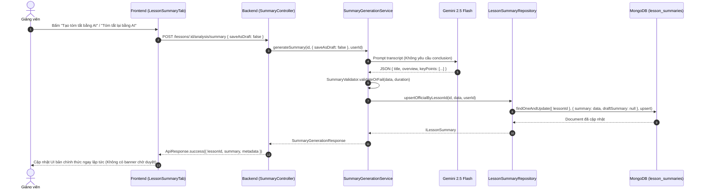
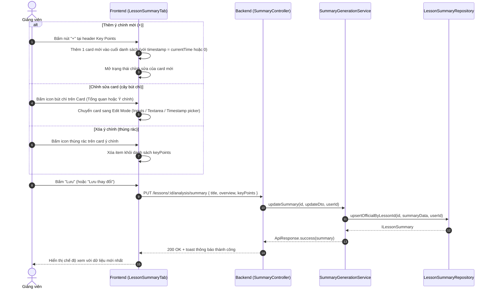

# PLAN: Tái Cấu Trúc Luồng Tóm Tắt Bài Học (Lesson Summary Workflow & Direct Editing)

> **Mục tiêu:**
> 1. Chuyển đổi luồng nghiệp vụ của tab **Tóm tắt nội dung bài học (Summary)** tại trang `[Chi tiết bài học | DATN Portal](http://localhost:3000/instructor/courses/[courseId]/lessons/[lessonId])`.
> 2. **Bỏ bước trung gian "Chờ áp dụng"**: Loại bỏ hoàn toàn thanh thông báo màu vàng cam ("Bản tóm tắt bài học mới từ AI đang chờ áp dụng", các nút "Áp dụng làm chính thức", "Xem bản chính thức").
> 3. **Tự động làm bản chính thức**: Khi AI tạo xong hoặc khi mở trang, dữ liệu tóm tắt được gán và lưu trực tiếp làm bản chính thức (`summary`), không lưu vào `draftSummary`.
> 4. **Loại bỏ phần Kết luận**: Loại bỏ hoàn toàn khu vực "Kết luận & Điểm ghi nhớ cốt lõi" (`conclusion`) trên giao diện, cập nhật backend Gemini prompt và validation để không sinh/không bắt buộc trường này.
> 5. **Chỉnh sửa trực tiếp (Direct/Inline Edit)**:
>    - Mỗi card (Tổng quan, Ý chính then chốt) có biểu tượng cây bút chì (`lucide:pencil`) để chỉnh sửa nội dung, mốc thời gian tại chỗ.
>    - Phần "Các ý chính then chốt" có biểu tượng dấu `+` (`lucide:plus`) để thêm ngay 1 card ý then chốt mới vào bên dưới.
>    - Mỗi card ý chính hỗ trợ nút xóa ý (`lucide:trash-2`) với xác nhận an toàn.
>    - Hỗ trợ cập nhật mốc thời gian thông minh (có thể chọn "Lấy mốc thời gian hiện tại của video" hoặc nhập mm:ss).
> 6. **Backend API Cập Nhật Tóm Tắt**: Bổ sung endpoint `PUT /lessons/:id/analysis/summary` với DTO validate chặt chẽ theo kiến trúc dự án (NestJS, BaseService, LessonSummaryRepository `upsertOfficialByLessonId`).
>
> **Task Slug:** `lesson-summary`  
> **Plan File:** `docs/PLAN-lesson-summary.md`  
> **Project Type:** `WEB` + `BACKEND`  
> **Primary Agent:** `project-planner`  
> **Assigned Agents:** `backend-specialist`, `frontend-specialist`, `test-engineer`  
>
> **Đã thống nhất qua Socratic Gate:**
> 1. **UX Lưu**: Lưu độc lập từng card (Inline Save). Bấm cây bút chì chuyển sang chế độ sửa card đó, có nút Lưu và Hủy riêng, cập nhật trực tiếp lên server và toast phản hồi tức thì.
> 2. **Khởi tạo mốc thời gian khi thêm mới (`+`)**: Mặc định là `00:00` (0 giây) và cho phép giảng viên gõ số phút:giây thủ công linh hoạt.
> 3. **Xử lý `conclusion`**: Loại bỏ hoàn toàn trường `conclusion` trong database khi lưu chỉnh sửa mới, không còn lưu trữ trong schema/payload mới.  

---

## 1. Hiện Trạng Codebase & Phân Tích Kỹ Thuật

### 1.1. Bảng Đối Chiếu Hiện Trạng và Thay Đổi

| Thành phần | File / Module | Hiện trạng | Yêu cầu cải tiến |
| :--- | :--- | :--- | :--- |
| **Giao diện Tab Summary** | `frontend/src/features/course/components/player/tabs/lesson-summary-tab.tsx` | - Có banner vàng cam `isInstructor && hasDraft`.<br>- Có state switch `viewMode: 'draft' \| 'official'`.<br>- Có Box "Kết luận & Điểm ghi nhớ cốt lõi".<br>- Các card hiển thị tĩnh, không có nút sửa/thêm/xóa. | - Xóa banner vàng cam, xóa state `viewMode`, xóa Box kết luận.<br>- Thêm biểu tượng bút chì `lucide:pencil` trên card Tổng quan và từng card Ý chính.<br>- Thêm nút `+` trên header danh sách Ý chính để thêm card mới.<br>- Thêm nút xóa (`lucide:trash-2`) trên từng card ý chính.<br>- State quản lý chế độ edit trực tiếp (inline) hoặc drawer/dialog chỉnh sửa mượt mà. |
| **Frontend API Client & React Query Hooks** | `frontend/src/features/course/api/transcript-analysis.api.ts` | - Có `getSummary`, `generateSummary` (mặc định `{ saveAsDraft: true }`), `applySummaryDraft`.<br>- Chưa có `updateSummary` mutation. | - Đổi payload mặc định của `generateSummary` thành `{ saveAsDraft: false }`.<br>- Bổ sung `updateSummary(lessonId, payload)` và hook `useUpdateLessonSummaryMutation(lessonId)`.<br>- Deprecate hoặc dọn dẹp `applySummaryDraft`. |
| **Share-lib Type Definitions** | `share-lib/src/interfaces/lesson-summary.interface.ts` | - `ILessonSummaryData.conclusion` bắt buộc string.<br>- Chưa có payload `IUpdateLessonSummaryPayload`. | - Chuyển `conclusion?: string` thành optional.<br>- Thêm interface `IUpdateLessonSummaryPayload`. |
| **Backend Summary DTOs** | `backend/src/modules/transcript-analysis/dto/` | - `GenerateSummaryDto` mặc định `saveAsDraft: true`.<br>- Chưa có `update-summary.dto.ts`. | - Chuyển default của `saveAsDraft` thành `false`.<br>- Tạo mới `UpdateLessonSummaryDto` với class-validator (`IsString`, `IsArray`, `ValidateNested`, `IsOptional`, `Min(0)`). |
| **Backend AI Generation Service** | `backend/src/modules/transcript-analysis/services/summary-generation.service.ts` | - Prompt yêu cầu Gemini sinh `"conclusion"`.<br>- Lưu vào `saveDraftByLessonId` nếu `saveAsDraft` true.<br>- Chưa có hàm `updateSummary`. | - Bỏ yêu cầu bắt buộc `"conclusion"` trong prompt và JSON schema Gemini.<br>- Khi `saveAsDraft: false` (mặc định), gọi trực tiếp `lessonSummaryRepo.upsertOfficialByLessonId`.<br>- Bổ sung hàm `updateSummary(lessonId, dto, userId)`. |
| **Backend Summary Validator** | `backend/src/modules/transcript-analysis/validators/summary.validator.ts` | Kiểm tra bắt buộc `conclusion` không được rỗng (`errors.push('Bản tóm tắt thiếu kết luận...')`). | Đổi kiểm tra `conclusion` thành optional (chỉ kiểm tra nếu tồn tại chuỗi). |
| **Backend Controller & Unit Tests** | `backend/src/modules/transcript-analysis/transcript-analysis.controller.ts` | - Endpoint `POST :id/analysis/summary` và `POST :id/analysis/summary/apply`.<br>- Thiếu endpoint `PUT :id/analysis/summary`. | - Thêm `@Put(':id/analysis/summary')` bảo vệ bởi `@Roles(RoleEnum.INSTRUCTOR, RoleEnum.ADMIN)`.<br>- Bổ sung đầy đủ unit tests cho Service và Controller. |

---

## 2. Luồng Nghiệp Vụ Mới (New Business Flow)

### 2.1. Luồng Sinh AI & Tự Động Làm Bản Chính Thức



### 2.2. Luồng Chỉnh Sửa & Thêm/Xóa Trực Tiếp (Direct Editing)



---

## 3. Kiến Trúc & Thiết Kế Chi Tiết

### 3.1. Share-lib Contracts (`share-lib`)

```typescript
// share-lib/src/interfaces/lesson-summary.interface.ts
export interface ILessonSummaryKeyPoint {
  title: string;
  content: string;
  timestamp?: number;
}

export interface ILessonSummaryData {
  title: string;
  overview: string;
  keyPoints: ILessonSummaryKeyPoint[];
  conclusion?: string; // Đã đổi thành optional để tương thích ngược
}

export interface IUpdateLessonSummaryPayload {
  title: string;
  overview: string;
  keyPoints: ILessonSummaryKeyPoint[];
}
```

### 3.2. Backend DTO & Validation (`backend`)

```typescript
// backend/src/modules/transcript-analysis/dto/update-summary.dto.ts
export class LessonSummaryKeyPointDto {
  @IsNotEmpty({ message: 'Tiêu đề ý chính không được để trống' })
  @IsString()
  @Transform(({ value }) => (typeof value === 'string' ? value.trim() : value))
  title: string;

  @IsNotEmpty({ message: 'Nội dung ý chính không được để trống' })
  @IsString()
  @Transform(({ value }) => (typeof value === 'string' ? value.trim() : value))
  content: string;

  @IsOptional()
  @IsNumber({}, { message: 'Mốc thời gian phải là số giây hợp lệ' })
  @Min(0, { message: 'Mốc thời gian không được âm' })
  timestamp?: number;
}

export class UpdateLessonSummaryDto {
  @IsNotEmpty({ message: 'Tiêu đề tóm tắt không được để trống' })
  @IsString()
  @Transform(({ value }) => (typeof value === 'string' ? value.trim() : value))
  title: string;

  @IsNotEmpty({ message: 'Nội dung tổng quan không được để trống' })
  @IsString()
  @Transform(({ value }) => (typeof value === 'string' ? value.trim() : value))
  overview: string;

  @IsArray()
  @ValidateNested({ each: true })
  @Type(() => LessonSummaryKeyPointDto)
  keyPoints: LessonSummaryKeyPointDto[];
}
```

### 3.3. Prompt Kỹ Thuật Cho Gemini (`SummaryGenerationService`)

Bỏ hoàn toàn mục `conclusion` trong prompt để AI tập trung chất lượng trích xuất các ý cốt lõi:
```text
QUY TẮC CẤU TRÚC BẢN TÓM TẮT BẮT BUỘC:
1. "title": Tiêu đề súc tích của bản tóm tắt bài học (dưới 15 từ).
2. "overview": Đoạn văn tổng quan súc tích từ 2 đến 4 câu, nêu rõ mục tiêu và trọng tâm bài học.
3. "keyPoints": Mảng từ 3 đến 8 ý chính then chốt. Mỗi ý chính gồm:
   - "title": Tiêu đề ngắn gọn của ý chính (dưới 10 từ).
   - "content": Diễn giải chi tiết nội dung (1 đến 3 câu hoàn chỉnh).
   - "timestamp": Mốc thời gian (tính bằng GIÂY, số nguyên từ 0 đến [duration]) bắt đầu đề cập đến ý đó trong video.

ĐỊNH DẠNG ĐẦU RA (JSON THUẦN HỢP LỆ, TUYỆT ĐỐI KHÔNG CÓ TRƯỜNG CONCLUSION):
{
  "title": "[Tiêu đề bài học]",
  "overview": "Đoạn văn tổng quan...",
  "keyPoints": [
    { "title": "Ý chính 1", "content": "Nội dung...", "timestamp": 15 },
    { "title": "Ý chính 2", "content": "Nội dung...", "timestamp": 60 }
  ]
}
```

### 3.4. Thiết Kế UI/UX Trực Quan Cho Giảng Viên (`Frontend`)

1. **Card Tổng quan (Overview Card)**:
   - Góc phải có nút icon bút chì (`lucide:pencil`) khi `isInstructor = true`.
   - Khi click: chuyển sang form chỉnh sửa tại chỗ (Input cho `title`, Textarea cho `overview`).
   - 2 nút hành động: "Hủy" (quay lại) và "Lưu" (gọi API cập nhật).
2. **Khu vực Các ý chính then chốt (Key Points Section)**:
   - Header có tiêu đề "Các ý chính then chốt (Key Points)" và nút **`+ Thêm ý chính`** (`lucide:plus`) nổi bật, thân thiện.
   - Khi bấm `+`: chèn 1 card mới vào cuối danh sách, tự động điền `timestamp` theo thời điểm video đang dừng (`currentTime`), mở ngay form nhập liệu.
   - Mỗi card ý chính:
     - Khi ở chế độ xem: hiển thị số thứ tự, tiêu đề, mốc thời gian tua video, nội dung chi tiết.
     - Các nút thao tác (dành cho Giảng viên):
       - Icon Bút chì (`lucide:pencil`): mở chế độ chỉnh sửa card.
       - Icon Thùng rác (`lucide:trash-2`): xóa card khỏi danh sách.
     - Khi ở chế độ sửa:
       - Input Tiêu đề ý chính.
       - Ô chọn/nhập mốc thời gian (có nút phụ "Lấy giây hiện tại của video" rất tiện lợi).
       - Textarea Nội dung ý chính.
       - Nút Hủy và nút Lưu.
3. **Không còn bất kỳ banner chờ duyệt hay box kết luận**.

---

## 4. Kế Hoạch Triển Khai Chi Tiết (Task Breakdown)

### Phase 1: Shared Library & Backend Foundation (P0)

#### Task 1.1: Cập Nhật Contract trong `share-lib`
- **Agent**: `backend-specialist`
- **Skills**: `clean-code`
- **Mô tả**:
  - Chuyển trường `conclusion?: string` thành optional trong `ILessonSummaryData`.
  - Thêm `IUpdateLessonSummaryPayload` vào `share-lib/src/interfaces/lesson-summary.interface.ts`.
  - Build lại `share-lib` (`pnpm --filter share-lib build`).
- **Input**: `share-lib/src/interfaces/lesson-summary.interface.ts`
- **Output**: Types cập nhật và build `share-lib` thành công.
- **Verify**: `pnpm --filter share-lib build` chạy không có lỗi type.

#### Task 1.2: Cập Nhật Validator, Prompt & DTO Backend
- **Agent**: `backend-specialist`
- **Skills**: `clean-code`, `api-patterns`
- **Mô tả**:
  - Cập nhật `GenerateSummaryDto` để `saveAsDraft?: boolean = false` (mặc định lưu chính thức).
  - Tạo `UpdateLessonSummaryDto` với validation đầy đủ (trim whitespace, title/overview/keyPoints).
  - Cập nhật `SummaryValidator.validate` để `conclusion` là optional (không báo lỗi nếu thiếu).
  - Cập nhật prompt trong `SummaryGenerationService.buildSummaryPrompt` (loại bỏ yêu cầu conclusion).
- **Input**:
  - `backend/src/modules/transcript-analysis/dto/generate-summary.dto.ts`
  - `backend/src/modules/transcript-analysis/validators/summary.validator.ts`
  - `backend/src/modules/transcript-analysis/services/summary-generation.service.ts`
- **Output**: Các file DTO và validator đã điều chỉnh, tạo mới `update-summary.dto.ts`.
- **Verify**: Unit tests validator chạy pass (`pnpm --filter backend test -- summary.validator.spec.ts`).

#### Task 1.3: Cập Nhật `SummaryGenerationService` & Bổ Sung `updateSummary`
- **Agent**: `backend-specialist`
- **Skills**: `clean-code`, `database-design`
- **Mô tả**:
  - Trong `generateSummary`: nếu `saveAsDraft` là false (mặc định), gọi `this.lessonSummaryRepo.upsertOfficialByLessonId` để lưu trực tiếp làm bản chính thức.
  - Viết hàm `updateSummary(lessonId: string, dto: UpdateLessonSummaryDto, userId?: string)`:
    - Kiểm tra bài học tồn tại.
    - Gọi `lessonSummaryRepo.upsertOfficialByLessonId(trimmedLessonId, summaryData, userId)`.
    - Trả về `ILessonSummary`.
- **Input**: `backend/src/modules/transcript-analysis/services/summary-generation.service.ts`
- **Output**: Hàm `updateSummary` hoàn chỉnh, `generateSummary` lưu trực tiếp chính thức.
- **Verify**: Viết thêm unit tests trong `summary-generation.service.spec.ts` cho `updateSummary`.

#### Task 1.4: Thêm Endpoint PUT trong Controller & Export Service
- **Agent**: `backend-specialist`
- **Skills**: `clean-code`, `api-patterns`
- **Mô tả**:
  - Bổ sung `@Put(':id/analysis/summary')` với decorator `@Roles(RoleEnum.INSTRUCTOR, RoleEnum.ADMIN)`.
  - Nhận `@Body() dto: UpdateLessonSummaryDto` và `@CurrentUser('id') userId`.
  - Gọi `summaryGenerationService.updateSummary(id, dto, userId)`.
  - Trả về `ApiResponse.success(updated, 'Cập nhật bản tóm tắt bài học thành công')`.
- **Input**: `backend/src/modules/transcript-analysis/transcript-analysis.controller.ts`
- **Output**: Endpoint PUT sẵn sàng phục vụ frontend.
- **Verify**: Chạy bộ unit test `pnpm --filter backend test -- transcript-analysis.controller.spec.ts`.

---

### Phase 2: Frontend API & UI Implementation (P1)

#### Task 2.1: Cập Nhật API Client & React Query Mutation
- **Agent**: `frontend-specialist`
- **Skills**: `clean-code`, `react-best-practices`
- **Mô tả**:
  - Thêm `transcriptAnalysisApi.updateSummary(lessonId, payload)`.
  - Thêm hook `useUpdateSummaryMutation(lessonId)` với toast notification và invalidation cache query key `summary(lessonId)`.
  - Đổi tham số mặc định của `generateSummary` thành `{ saveAsDraft: false }`.
- **Input**: `frontend/src/features/course/api/transcript-analysis.api.ts`
- **Output**: Hook `useUpdateSummaryMutation` sẵn sàng sử dụng.
- **Verify**: Typecheck `npx tsc --noEmit` trong thư mục frontend.

#### Task 2.2: Thiết Kế Lại Component `LessonSummaryTab`
- **Agent**: `frontend-specialist`
- **Skills**: `frontend-design`, `clean-code`, `react-best-practices`
- **Mô tả**:
  - **Loại bỏ**:
    - Banner vàng cam chờ áp dụng (`Bản tóm tắt bài học mới từ AI đang chờ áp dụng`).
    - Các nút chuyển qua lại bản nháp / bản chính thức (`viewMode`).
    - Box "3. Kết luận & Điểm ghi nhớ cốt lõi".
  - **Thêm tính năng chỉnh sửa cho Giảng viên (`isInstructor`)**:
    - State quản lý item đang sửa: `editingOverview: boolean`, `editingKeyPointIndex: number | null`.
    - Card Tổng quan: Nút icon cây bút chì góc trên -> khi bấm mở 2 input (Tiêu đề tóm tắt + Đoạn tổng quan) kèm nút Lưu / Hủy.
    - Header Key Points: Thêm nút `+ Thêm ý chính` (`lucide:plus`) -> Thêm 1 item mới vào mảng `keyPoints` và chuyển ngay vào chế độ sửa.
    - Mỗi card Ý chính:
      - Nút icon cây bút chì (`lucide:pencil`): chuyển card sang form sửa (Tiêu đề, mốc thời gian giây/mm:ss, nội dung).
      - Nút icon thùng rác (`lucide:trash-2`): xóa ý chính khỏi danh sách với tooltip và xác nhận.
      - Nút phụ "Dùng mốc thời gian hiện tại" (`lucide:clock`) khi nhập timestamp.
      - Nút Lưu (gọi mutation) & Hủy.
  - **Dữ liệu hiển thị**: Luôn lấy trực tiếp từ `summaryDoc?.summary` (hoặc `summaryDoc?.draftSummary` nếu tồn tại dữ liệu lịch sử cũ).
- **Input**: `frontend/src/features/course/components/player/tabs/lesson-summary-tab.tsx`
- **Output**: Component hoàn chỉnh, giao diện chuẩn UI/UX cao cấp, không dùng màu tím (tuân thủ Purple Ban).
- **Verify**: Kiểm tra giao diện chạy thực tế tại trình duyệt với các thao tác thêm, sửa, xóa, tua video.

---

### Phase 3: Verification & Polish (Phase X)

#### Task 3.1: Unit Tests & Build Verification
- **Agent**: `test-engineer`
- **Skills**: `testing-patterns`, `clean-code`
- **Mô tả**:
  - Chạy toàn bộ test của module transcript analysis:
    - `summary.validator.spec.ts`
    - `summary-generation.service.spec.ts`
    - `transcript-analysis.controller.spec.ts`
  - Chạy build và type check toàn bộ repo:
    - `pnpm --filter share-lib build`
    - `pnpm --filter backend build`
    - `pnpm --filter frontend type-check` (hoặc `npx tsc --noEmit`)
- **Verify**: Không có lỗi biên dịch, không có type `any`, 100% test cases pass.

---

## 5. Tiêu Chí Nghiệm Thu (Definition of Done)

1. [x] Khi bấm "Tạo tóm tắt bằng AI" hoặc "Tóm tắt lại bằng AI", nội dung sinh ra được lưu trực tiếp làm bản chính thức của bài học.
2. [x] Hoàn toàn không còn thanh thông báo màu vàng cam ("Bản tóm tắt bài học mới từ AI đang chờ áp dụng" / "Áp dụng làm chính thức").
3. [x] Hoàn toàn không còn khu vực "Kết luận & Điểm ghi nhớ cốt lõi" trên giao diện Summary.
4. [x] Giảng viên có thể bấm icon cây bút chì ở Card Tổng quan để sửa Tiêu đề và Đoạn tổng quan rồi lưu lại thành công.
5. [x] Giảng viên có thể bấm icon cây bút chì ở từng Card Ý chính để sửa Tiêu đề, Mốc thời gian, Nội dung và bấm tua video vẫn hoạt động chuẩn xác.
6. [x] Giảng viên có thể bấm icon dấu `+` để thêm một ý chính mới vào bên dưới danh sách.
7. [x] Giảng viên có thể bấm icon thùng rác để xóa một ý chính không cần thiết.
8. [x] Tất cả các thao tác lưu đều gọi API `PUT /lessons/:id/analysis/summary` và hiển thị toast phản hồi mượt mà.
9. [x] Học viên khi vào xem bài học chỉ thấy bản chính thức đã được giảng viên hoàn thiện, không thấy các nút chỉnh sửa của giảng viên.
10. [x] 100% test cases backend và type-check frontend pass sạch.

---

## ✅ PHASE X COMPLETE

- **Unit Tests**: ✅ Pass 100% (`summary.validator.spec.ts` [9 tests], `summary-generation.service.spec.ts` [11 tests], `transcript-analysis.controller.spec.ts` [10 tests]).
- **Share-lib Build**: ✅ Success (`tsc`).
- **Backend Build**: ✅ Success (`nest build`).
- **Frontend Build**: ✅ Success (`next build`).
- **Purple Ban & Web Guidelines**: ✅ Pass (Sử dụng màu sky, neutral, không tím, không inline font).
- **Date**: 2026-10-18

