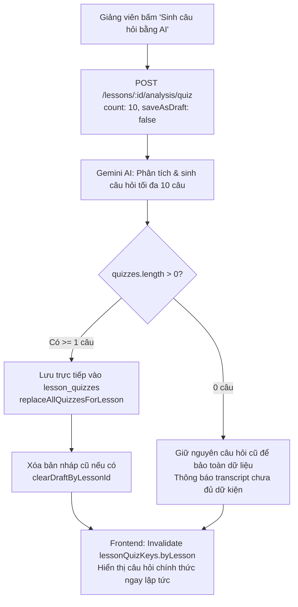

# Kế hoạch Triển khai: Đơn Giản Hóa Luồng Quiz — Tự Động Áp Dụng Chính Thức & Cố Định Trần 10 Câu

> **File:** `docs/PLAN-quiz-auto-official.md`  
> **Trạng thái:** PROPOSED / READY FOR REVIEW  
> **Agent lập kế hoạch:** `project-planner`  
> **Chuyên gia phụ trách:** `backend-specialist` & `frontend-specialist` (Skills: `clean-code`, `database-design`, `api-patterns`, `react-best-practices`)  
> **Giao diện mục tiêu:** `http://localhost:3000/instructor/courses/[id]/lessons/[lessonId]` (Tab Quiz bài học)  

---

## 1. Tổng quan & Yêu cầu Người dùng (Overview & Requirements)

### 1.1. Yêu cầu điều chỉnh
1. **Bỏ bộ chọn số lượng câu hỏi trần (Ceiling Selector)**:
   - Loại bỏ dropdown chọn trần câu hỏi (3, 5, 8, 10, 15, 20) trên giao diện.
   - Mặc định trần tối đa cố định là **10 câu hỏi** (`maxCount = 10`), AI tự cân đối sinh từ 0 đến 10 câu theo hàm lượng kiến thức trong transcript.
2. **Loại bỏ trạng thái chờ phê duyệt (Yellow Draft Banner)**:
   - Xóa bỏ banner màu vàng hổ phách (`Bộ X câu hỏi trắc nghiệm mới từ AI đang chờ duyệt`) cùng 2 nút `[Xem bản chính thức / Xem bản nháp]` và `[Áp dụng làm chính thức]`.
3. **Tự động trở thành bản chính thức (Auto-Apply Official Quizzes)**:
   - Khi giảng viên bấm *"Sinh câu hỏi bằng AI"*, kết quả sinh ra được **lưu trực tiếp thành câu hỏi chính thức của bài học** (ghi vào collection `lesson_quizzes`), tương tự như cơ chế của tab Tóm tắt bài học (Summary).
   - Xóa bỏ bản nháp cũ (nếu có) sau khi sinh mới thành công.

---

## 2. Kiến trúc Giải pháp & Luồng Dữ Liệu

---

## 3. Phân tích Tác động Chi tiết từng Tầng (Impact Analysis)

### 3.1. Backend (`backend/src/modules/transcript-analysis/`)

1. **`GenerateQuizDto`** (`dto/generate-quiz.dto.ts`):
   - Đổi giá trị mặc định của `saveAsDraft?: boolean = false` (thay vì `true`).
   - Mặc định `count?: number = 10`.

2. **`QuizGenerationService`** (`services/quiz-generation.service.ts`):
   - Tại `generateQuiz`:
     - Kiểm tra cờ `saveAsDraft` (mặc định là `false`).
     - Khi `saveAsDraft === false`:
       - Nếu `quizzes.length > 0`:
         - Chuyển đổi dữ liệu `IGeneratedQuizItem` sang format `LessonQuizEntity` (`timestamp`, `order`, `question`, `questionType`, `options`, `explanation`).
         - Gọi `this.lessonQuizRepo.replaceAllQuizzesForLesson(trimmedLessonId, quizzesToInsert)` để cập nhật trực tiếp thành câu hỏi chính thức.
         - Xóa bản nháp cũ qua `this.lessonQuizDraftRepo.clearDraftByLessonId(trimmedLessonId)`.
         - Log: `Đã lưu và áp dụng trực tiếp ${quizzes.length} câu hỏi Quiz chính thức cho bài học...`.
       - Nếu `quizzes.length === 0`:
         - Không ghi đè danh sách rỗng lên câu hỏi chính thức hiện có (đảm bảo an toàn không làm mất câu hỏi đã soạn thủ công nếu có).
         - Log: `AI sinh 0 câu hỏi do transcript không đủ dữ kiện, bảo toàn câu hỏi chính thức hiện tại.`
     - Khi `saveAsDraft === true`: Giữ lại logic lưu nháp để tương thích ngược nếu cần.

3. **Backend Unit Tests** (`tests/quiz-generation.service.spec.ts`):
   - Cập nhật unit test của `generateQuiz` để xác nhận:
     - Khi gọi mặc định (`saveAsDraft: false`), service gọi `replaceAllQuizzesForLesson` và `clearDraftByLessonId`.
     - Danh sách chính thức được trả về đồng bộ.

---

### 3.2. Frontend (`frontend/src/features/course/`)

1. **`transcript-analysis.api.ts`**:
   - Cập nhật payload mặc định của `generateQuiz`: `{ count: 10, saveAsDraft: false }`.
   - Trong `useGenerateQuizMutation`:
     - Invalidate cả `lessonQuizKeys.byLesson(lessonId)` (để cập nhật bảng câu hỏi chính thức tức thì) và `transcriptAnalysisKeys.quizDraft(lessonId)`.
     - Toast thành công: `"Đã tạo và cập nhật ${res.quizzes.length} câu hỏi trắc nghiệm chính thức cho bài học!"`.

2. **`lesson-quiz-tab.tsx`**:
   - **Xóa bỏ các phần thừa**:
     - Xóa component `Select` chọn trần số lượng câu hỏi và state `maxQuestions`.
     - Xóa hook `useLessonQuizDraftQuery` và `useApplyQuizDraftMutation`.
     - Xóa state `viewMode` (`'draft' | 'official'`).
     - Xóa hoàn toàn banner màu vàng `Instructor Draft Banner` và các nút chuyển đổi bản nháp/chính thức.
   - **Giao diện tinh gọn**:
     - Nút hành động chính tại header:
       - Chưa có câu hỏi: `[Sinh câu hỏi bằng AI]` kèm icon `lucide:sparkles`.
       - Đã có câu hỏi: `[Sinh lại câu hỏi AI]` kèm icon `lucide:sparkles`.
       - Click: gọi `generateQuiz({ count: 10, saveAsDraft: false })`.
     - Nút tại Empty State:
       - `[Sinh câu hỏi bằng AI]` (không kèm số lượng gượng ép).
     - Danh sách hiển thị: `activeQuestions` luôn trực tiếp là `officialQuizzes`.

---

## 4. Kế hoạch Chi tiết các Tác vụ (Task Breakdown)

| Tác vụ | File ảnh hưởng | Mô tả chi tiết |
| :--- | :--- | :--- |
| **Task 1** | `backend/src/modules/transcript-analysis/dto/generate-quiz.dto.ts` | Đổi mặc định `saveAsDraft = false` và `count = 10`. |
| **Task 2** | `backend/src/modules/transcript-analysis/services/quiz-generation.service.ts` | Triển khai lưu trực tiếp câu hỏi chính thức (`replaceAllQuizzesForLesson`) khi `saveAsDraft = false`, dọn dẹp bản nháp cũ. |
| **Task 3** | `backend/src/modules/transcript-analysis/tests/quiz-generation.service.spec.ts` | Cập nhật unit tests cho luồng lưu chính thức trực tiếp. |
| **Task 4** | `frontend/src/features/course/api/transcript-analysis.api.ts` | Đổi mặc định mutation sang `saveAsDraft: false`, invalidate `lessonQuizKeys.byLesson(lessonId)`. |
| **Task 5** | `frontend/src/features/course/components/player/tabs/lesson-quiz-tab.tsx` | Xóa bỏ selector trần, xóa banner draft màu vàng, xóa nút áp dụng bản nháp; chuyển activeQuestions về officialQuizzes. |
| **Task 6** | `a-agentic/features/ai-video-pipeline/` | Cập nhật `dev-history.md` và `rules-and-flows.md`. |

---

## 5. Kế hoạch Kiểm thử & Xác minh (Verification Checklist)

| STT | Hạng mục kiểm thử | Tiêu chuẩn đạt |
| :--- | :--- | :--- |
| 1 | **Unit Test: `QuizGenerationService`** | `pnpm --filter backend test quiz-generation.service.spec.ts` pass 100%, kiểm chứng `replaceAllQuizzesForLesson` được gọi. |
| 2 | **Unit Test: Toàn bộ module `transcript-analysis`** | `pnpm --filter backend test src/modules/transcript-analysis` pass 100% (74+ tests). |
| 3 | **TypeScript Typecheck Backend & Frontend** | `pnpm --filter frontend exec tsc --noEmit` và backend typecheck sạch 100% lỗi. |
| 4 | **UI/UX Verification** | Tab Quiz không còn thanh màu vàng, không còn dropdown chọn trần. Bấm "Sinh câu hỏi bằng AI" lập tức cập nhật câu hỏi hiển thị cho học viên mà không qua bước duyệt trung gian. |
