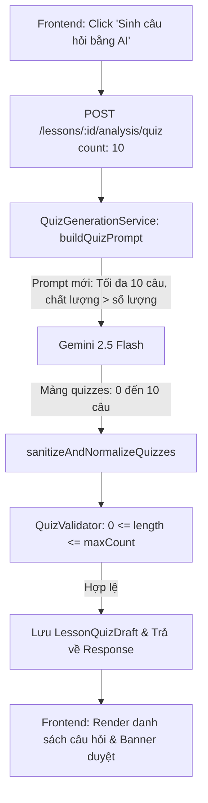

# Kế hoạch Triển khai: Tối ưu Hóa Prompt & Cơ Chế Sinh Câu Hỏi Quiz AI (Ưu Tiên Chất Lượng Hơn Số Lượng - Tối Đa 10 Câu)

> **File:** `docs/PLAN-quiz-generation-quality.md`  
> **Trạng thái:** PROPOSED / READY FOR REVIEW  
> **Agent lập kế hoạch:** `project-planner`  
> **Chuyên gia phụ trách:** `backend-specialist` & `frontend-specialist` (Skills: `clean-code`, `api-patterns`, `react-best-practices`, `tailwind-patterns`)  
> **Giao diện mục tiêu:** `http://localhost:3000/instructor/courses/[id]/lessons/[lessonId]` (Tab Câu hỏi trắc nghiệm kiểm tra - Quiz)  

---

## 1. Bối cảnh & Yêu cầu cốt lõi (User Requirements)

### 1.1. Hiện trạng hệ thống
- **Backend Prompt (`buildQuizPrompt`)**: Đang ép cứng AI phải tạo **ĐÚNG** `count` (mặc định 10) câu hỏi trắc nghiệm (`"Phải tạo ra ĐÚNG 10 câu hỏi trắc nghiệm (không thừa, không thiếu)"`).
- **Validation (`QuizValidator.validate`)**: Đang kiểm tra chặt `if (quizzes.length !== expectedCount)`, nếu AI trả về 4, 6 hay 8 câu thì hệ thống ném `422 UnprocessableEntityException` và từ chối toàn bộ kết quả.
- **Frontend UI (`lesson-quiz-tab.tsx`)**: Đang hiển thị nhãn nút bấm và mô tả cố định là `"Sinh 10 câu hỏi bằng AI"` và `"Đang sinh 10 câu hỏi AI..."`.

### 1.2. Yêu cầu nghiệp vụ mới: "Chất lượng hơn số lượng"
1. **Số lượng linh hoạt (Tối đa 10 câu)**:
   - Giới hạn trần tối đa là 10 câu hỏi, **không bắt buộc phải đủ 10 câu**.
   - Nếu transcript chỉ đủ nội dung cho 4 câu hỏi chất lượng, chỉ sinh 4 câu. Nếu có 6 câu hữu ích, sinh 6 câu. Chỉ sinh đủ 10 câu khi nội dung bài giảng thực sự phong phú.
   - Nếu nội dung bài giảng quá ngắn, đơn giản hoặc không đủ kiến thức phù hợp, sinh ít hơn hoặc thậm chí trả về 0 câu hỏi nếu cần thiết.
2. **Tiêu chí chất lượng sư phạm khắt khe**:
   - Chỉ tạo câu hỏi khi nội dung transcript chứa kiến thức quan trọng, có giá trị học tập và đủ dữ kiện xây dựng câu hỏi chất lượng.
   - Ưu tiên: kiến thức cốt lõi, khái niệm quan trọng, nguyên lý, quy trình, mối quan hệ nhân quả, sự khác biệt giữa các khái niệm, hoặc nội dung cần ghi nhớ & vận dụng.
   - Loại bỏ triệt để: thông tin vụn vặt, ít giá trị, câu hỏi chào hỏi/mở đầu râu ria, nội dung lặp lại.
   - Cấm chia nhỏ một kiến thức thành nhiều câu hỏi tương tự nhau chỉ để tăng số lượng.
   - Mỗi câu hỏi phải kiểm tra một năng lực hiểu bài có ý nghĩa riêng biệt; tránh trùng lặp ý tưởng kiểm tra hoặc mẫu câu hỏi/đáp án.
   - Mọi câu hỏi và đáp án phải căn cứ tuyệt đối từ transcript, không tự bịa (hallucinate) thông tin bên ngoài.

---

## 2. Phân tích Tác động & Kiến trúc Giải pháp

### 2.1. Backend (`backend/src/modules/transcript-analysis/`)
1. **Prompt Template (`QuizGenerationService.buildQuizPrompt`)**:
   - Viết lại toàn bộ chỉ thị sư phạm, đưa nguyên tắc *"Chất lượng hơn số lượng, tối đa 10 câu"* vào prompt tiếng Việt rõ ràng, mạch lạc, nhấn mạnh không được cố ép số lượng.
   - Hướng dẫn Gemini tự đánh giá transcript: nếu transcript chỉ đủ cho `N` câu hỏi chất lượng cao thì chỉ xuất ra `N` câu hỏi (0 <= N <= maxCount).
   - Duy trì chuẩn JSON `{ "quizzes": [...] }`, mỗi câu gồm `order`, `timestamp`, `question`, `questionType: "single"`, 4 `options` (đúng 1 `isCorrect: true`), và `explanation`.
2. **Data Sanitizer (`QuizGenerationService.sanitizeAndNormalizeQuizzes`)**:
   - Nhận mảng động từ 0 đến `maxCount` (mặc định 10). Nếu AI sinh vượt quá 10, cắt gọn về 10 (`slice(0, maxCount)`).
   - Phân bổ timestamp fallback thông minh dựa trên `list.length` thay vì chia cho số lượng cố định 10.
3. **Validator (`QuizValidator.ts`)**:
   - Thay đổi điều kiện kiểm tra:
     - Cho phép `quizzes.length` nằm trong khoảng `[0, maxCount]` (thay vì bắt buộc `quizzes.length === expectedCount`).
     - Nếu `quizzes.length === 0`: Hợp lệ (AI đánh giá transcript không đủ dữ liệu câu hỏi).
     - Nếu `quizzes.length > 0`: Tiếp tục kiểm tra nghiêm ngặt từng câu hỏi (nội dung câu hỏi, timestamp trong khoảng video, đủ 4 lựa chọn, đúng 1 đáp án `isCorrect: true`, có `explanation`).
4. **DTO & Service Logic**:
   - `GenerateQuizDto`: Giữ nguyên trường `count?: number = 10` (đóng vai trò là `maxCount`, giới hạn trần tối đa, tương thích ngược 100% với các client hiện tại).

### 2.2. Frontend (`frontend/src/features/course/components/player/tabs/lesson-quiz-tab.tsx`)
1. **Cập nhật giao diện & Text labels**:
   - Nút hành động chính:
     - Khi chưa có câu hỏi: `"Sinh câu hỏi bằng AI"` (thay vì `"Sinh 10 câu hỏi bằng AI"`).
     - Khi đã có câu hỏi: `"Sinh lại câu hỏi AI"` (thay vì `"Sinh lại 10 câu AI"`).
     - Trạng thái loading: `"Đang phân tích & tạo câu hỏi..."` (thay vì `"Đang sinh 10 câu hỏi AI..."`).
   - Tiêu đề phụ & mô tả:
     - Mô tả đầu trang: `"Bộ câu hỏi củng cố kiến thức theo mốc thời gian bài học (tối đa 10 câu hỏi trọng tâm)."`
   - Empty state description:
     - `"Nhấn nút 'Sinh câu hỏi bằng AI' để tự động tạo bộ câu hỏi chất lượng cao kèm đáp án và giải thích từ nội dung bài giảng."`
2. **Xử lý tình huống AI trả về 0 câu hỏi**:
   - Nếu AI trả về 0 câu hỏi (do transcript quá ngắn hoặc không có kiến thức trọng tâm), hiển thị thông báo toast thân thiện (`toast.info("Nội dung bài học chưa đủ dữ kiện để tạo câu hỏi kiểm tra chất lượng cao.")`) hoặc hiển thị empty state phù hợp mà không gây lỗi giao diện.

---

## 3. Kế hoạch Chi tiết các Tác vụ (Task Breakdown)

### Task 1: Cập nhật Backend Validator (`QuizValidator`)
- **File:** `backend/src/modules/transcript-analysis/validators/quiz.validator.ts`
- **Mục tiêu:** Cho phép danh sách câu hỏi dao động linh hoạt từ 0 đến `maxCount` (mặc định 10).
- **Chi tiết:**
  - Đổi tham số `expectedCount = 10` thành `maxCount = 10`.
  - Thay đoạn kiểm tra `quizzes.length !== expectedCount` thành `quizzes.length > maxCount`.
  - Bỏ qua vòng lặp kiểm tra câu hỏi nếu `quizzes.length === 0`.
  - Cập nhật test suite trong `backend/src/modules/transcript-analysis/tests/quiz.validator.spec.ts` (test case 4 câu, 6 câu, 10 câu hợp lệ, test case > 10 câu báo lỗi).

### Task 2: Cập nhật Quiz Generation Prompt & Service Logic
- **File:** `backend/src/modules/transcript-analysis/services/quiz-generation.service.ts`
- **Mục tiêu:** Đưa toàn bộ nguyên tắc sư phạm "Chất lượng hơn số lượng" vào `buildQuizPrompt` và cập nhật `sanitizeAndNormalizeQuizzes`.
- **Chi tiết:**
  - Cấu trúc prompt mới:
    - Mục tiêu: Tối đa `maxCount` câu hỏi (mặc định 10), không bắt buộc đủ 10 câu.
    - Tiêu chí đánh giá transcript và lọc kiến thức cốt lõi (khái niệm, quy trình, nhân quả, vận dụng).
    - Quy tắc cấm: không tạo câu hỏi vụn vặt, không lặp lại ý, không chia nhỏ gượng ép, không bịa thông tin ngoài transcript.
    - Quy tắc linh hoạt: 4 câu nếu chỉ có 4 ý chất lượng, 6 câu nếu có 6 ý, 10 câu khi thực sự phong phú, hoặc 0 câu nếu transcript quá sơ sài.
    - Cấu trúc JSON chuẩn tiếng Việt, `questionType: "single"`, 4 lựa chọn, 1 đáp án đúng, explanation chi tiết trích dẫn ý giảng.
  - Cập nhật `sanitizeAndNormalizeQuizzes` để hỗ trợ an toàn khi mảng rỗng `[]` hoặc số lượng câu hỏi ít hơn 10.
  - Cập nhật unit tests trong `backend/src/modules/transcript-analysis/tests/quiz-generation.service.spec.ts`.

### Task 3: Cập nhật Frontend UI (`LessonQuizTab`)
- **File:** `frontend/src/features/course/components/player/tabs/lesson-quiz-tab.tsx`
- **Mục tiêu:** Điều chỉnh các chuỗi văn bản, nút bấm và trạng thái hiển thị để phản ánh đúng logic "Tối đa 10 câu hỏi".
- **Chi tiết:**
  - Đổi label nút: `"Sinh câu hỏi bằng AI"`, `"Sinh lại câu hỏi AI"`, loading `"Đang phân tích & tạo câu hỏi..."`.
  - Đổi mô tả hướng dẫn ở header và empty state.
  - Giữ nguyên payload gọi API `{ count: 10, saveAsDraft: true }` (đóng vai trò trần tối đa 10 câu).
  - Đảm bảo banner hiển thị số lượng linh hoạt: `"Bộ ${draftDoc.quizzes.length} câu hỏi trắc nghiệm mới từ AI đang chờ duyệt"` hoạt động chuẩn xác với mọi số lượng (ví dụ: 4 câu, 6 câu, 10 câu).

### Task 4: Cập nhật Tài liệu Living Docs
- **File:** `a-agentic/features/ai-video-pipeline/dev-history.md`
- **File:** `a-agentic/features/ai-video-pipeline/rules-and-flows.md`
- **Mục tiêu:** Ghi lại thay đổi quy tắc sư phạm cho AI Quiz Generation để đảm bảo tính nhất quán của hệ thống.

---

## 4. Kế hoạch Kiểm thử & Xác minh (Verification Checklist)

| STT | Hạng mục kiểm thử | Tiêu chuẩn đạt | Kết quả |
| :--- | :--- | :--- | :--- |
| 1 | **Unit Test: `QuizValidator`** | `pnpm --filter backend test quiz.validator.spec.ts` pass 100% với danh sách 0, 4, 6, 10 câu hỏi. | Pending |
| 2 | **Unit Test: `QuizGenerationService`** | `pnpm --filter backend test quiz-generation.service.spec.ts` pass 100% với mock Gemini trả về 4 câu hoặc 10 câu. | Pending |
| 3 | **Toàn bộ Test Suite Backend** | `pnpm --filter backend test src/modules/transcript-analysis` đạt 100% pass (tối thiểu 72 tests). | Pending |
| 4 | **Lint & Type Check** | Không có lỗi TypeScript (`tsc --noEmit`), tuân thủ strict typing (không dùng `any`). | Pending |
| 5 | **Frontend Build / Check** | Không lỗi build trên giao diện Next.js, hiển thị đúng các text label mới. | Pending |
| 6 | **Kiểm thử E2E trực tiếp** | Bấm "Sinh câu hỏi bằng AI" tại bài học `6ad3918c7126d0485865d90b`: AI sinh ra số lượng câu hỏi phù hợp với chất lượng bài giảng (<= 10 câu), hiển thị mượt mà trên UI. | Pending |
