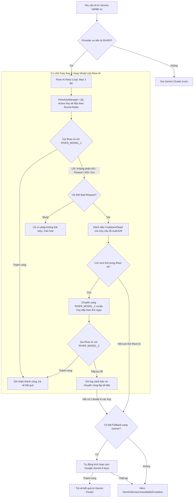

# Kế hoạch Triển khai: Cơ chế Xoay API Key & Xoay Model cho River AI

> **File:** `docs/PLAN-river-rotation.md`  
> **Trạng thái:** COMPLETED / VERIFIED  
> **Agent lập kế hoạch:** `project-planner`  
> **Chuyên gia thực hiện:** `backend-specialist` (Skills: `clean-code`, `api-patterns`, `testing-patterns`)  
> **Định hướng:** Đồng bộ cơ chế quản lý API key của River AI tương tự Google Gemini (Round-Robin, Cooldown 429/timeout, Dead 401/403, Mask logs) kết hợp cơ chế Model Fallback tự động (Model 1 -> Model 2) khi gặp sự cố, đảm bảo 100% Zero-Downtime và tương thích ngược hoàn toàn.

---

## 1. Bối cảnh & Mục tiêu

### 1.1. Thực trạng hiện tại
- Hệ thống đã tích hợp River AI (tương thích OpenAI API) như một Provider song hành cùng Google Gemini.
- River AI hiện tại chỉ cấu hình 1 API key duy nhất (`RIVER_API_KEY`) và 1 model duy nhất (`RIVER_MODEL`).
- Cụm Google Gemini đã có `GeminiKeyManager` rất hoàn thiện: xoay 6 API key theo thuật toán Round-Robin, tự động phạt Cooldown với Exponential Backoff khi chạm hạn mức 429, đánh dấu Dead khi key chết (401/403), mask key trong logs và hỗ trợ fallback sang `gemini-3.5-flash-lite`.
- Khi River AI hết hạn ngạch hoặc gặp sự cố server / timeout / rate-limit, luồng River AI sẽ lập tức fail sang Gemini mà chưa tận dụng được nhiều API key và model dự phòng nội bộ của River AI.

### 1.2. Mục tiêu kỹ thuật
1. **Quản lý đa API Key River AI**: Hỗ trợ 3 API key (`RIVER_API_KEY_1`, `RIVER_API_KEY_2`, `RIVER_API_KEY_3`) với fallback tương thích biến đơn `RIVER_API_KEY`.
2. **Xoay Key thông minh (Round-Robin & Health Check)**: Xây dựng lớp chuyên biệt `RiverKeyManager` tương tự `GeminiKeyManager`, caching OpenAI SDK client theo từng key, xử lý Cooldown (429/timeout) và Dead (401/403).
3. **Cơ chế Xoay Model (Dual Model Fallback)**: Cấu hình `RIVER_MODEL_1` (model ưu tiên, ví dụ: DeepSeek V4.1 Flash) và `RIVER_MODEL_2` (model dự phòng, ví dụ: DeepSeek V3 / model khác). Nếu Model 1 không phản hồi hoặc gặp lỗi mạng / server quá tải / timeout, hệ thống tự động đổi sang Model 2 trên key tiếp theo ngay lập tức.
4. **Mẫu cấu hình trực quan**: Cập nhật file `.env.example` với chú thích rõ ràng để lập trình viên copy sang `.env`.
5. **Đảm bảo chất lượng**: Viết unit test đạt chuẩn 100% pass cho `RiverKeyManager` và các kịch bản xoay key/model trong `GeminiService`. Bổ sung script CLI `backend/scripts/test-river.ts` để kiểm thử nhanh.

---

## 2. Kiến trúc & Sơ đồ Luồng Hoạt động



---

## 3. Quy ước Biến Môi trường (`.env` & `.env.example`)

Quy ước chuẩn theo thỏa thuận với người dùng:

```env
# ==========================================
# AI Provider Priority
# ==========================================
AI_PRIMARY_PROVIDER=RIVER

# ==========================================
# River AI Configuration (OpenAI Compatible)
# Hỗ trợ xoay vòng 3 API Key và 2 Model (Chính & Dự phòng)
# ==========================================
RIVER_BASE_URL=https://api.river.ai/v1
RIVER_TIMEOUT_MS=60000

# Mô hình River AI (Model 1 là chính, Model 2 tự động kích hoạt khi Model 1 không phản hồi)
RIVER_MODEL_1=deepseek-ai/DeepSeek-V4.1-Flash
RIVER_MODEL_2=deepseek-ai/DeepSeek-V3
# Tương thích ngược:
RIVER_MODEL=deepseek-ai/DeepSeek-V4.1-Flash

# Danh sách API Key River AI (Quản lý tự động Round-Robin, Cooldown 429 & Dead 401)
RIVER_API_KEY_1=your_river_api_key_1_here
RIVER_API_KEY_2=your_river_api_key_2_here
RIVER_API_KEY_3=your_river_api_key_3_here
# Tương thích ngược nếu chỉ cấu hình 1 key đơn:
RIVER_API_KEY=
```

---

## 4. Chi tiết Kỹ thuật Các Thành phần Cần Triển khai

### 4.1. Phase 1: Mở rộng Interfaces & Hợp đồng Dữ liệu
- **File:** `backend/src/modules/gemini/interfaces/gemini.interface.ts`
- Bổ sung các kiểu dữ liệu cho River Key Manager:
  ```typescript
  export type RiverKeyStatus = 'ACTIVE' | 'COOLDOWN' | 'DEAD';

  export interface RiverKeyMetadata {
    index: number;
    name: string;
    key: string;
    maskedKey: string;
    status: RiverKeyStatus;
    cooldownUntil: number;
    failureCount: number;
    lastUsedAt: number;
  }

  export interface IRiverKeyManager {
    getNextAvailableKey(): RiverKeyMetadata;
    markCooldown(keyIndex: number, errorMsg?: string): void;
    markDead(keyIndex: number, reason?: string): void;
    recordSuccess(keyIndex: number): void;
    isConfigured(): boolean;
    getClient(apiKey: string, baseUrl: string, timeoutMs: number): OpenAI;
  }
  ```

### 4.2. Phase 2: Xây dựng `RiverKeyManager`
- **File mới:** `backend/src/modules/gemini/river-key.manager.ts`
- **Chức năng:**
  1. Quét `RIVER_API_KEY_1`, `RIVER_API_KEY_2`, `RIVER_API_KEY_3` và fallback `RIVER_API_KEY`.
  2. Bỏ qua các placeholder (`your_`, `placeholder`, `key_thuc_te`).
  3. Mask key theo chuẩn an toàn PII: `RiverKeyManager.maskKey(key)` hiển thị `rv_abc...1234`.
  4. Thuật toán Round-Robin với tự phục hồi trạng thái sau Cooldown (30s -> 60s -> 120s -> max 300s).
  5. Quản lý Map Client Cache `Map<string, OpenAI>` để tái sử dụng connection pool theo từng key, tránh khởi tạo `new OpenAI()` liên tục.
  6. Export và khai báo Provider trong `GeminiModule`.

### 4.3. Phase 3: Cập nhật Cấu hình & Validation Joi
- **File 1:** `backend/.env.example`
  - Thêm đầy đủ chú thích tiếng Việt cho cụm biến River AI.
- **File 2:** `backend/src/config/env.validation.ts`
  - Cập nhật Joi schema cho:
    - `RIVER_MODEL_1`: `Joi.string().default('deepseek-ai/DeepSeek-V4.1-Flash')`
    - `RIVER_MODEL_2`: `Joi.string().allow('').default('deepseek-ai/DeepSeek-V3')`
    - `RIVER_API_KEY_1`: `Joi.string().allow('').default('')`
    - `RIVER_API_KEY_2`: `Joi.string().allow('').default('')`
    - `RIVER_API_KEY_3`: `Joi.string().allow('').default('')`
    - Giữ các trường cũ `RIVER_API_KEY`, `RIVER_MODEL` để tương thích.

### 4.4. Phase 4: Nâng cấp `GeminiService` với Cơ chế Xoay Key & Xoay Model
- **File:** `backend/src/modules/gemini/gemini.service.ts`
- **Nâng cấp logic:**
  1. Inject `RiverKeyManager` vào `constructor`.
  2. Đọc `riverModel1` và `riverModel2` từ ConfigService (với fallback `RIVER_MODEL` nếu model 1/2 chưa set).
  3. Thay thế hàm `callRiverAi` đơn giản thành `executeRiverAiWithRetry`:
     - Vòng lặp tối đa 3 lần thử (`maxAttempts = 3`).
     - Lần đầu tiên thử gọi với `RIVER_MODEL_1` bằng `activeKey = riverKeyManager.getNextAvailableKey()`.
     - Nếu gặp lỗi:
       - Phân loại lỗi:
         - **401/403 (Invalid Key):** `riverKeyManager.markDead(activeKey.index)`.
         - **429 (Rate Limit):** `riverKeyManager.markCooldown(activeKey.index)`.
         - **Timeout / 500 / 503 / Network / Unresponsive:** Đổi model sang `RIVER_MODEL_2` (nếu có cấu hình) và lấy active key tiếp theo thử lại ngay.
         - **400 (Bad Request):** Không retry, ném `GeminiInvalidRequestException`.
     - Khi thành công: Ghi nhận `riverKeyManager.recordSuccess(activeKey.index)`.
  4. Trả về kết quả với trường `model: riverai:${usedModel}` và `maskedKey` tương ứng của key River đang gọi, kèm cờ `isFallback` rõ ràng trong log.

### 4.5. Phase 5: Xây dựng Script CLI Test Trực tiếp
- **File mới:** `backend/scripts/test-river.ts`
  - Đọc file `.env`, nhận diện các keys `RIVER_API_KEY_1..3` và hai models `RIVER_MODEL_1`, `RIVER_MODEL_2`.
  - Cho phép chạy CLI: `pnpm tsx scripts/test-river.ts` để kiểm tra độ trễ (latency), kết nối và tính sẵn sàng của từng key cũng như model.
  - Cập nhật `package.json` thêm script `"test:river": "tsx scripts/test-river.ts"`.

### 4.6. Phase 6: Unit Testing Toàn diện
- **File 1:** `backend/src/modules/gemini/tests/river-key.manager.spec.ts`
  - Test nạp danh sách 3 keys và fallback key đơn.
  - Test xoay vòng Round-Robin qua các keys.
  - Test xử lý Cooldown và phục hồi sau khi hết thời gian.
  - Test xử lý Dead key khi gặp 401/403.
  - Test ném ngoại lệ khi tất cả các keys đều cạn kiệt.
- **File 2:** `backend/src/modules/gemini/tests/gemini.service.spec.ts`
  - Cập nhật mock cho `RiverKeyManager`.
  - Test trường hợp River Model 1 bị timeout/500 -> tự động chuyển sang River Model 2 với key tiếp theo và thành công.
  - Test trường hợp cả Model 1 và Model 2 trên toàn bộ River keys đều lỗi -> tự động fallback sang cụm Gemini.
  - Test đảm bảo `generateJson` vẫn bóc tách JSON thành công từ phản hồi của River AI Model 2.

---

## 5. Phân công Agent & Kế hoạch Thực hiện

| Bước | Hạng mục | Chuyên gia phụ trách | Kết quả đầu ra |
|---|---|---|---|
| **Step 1** | Cấu hình & Schema Validation | `backend-specialist` | `.env.example`, `env.validation.ts` |
| **Step 2** | Hợp đồng & Lớp RiverKeyManager | `backend-specialist` | `gemini.interface.ts`, `river-key.manager.ts`, `gemini.module.ts` |
| **Step 3** | Cập nhật logic Xoay Key & Xoay Model | `backend-specialist` | `gemini.service.ts` |
| **Step 4** | Script CLI kiểm thử River AI | `backend-specialist` | `scripts/test-river.ts`, `package.json` |
| **Step 5** | Bộ Unit Tests | `backend-specialist` | `river-key.manager.spec.ts`, `gemini.service.spec.ts` |
| **Step 6** | Audit & Verification | `orchestrator` / `security-auditor` | 100% test pass, masked log audit |

---

## 6. Tiêu chí Nghiệm thu (Verification Checklist)

- [ ] `.env.example` chứa đầy đủ cấu hình mẫu cho `RIVER_MODEL_1`, `RIVER_MODEL_2`, `RIVER_API_KEY_1`, `RIVER_API_KEY_2`, `RIVER_API_KEY_3`.
- [ ] `env.validation.ts` validate đầy đủ không gây lỗi khi chạy app nếu biến chưa được cấu hình.
- [ ] `RiverKeyManager` khởi tạo chính xác số lượng key khả dụng, bỏ qua placeholder.
- [ ] Khi River Model 1 bị timeout hoặc lỗi mạng, hệ thống tự động gọi sang River Model 2 với key tiếp theo.
- [ ] Khi 1 key River bị 429 hoặc 401, key đó được đưa vào Cooldown hoặc Dead, chuyển sang key còn lại.
- [ ] Không rò rỉ API key nguyên bản ra màn hình console hay file logs.
- [ ] Lệnh `pnpm --filter backend test src/modules/gemini` chạy thành công 100% tests.
- [ ] Các service cấp cao (`SummaryGenerationService`, `MindmapAnalysisService`, `QuizGenerationService`) hoạt động bình thường mà không phải thay đổi code.
