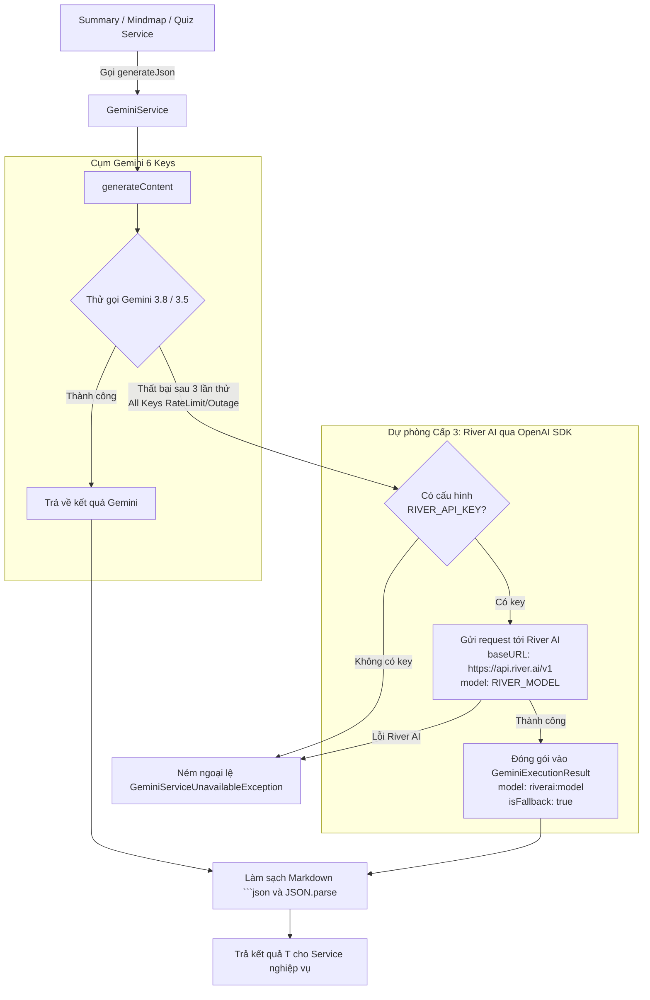

# Kế hoạch Triển khai: Tích hợp River AI Dự phòng Tối đa Tái sử dụng Luồng Gemini

> **File:** `docs/PLAN-riverai-fallback.md`  
> **Trạng thái:** COMPLETED / VERIFIED  
> **Agent lập kế hoạch:** `project-planner`  
> **Chuyên gia thực hiện:** `backend-specialist` (Skills: `clean-code`, `api-patterns`, `testing-patterns`)  
> **Nguyên tắc cốt lõi:** Tận dụng 100% luồng nghiệp vụ hiện có của Gemini, không tạo module cồng kềnh, chỉ bổ sung logic fallback cần thiết.  

---

## 1. Triết lý Thiết kế: Tái sử dụng Tối đa (DRY & Zero-Breaking Change)

1. **Giữ nguyên 100% các Service Nghiệp vụ Cấp cao**:
   - `SummaryGenerationService` (Tóm tắt bài học)
   - `MindmapAnalysisService` (Sơ đồ tư duy)
   - `QuizGenerationService` (Câu hỏi trắc nghiệm)
   - 👉 **Không sửa đổi bất kỳ dòng code nào** trong các service này! Các service vẫn tiếp tục inject `GeminiService` và gọi `this.geminiService.generateJson<T>()`.

2. **Tận dụng các bộ xử lý có sẵn trong `GeminiService`**:
   - Tái sử dụng toàn bộ hàm bóc tách Markdown code fences (````json ... ````) và `JSON.parse`.
   - Tái sử dụng cấu trúc kết quả trả về `GeminiExecutionResult<T>` (`data`, `rawText`, `model`, `executionTimeMs`, `usage`, `isFallback`).
   - Tái sử dụng cơ chế xử lý prompt, timeout và log audit.

3. **Luồng Fallback 3 Cấp Thống nhất (3-Tier Fallback Hierarchy)**:
   - **Cấp 1 (Chính):** Google Gemini `gemini-3.8-flash` qua danh sách 6 API key xoay vòng.
   - **Cấp 2 (Tạm thời khi 503):** Chuyển tức thời sang `gemini-3.5-flash-lite` khi cụm model 3.8 quá tải.
   - **Cấp 3 (Dự phòng tối thượng - MỚI):** Khi cả 3 lần thử Gemini đều thất bại (toàn bộ key cạn quota hoặc Google API sập) -> Tự động chuyển tiếp yêu cầu sang **River AI** (thông qua SDK `openai` vừa cài đặt).

---

## 2. Sơ đồ Luồng Tái Sử Dụng Nghiệp Vụ



---

## 3. Các thành phần Cần tạo & Cập nhật (Chỉ tạo cái mới)

### 3.1. Cấu hình Môi trường (`.env.example` & `env.validation.ts`)
- **File 1:** [backend/.env.example](file:///d:/Download/hk1_2027/project_do_an/backend/.env.example)
  ```env
  # ==========================================
  # River AI Configuration (Fallback Provider)
  # ==========================================
  RIVER_API_KEY=
  RIVER_BASE_URL=https://api.river.ai/v1
  RIVER_MODEL=deepseek-ai/DeepSeek-V3
  RIVER_TIMEOUT_MS=60000
  ```
- **File 2:** [backend/src/config/env.validation.ts](file:///d:/Download/hk1_2027/project_do_an/backend/src/config/env.validation.ts)
  - Thêm 4 trường validate (cho phép rỗng `allow('')`, có giá trị mặc định để app không bao giờ bị crash nếu người dùng chưa điền key).

### 3.2. Cập nhật `GeminiService` ([backend/src/modules/gemini/gemini.service.ts](file:///d:/Download/hk1_2027/project_do_an/backend/src/modules/gemini/gemini.service.ts))
- Khởi tạo `OpenAI` client từ package `openai` khi có `RIVER_API_KEY`:
  ```typescript
  import OpenAI from 'openai';
  ```
- Thêm phương thức private:
  ```typescript
  private async callRiverAiFallback(
    prompt: string,
    options?: GenerateContentOptions,
  ): Promise<GeminiExecutionResult<string>>
  ```
  - Gọi `this.riverAiClient.chat.completions.create({...})`.
  - Hỗ trợ cả `systemInstruction`, `temperature`, và JSON format.
  - Chuẩn hóa đầu ra thành `GeminiExecutionResult<string>`.
- Tại cuối vòng lặp retry của `generateContent`:
  - Trước khi ném `GeminiServiceUnavailableException`, kiểm tra:
    ```typescript
    if (this.isRiverAiEnabled()) {
      this.logger.warn('Toàn bộ key Gemini gặp sự cố. Kích hoạt fallback khẩn cấp sang River AI...');
      return await this.callRiverAiFallback(trimmedPrompt, options);
    }
    ```
- Nhờ vậy, hàm `generateJson<T>` tự động parse kết quả từ River AI mà không cần viết lại một dòng code nào!

### 3.3. Unit Test bổ sung ([backend/src/modules/gemini/tests/gemini.service.spec.ts](file:///d:/Download/hk1_2027/project_do_an/backend/src/modules/gemini/tests/gemini.service.spec.ts))
- Thêm kịch bản test:
  1. Khi Gemini 3.8 và 3.5 đều lỗi qua cả 3 lần thử -> Tự động gọi sang OpenAI client (River AI).
  2. Kết quả trả về từ River AI được `generateJson` làm sạch và parse thành công.
  3. Khi không cấu hình `RIVER_API_KEY`, hành vi cũ vẫn ném `GeminiServiceUnavailableException`.

---

## 4. Kế hoạch Thực hiện Chi tiết (Phân bước)

- [ ] **Bước 1:** Bổ sung cấu hình vào `backend/.env.example` và `backend/src/config/env.validation.ts`.
- [ ] **Bước 2:** Cập nhật `GeminiService` để khởi tạo OpenAI client trỏ vào River AI và tích hợp hàm `callRiverAiFallback`.
- [ ] **Bước 3:** Cập nhật `backend/src/modules/gemini/tests/gemini.service.spec.ts` với test case fallback River AI.
- [ ] **Bước 4:** Chạy toàn bộ test suite của module `gemini` và `transcript-analysis` để đảm bảo 100% PASS.
  ```bash
  pnpm --filter backend test
  ```

---

## 5. Danh sách Kiểm định Nghiệp vụ (Acceptance Criteria)

1. **Tính tương thích ngược (Backward Compatibility):** Khi không có `RIVER_API_KEY`, hệ thống chạy Gemini như bình thường, không sinh lỗi.
2. **Kích hoạt tự động:** Khi có `RIVER_API_KEY` và Gemini bị lỗi cạn quota/sập mạng, request không bị chết mà chuyển sang River AI và trả về kết quả hợp lệ cho UI.
3. **Độ sạch của Code:** Không tạo thừa thãi các module hay file DTO trùng lặp, tái sử dụng 100% flow của `GeminiService`.
