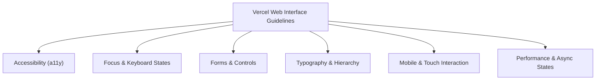

# Plan: Tích hợp và Cài đặt Web Design Guidelines Skill (`web-design-guidelines`) từ Vercel Labs

> **Trạng thái**: Completed (Đã hoàn tất cài đặt, tích hợp tooling và kiểm thử)  
> **Tác giả**: `project-planner`  
> **Mã nguồn gốc**: [vercel-labs/agent-skills/skills/web-design-guidelines](https://github.com/vercel-labs/agent-skills/tree/main/skills/web-design-guidelines)  
> **Quy chuẩn gốc**: [vercel-labs/web-interface-guidelines](https://github.com/vercel-labs/web-interface-guidelines)  
> **File kế hoạch**: `docs/PLAN-web-design-guidelines.md`  

---

## 1. Tổng quan & Khảo sát chuyên sâu về Web Design Guidelines

### 1.1 Web Design Guidelines là gì?
**Web Design Guidelines (`web-design-guidelines`)** là một Agent Skill chính thức phát triển bởi **Vercel Labs**, được thiết kế để biến AI coding assistant thành một chuyên gia kiểm định giao diện người dùng (UI Auditor) theo các chuẩn mực nghiêm ngặt của Vercel Web Interface Guidelines.

Kỹ năng này hoạt động như một **Quality Gate sau khi code (Post-implementation UI Audit)**, rà soát mã nguồn giao diện (React / Next.js / HTML) và đưa ra danh sách vi phạm ở định dạng súc tích `file:line: issue`.

### 1.2 Phân tích cốt lõi các nhóm quy chuẩn (Vercel Guidelines)

1. **Accessibility (Truy cập tiện ích - a11y)**:
   - Các nút chỉ có icon (Icon-only buttons) bắt buộc phải có `aria-label`.
   - Điều khiển form (Input, Select, Switch) bắt buộc có `<label>` liên kết hoặc `aria-label`.
   - Dùng đúng thẻ ngữ nghĩa (`<button>` cho hành động, `<a>`/`<Link>` cho điều hướng), tuyệt đối cấm `
`.
   - Ảnh bắt buộc có thuộc tính `alt` (hoặc `alt=""` nếu là ảnh trang trí).
   - Icon trang trí thuần túy bắt buộc có `aria-hidden="true"`.
   - Thông báo bất đồng bộ (Toasts, Banner validate) phải kèm `aria-live="polite"`.

2. **Focus States & Keyboard Handlers**:
   - Tất cả tương tác click đều phải có handler bàn phím tương ứng (`onKeyDown`/`onKeyUp` cho Space/Enter).
   - Không được tắt focus ring (`outline: none`) mà không có style focus thay thế rõ ràng.
   - Quản lý tiêu điểm (Focus trap) trong Modal, Sheet, Dialog khi mở/đóng.

3. **Typography & Layout Hierarchy**:
   - Phân cấp tiêu đề nghiêm ngặt: Một `<h1>` duy nhất, tiếp đến `<h2>` -> `<h6>` không nhảy cóc cấp độ.
   - Anchor heading có `scroll-margin-top` để không bị Header che khuất.
   - Bố cục responsive không bị tràn ngang (Horizontal overflow ban).

4. **Touch & Mobile Targets**:
   - Vùng cảm ứng tối thiểu 44×44px cho mọi nút bấm/liên kết trên thiết bị di động.
   - Hiệu ứng `:hover` không được để bị "kẹt" lại trên màn hình cảm ứng di động.

---

### 1.3 Khảo sát hiện trạng trong Workspace

| Tiêu chí | Trạng thái hiện tại | Đánh giá & Khoảng cách |
| :--- | :--- | :--- |
| **Thư mục `.agent/skills/`** | Đã cài đặt hoàn chỉnh `web-design-guidelines/SKILL.md` và script `scripts/audit-ui.mjs` | ✅ Hoàn thành |
| **Thư mục `.agents/skills/`** | Đã đồng bộ sang `.agents/skills/` cho Antigravity IDE | ✅ Hoàn thành |
| **Bộ quy tắc gốc (Rules file)** | Skill fetch online trực tiếp từ URL GitHub Raw Vercel | ✅ Hoàn thành (chuẩn Vercel) |
| **Audit Automation Script** | Đã có `scripts/audit-ui.mjs` tích hợp lệnh `pnpm audit:ui` | ✅ Hoàn thành |
| **Tương thích Stack Dự án** | Dự án dùng Next.js 16 App Router, React 19, Tailwind CSS, Shadcn UI | ✅ Hoàn thành |

---

## 2. Kế hoạch triển khai chi tiết (Task Breakdown)

### Giai đoạn 1: Chuẩn bị & Đồng bộ Skill vào Workspace
- [x] **Task 1.1**: Tạo và cập nhật cấu trúc thư mục skill:
  - `.agent/skills/web-design-guidelines/`
  - `.agents/skills/web-design-guidelines/` (Workspace Customizations Root của Antigravity)
- [x] **Task 1.2**: Đồng bộ `SKILL.md` chuẩn hóa từ repository `vercel-labs/agent-skills`:
  - Khai báo YAML frontmatter chuẩn (`name`, `description`, `metadata`).
  - Sử dụng cơ chế fetch động URL online của GitHub (`https://raw.githubusercontent.com/vercel-labs/web-interface-guidelines/main/command.md`) theo chuẩn gốc Vercel Labs.
  - Hướng dẫn các bước rà soát mã nguồn và xuất kết quả `file:line`.

### Giai đoạn 2: Tích hợp với Hệ sinh thái Dự án & Tooling
- [x] **Task 2.1**: Tích hợp với Agent `frontend-specialist`:
  - Khai báo bổ sung `web-design-guidelines` vào frontmatter `skills` của `.agent/agents/frontend-specialist.md`.
  - Kết hợp với `design-taste-frontend` / `taste-skill`: `taste-skill` định hình phong cách trước khi code, `web-design-guidelines` kiểm soát a11y và chuẩn mực giao diện sau khi code.
- [x] **Task 2.2**: Xây dựng script kiểm tra tự động nhanh `scripts/audit-ui.mjs`:
  - Quét tự động các file `.tsx` trong `frontend/src/`.
  - Phát hiện nhanh các vi phạm phổ biến: `<button>` thiếu `aria-label` khi chỉ chứa icon, `
` thay vì thẻ `<button>`, `` thiếu `alt`, interactive element thiếu keyboard listeners.
- [x] **Task 2.3**: Đăng ký lệnh `pnpm audit:ui` vào `frontend/package.json` và root `package.json` để chạy audit tự động thuận tiện.

### Giai đoạn 3: Kiểm thử & Nghiệm thu
- [x] **Task 3.1**: Kiểm tra khả năng fetch online guidelines từ GitHub raw URL (thành công).
- [x] **Task 3.2**: Chạy thử nghiệm script `audit-ui.mjs` trên 203 file trong `frontend/src/` (thành công, phát hiện 62 điểm lưu ý a11y/style).
- [x] **Task 3.3**: Thử nghiệm tích hợp và kiểm tra `pnpm audit:ui` từ root monorepo (thành công).

---

## 3. Quyết định của người dùng (Socratic Gate)

1. **Cơ chế tải bộ quy tắc**: Sử dụng URL online chính thức của GitHub (`https://raw.githubusercontent.com/vercel-labs/web-interface-guidelines/main/command.md`) để luôn cập nhật các nguyên tắc mới nhất từ Vercel Labs theo đúng thiết kế nguyên bản.
2. **Vị trí cài đặt**: Cài đặt đồng bộ vào cả 2 vị trí:
   - `.agent/skills/web-design-guidelines/`
   - `.agents/skills/web-design-guidelines/` (Workspace Customizations Root)
3. **Bộ công cụ bổ trợ**: Bổ sung thêm script `scripts/audit-ui.mjs` để kiểm tra tĩnh tự động (static linter) các lỗi a11y và cú pháp phổ biến trong `frontend/` trước khi tiến hành AI review.

