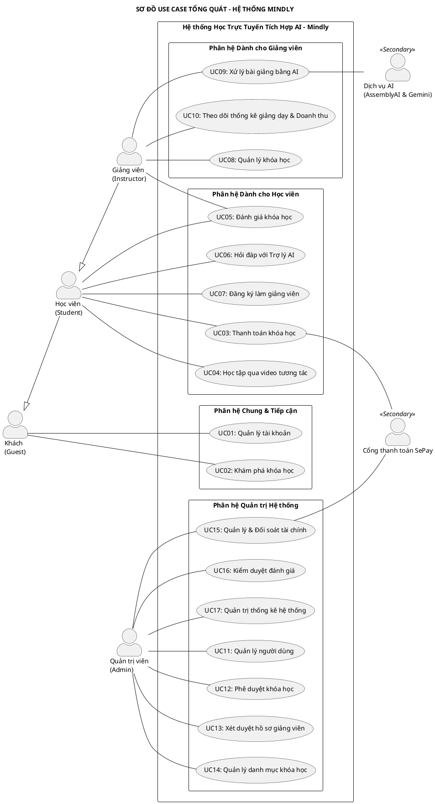

# TÀI LIỆU ĐẶC TẢ USE CASE TỔNG QUÁT (OVERALL USE CASE SPECIFICATION)
## HỆ THỐNG HỌC TRỰC TUYẾN TÍCH HỢP AI – MINDLY
*Tài liệu phục vụ Báo cáo Đồ án tốt nghiệp ngành Kỹ thuật Phần mềm / Công nghệ Thông tin*

---

## 1. Giới thiệu sơ đồ Use Case tổng quát

Sơ đồ Use Case tổng quát (Overall Use Case Diagram) đóng vai trò là bản đồ kiến trúc chức năng cấp cao nhất của hệ thống học trực tuyến **Mindly**. Mục đích của sơ đồ này bao gồm:
1. **Xác định ranh giới hệ thống (System Boundary)**: Phân định rõ ràng những gì thuộc phạm vi giải quyết của nền tảng Mindly và những thành phần nằm ngoài hệ thống.
2. **Nhận diện đầy đủ các tác nhân (Actors)**: Bao gồm cả người dùng trực tiếp (khách vãng lai, học viên, giảng viên, quản trị viên) và các hệ thống bên ngoài có tích hợp nghiệp vụ tự động (Cổng thanh toán SePay, Dịch vụ AI đám mây).
3. **Mô hình hóa các mục tiêu nghiệp vụ chính (Core Business Goals)**: Gom nhóm các chức năng có cùng mục đích nghiệp vụ thành các ca sử dụng cấp cao (High-Level Use Cases), không sa đà vào các thao tác CRUD vụn vặt hoặc chức năng con cấp giao diện.
4. **Chuẩn hóa các mối quan hệ tương tác**: Thể hiện trực quan mối liên kết liên kết (Association), quan hệ kế thừa giữa các tác nhân (Actor Generalization) và sự tương tác đa chiều giữa hệ thống với các dịch vụ bên ngoài.

Toàn bộ nội dung trong tài liệu này được trích xuất và đối chiếu trực tiếp từ hiện trạng mã nguồn thực tế của dự án Mindly (Backend NestJS 11, Frontend Next.js 16 App Router, hệ thống xử lý hàng đợi RabbitMQ và các dịch vụ tích hợp bên ngoài).

---

## 2. Danh sách các Actor (Tác nhân)

Căn cứ vào mã nguồn phân quyền (`RoleEnum` tại `share-lib/src/enums/role.enum.ts`, các Guards và các Controllers thực tế), hệ thống Mindly gồm có **4 tác nhân người dùng (Primary Actors)** và **2 tác nhân hệ thống bên ngoài (Secondary / Supporting Actors)**:

| STT | Actor | Phân loại | Mô tả vai trò và phạm vi tương tác |
|:---:|:---|:---:|:---|
| 1 | **Khách**<br>*(Guest)* | Con người<br>*(Primary)* | Người dùng vãng lai chưa đăng nhập hệ thống. Tương tác với các chức năng công khai: duyệt danh mục, tìm kiếm khóa học, xem chi tiết và đề cương bài học, xem trước video học thử, thực hiện đăng ký tài khoản mới hoặc đăng nhập. |
| 2 | **Học viên**<br>*(Student)* | Con người<br>*(Primary)* | Người dùng đã đăng nhập với vai trò `STUDENT`. Kế thừa toàn bộ quyền của Khách, đồng thời có thể: quản lý tài khoản cá nhân, mua khóa học qua VietQR, tham gia học qua video đa tương tác (trả lời In-video Quiz, xem Mindmap bài giảng, lưu tiến độ học tập), gửi đánh giá khóa học, tương tác với Trợ lý AI và nộp hồ sơ đăng ký trở thành giảng viên. |
| 3 | **Giảng viên**<br>*(Instructor)* | Con người<br>*(Primary)* | Người dùng đã được cấp quyền `INSTRUCTOR`. Kế thừa các quyền cơ bản của Học viên (có thể tham gia học các khóa học khác), đồng thời sở hữu không gian làm việc chuyên biệt để: tạo và quản lý nội dung khóa học/chương/bài học, tải video bài giảng để hệ thống kích hoạt AI phân tích, tinh chỉnh câu hỏi Quiz và Mindmap do AI sinh ra, phản hồi đánh giá của học viên và theo dõi thống kê doanh thu giảng dạy cá nhân. |
| 4 | **Quản trị viên**<br>*(Administrator)* | Con người<br>*(Primary)* | Người dùng sở hữu vai trò quản trị tối cao `ADMIN`. Quản trị toàn bộ nền tảng: quản lý tài khoản người dùng và phân quyền, phê duyệt hoặc từ chối khóa học của giảng viên, thẩm định hồ sơ ứng viên giảng viên, quản lý danh mục khóa học, đối soát dòng tiền giao dịch SePay, kiểm duyệt đánh giá và theo dõi bảng điều khiển thống kê tổng quan toàn hệ thống. |
| 5 | **Cổng thanh toán SePay**<br>*(Payment Gateway)* | Hệ thống ngoại vi<br>*(Secondary)* | Hệ thống tài chính ngân hàng bên ngoài kết nối qua SePay. Tự động gửi tín hiệu Webhook xác nhận biến động số dư chuyển khoản VietQR để Mindly xác thực và kích hoạt ghi danh khóa học tức thời. |
| 6 | **Dịch vụ AI bên ngoài**<br>*(AssemblyAI & Gemini API)* | Hệ thống ngoại vi<br>*(Secondary)* | Nền tảng trí tuệ nhân tạo đám mây nhận lệnh xử lý bất đồng bộ từ Mindly: AssemblyAI thực hiện chuyển giọng nói trong video bài giảng thành văn bản (Speech-to-Text có mốc thời gian), Google Gemini LLM phân tích transcript để sinh sơ đồ tư duy (Mindmap Markdown) và bộ câu hỏi trắc nghiệm dừng video. |

> **Nguyên tắc Kế thừa Tác nhân (Actor Generalization) trong UML:**
> - `Khách` *(Guest)* $\leftarrow$ kế thừa bởi $\leftarrow$ `Học viên` *(Student)*: Mọi chức năng Khách tiếp cận được thì Học viên đều có thể thực hiện.
> - `Học viên` *(Student)* $\leftarrow$ kế thừa bởi $\leftarrow$ `Giảng viên` *(Instructor)*: Giảng viên xuất phát từ một người dùng trong hệ thống, có thể học khóa học và có thêm thẩm quyền tác quyền khóa học của mình.
> - `Quản trị viên` *(Administrator)* hoạt động độc lập ở phân tầng quản trị back-office để đảm bảo tính an toàn và minh bạch dữ liệu.

---

## 3. Danh sách Use Case tổng quát

Mỗi Use Case cấp cao dưới đây đại diện cho một nhóm nghiệp vụ hoàn chỉnh nhằm đạt được mục tiêu cụ thể của tác nhân. Tuyệt đối không phân rã thành các thao tác CRUD riêng lẻ.

| STT | Mã Use Case | Tên Use Case | Actor tham gia | Mô tả ngắn gọn mục tiêu nghiệp vụ |
|:---:|:---:|:---|:---|:---|
| 1 | **UC01** | **Quản lý tài khoản** | Khách, Học viên, Giảng viên, Quản trị viên | Đăng ký, đăng nhập hệ thống, xác thực email, khôi phục mật khẩu và cập nhật thông tin hồ sơ cá nhân/bảo mật. |
| 2 | **UC02** | **Khám phá khóa học** | Khách, Học viên | Tìm kiếm, lọc theo tiêu chí, xem thông tin chi tiết khóa học, đề cương bài giảng và xem video học thử miễn phí. |
| 3 | **UC03** | **Thanh toán khóa học** | Học viên, Cổng thanh toán SePay | Khởi tạo đơn hàng, thanh toán tự động qua mã VietQR và nhận kích hoạt ghi danh khóa học tức thì thông qua Webhook. |
| 4 | **UC04** | **Học tập qua video tương tác** | Học viên | Xem video bài giảng, tương tác trả lời câu hỏi trắc nghiệm dừng video (In-video Quiz), xem sơ đồ tư duy Mindmap song hành và tự động đồng bộ tiến độ học. |
| 5 | **UC05** | **Đánh giá khóa học** | Học viên, Giảng viên | Học viên gửi chấm điểm và nhận xét cho khóa học đã hoàn thành; Giảng viên xem và phản hồi các đánh giá của học viên. |
| 6 | **UC06** | **Hỏi đáp với Trợ lý AI** | Học viên | Trò chuyện trực tiếp với Chatbot AI thông minh để giải đáp thắc mắc nội dung bài giảng và định hướng lộ trình học tập. |
| 7 | **UC07** | **Đăng ký làm giảng viên** | Học viên | Nộp hồ sơ thông tin năng lực, chấp thuận điều khoản để xin xét duyệt quyền trở thành giảng viên trên nền tảng. |
| 8 | **UC08** | **Quản lý khóa học** | Giảng viên | Xây dựng, cập nhật cấu trúc chương mục, bài giảng, tài liệu đính kèm và gửi yêu cầu phê duyệt xuất bản khóa học. |
| 9 | **UC09** | **Xử lý bài giảng bằng AI** | Giảng viên, Dịch vụ AI bên ngoài | Tải video bài giảng lên để AI tự động bóc băng âm thanh, tạo sơ đồ tư duy và bộ câu hỏi trắc nghiệm; kiểm tra và tinh chỉnh kết quả AI sinh ra. |
| 10 | **UC10** | **Theo dõi thống kê giảng dạy & Doanh thu** | Giảng viên | Xem báo cáo doanh thu khóa học, tỷ lệ hoa hồng, số lượng học viên ghi danh và các chỉ số tăng trưởng giảng dạy cá nhân. |
| 11 | **UC11** | **Quản lý người dùng** | Quản trị viên | Quản lý danh sách người dùng, cấp phát hoặc thu hồi quyền hạn, khóa hoặc mở khóa tài khoản và tra cứu lịch sử hoạt động. |
| 12 | **UC12** | **Phê duyệt khóa học** | Quản trị viên | Kiểm duyệt nội dung, đối chiếu tiêu chuẩn chất lượng khóa học và quyết định chấp thuận xuất bản hoặc từ chối kèm lý do. |
| 13 | **UC13** | **Xét duyệt hồ sơ giảng viên** | Quản trị viên | Thẩm định các hồ sơ đăng ký làm giảng viên, phê duyệt hoặc từ chối cấp quyền và cập nhật chính sách điều khoản giảng viên. |
| 14 | **UC14** | **Quản lý danh mục khóa học** | Quản trị viên | Thiết lập và quản lý cấu trúc cây phân loại danh mục, thể loại và thẻ chủ đề cho toàn bộ khóa học trên hệ thống. |
| 15 | **UC15** | **Quản lý & Đối soát tài chính** | Quản trị viên, Cổng thanh toán SePay | Theo dõi toàn bộ lịch sử đơn hàng, đối soát các giao dịch thanh toán ngân hàng qua SePay và xử lý ngoại lệ giao dịch. |
| 16 | **UC16** | **Kiểm duyệt đánh giá** | Quản trị viên | Giám sát chất lượng bình luận, ẩn hoặc xóa các đánh giá tiêu cực, vi phạm chính sách hoặc mang tính chất công kích. |
| 17 | **UC17** | **Quản trị thống kê hệ thống** | Quản trị viên | Theo dõi bảng điều khiển (Dashboard) phân tích doanh thu toàn sàn, số liệu tăng trưởng người dùng, xếp hạng giảng viên và khóa học nổi bật. |

---

## 4. Sơ đồ Use Case tổng quát (Overall Use Case Diagram)

### 4.1. Sơ đồ biểu diễn trực quan (Mermaid Diagram)

Sơ đồ dưới đây được chuẩn hóa theo UML: thể hiện ranh giới hệ thống Mindly, các tác nhân chính - phụ, quan hệ kế thừa giữa các tác nhân và đường liên kết (Association) tới các Use Case cấp cao tương ứng.

```mermaid
flowchart LR
    %% =======================================================
    %% ACTORS DEFINITION
    %% =======================================================
    Guest["👤 Khách (Guest)"]
    Student["🎓 Học viên (Student)"]
    Instructor["👨‍🏫 Giảng viên (Instructor)"]
    Admin["👑 Quản trị viên (Admin)"]
    
    SePay[("🏦 Cổng thanh toán SePay<br>«Secondary Actor»")]
    AIServices[("🤖 Dịch vụ AI (AssemblyAI + Gemini)<br>«Secondary Actor»")]

    %% Actor Generalization
    Guest <|-- Student
    Student <|-- Instructor

    %% =======================================================
    %% SYSTEM BOUNDARY: MINDLY PLATFORM
    %% =======================================================
    subgraph MindlySystem ["HỆ THỐNG HỌC TRỰC TUYẾN TÍCH HỢP AI - MINDLY"]
        
        %% Nhóm 1: Tài khoản & Khám phá
        subgraph Sub_Common ["Phân hệ Chung & Tiếp cận"]
            UC01(["UC01: Quản lý tài khoản"])
            UC02(["UC02: Khám phá khóa học"])
        end

        %% Nhóm 2: Không gian Học tập & Tương tác
        subgraph Sub_Learning ["Phân hệ Dành cho Học viên"]
            UC03(["UC03: Thanh toán khóa học"])
            UC04(["UC04: Học tập qua video tương tác"])
            UC05(["UC05: Đánh giá khóa học"])
            UC06(["UC06: Hỏi đáp với Trợ lý AI"])
            UC07(["UC07: Đăng ký làm giảng viên"])
        end

        %% Nhóm 3: Giảng dạy & Xử lý AI
        subgraph Sub_Teaching ["Phân hệ Dành cho Giảng viên"]
            UC08(["UC08: Quản lý khóa học"])
            UC09(["UC09: Xử lý bài giảng bằng AI"])
            UC10(["UC10: Theo dõi thống kê giảng dạy & Doanh thu"])
        end

        %% Nhóm 4: Quản trị Vận hành
        subgraph Sub_Admin ["Phân hệ Quản trị Hệ thống"]
            UC11(["UC11: Quản lý người dùng"])
            UC12(["UC12: Phê duyệt khóa học"])
            UC13(["UC13: Xét duyệt hồ sơ giảng viên"])
            UC14(["UC14: Quản lý danh mục khóa học"])
            UC15(["UC15: Quản lý & Đối soát tài chính"])
            UC16(["UC16: Kiểm duyệt đánh giá"])
            UC17(["UC17: Quản trị thống kê hệ thống"])
        end

    end

    %% =======================================================
    %% ASSOCIATIONS (Actor - Use Case Connections)
    %% =======================================================
    
    %% Khách (Guest)
    Guest --- UC01
    Guest --- UC02

    %% Học viên (Student)
    Student --- UC03
    Student --- UC04
    Student --- UC05
    Student --- UC06
    Student --- UC07

    %% Giảng viên (Instructor)
    Instructor --- UC05
    Instructor --- UC08
    Instructor --- UC09
    Instructor --- UC10

    %% Quản trị viên (Admin)
    Admin --- UC11
    Admin --- UC12
    Admin --- UC13
    Admin --- UC14
    Admin --- UC15
    Admin --- UC16
    Admin --- UC17

    %% Dịch vụ bên ngoài (Secondary Actors)
    UC03 --- SePay
    UC15 --- SePay
    UC09 --- AIServices
```

---

### 4.2. Mã nguồn PlantUML (Dùng vẽ báo cáo trên StarUML / PlantUML / Word)

Sinh viên có thể sao chép đoạn mã PlantUML chuẩn hóa dưới đây để kết xuất hình ảnh chất lượng cao chèn trực tiếp vào báo cáo thuyết minh đồ án tốt nghiệp:



---

## 5. Bảng kiểm chứng Use Case với Hiện trạng Source Code (Traceability Matrix)

Nhằm đảm bảo tính khoa học và minh bạch, bảng đối chiếu dưới đây chứng minh mọi Use Case cấp cao đều có căn cứ triển khai thực tế trong mã nguồn dự án:

| Mã UC | Tên Use Case cấp cao | Phân hệ Backend (Controllers & Services) | Đường dẫn Frontend (Pages & Features) | Bằng chứng xác thực từ Source Code |
|:---:|:---|:---|:---|:---|
| **UC01** | Quản lý tài khoản | `auth/`, `user/`, `profile/` | `app/(auth)/login`, `app/(auth)/register`, `app/profile`, `app/settings` | `AuthController`, `UserController`, `PublicProfileController`. Đầy đủ logic JWT, reset mật khẩu, cập nhật profile. |
| **UC02** | Khám phá khóa học | `course/`, `course-category/` | `app/courses`, `app/courses/[courseId]` | `CourseController.findPublicCourses`, `CourseCategoryController`. Public API tìm kiếm, lọc, xem trước bài học. |
| **UC03** | Thanh toán khóa học | `payment/`, `enrollment/` | `app/checkout`, `app/checkout/[orderCode]` | `PaymentController.createOrder`, `sepayWebhook`, `EnrollmentController`. Giao dịch VietQR tự động qua SePay. |
| **UC04** | Học tập qua video tương tác | `learning-progress/`, `course/` | `app/courses/[courseId]/learn` | `LearningProgressController`, `LessonQuizController` (In-video Quiz), `CourseMindmapController` (Markmap). |
| **UC05** | Đánh giá khóa học | `review/` | `features/review/`, `app/courses/[courseId]` | `ReviewController.createReview`, `ReviewController.replyReview`. Học viên gửi sao/nhận xét, giảng viên phản hồi. |
| **UC06** | Hỏi đáp với Trợ lý AI | `chatbot/` | `features/chatbot/` | `ChatbotController.createMessage`, `ChatbotMessageService`. Kết nối AI giải đáp thắc mắc người học có Rate Limit. |
| **UC07** | Đăng ký làm giảng viên | `instructor-application/` | `app/become-instructor` | `InstructorApplicationUserController.apply`, `getTerms`, `getMyApplication`. Nộp hồ sơ và điều khoản giảng viên. |
| **UC08** | Quản lý khóa học | `course/` | `app/instructor/courses`, `app/instructor/courses/[id]` | `CourseController`, `LessonController`, `CourseApprovalController.requestApproval`. Soạn thảo chương/bài và gửi duyệt. |
| **UC09** | Xử lý bài giảng bằng AI | `transcript-analysis/`, `jobs/`, `assemblyai/`, `gemini/` | `app/instructor/courses/[id]/lessons/[lessonId]` | `AnalysisJobsController`, `TranscriptAnalysisController`, RabbitMQ Consumer. Xử lý bóc băng STT, sinh Quiz & Mindmap. |
| **UC10** | Theo dõi thống kê giảng dạy & Doanh thu | `payment/` | `app/instructor/statistics` | `InstructorTeachingStatsController`, `RevenueController`. Thống kê doanh thu, tỷ lệ hoa hồng và lượt học viên. |
| **UC11** | Quản lý người dùng | `admin-users/`, `user/` | `app/(admin)/admin/users`, `app/(admin)/admin/users/[userId]` | `AdminUserCoursesController`, `UserController`. Phân quyền, cập nhật trạng thái `ACTIVE`/`BLOCKED`, xem chi tiết người dùng. |
| **UC12** | Phê duyệt khóa học | `course/` | `app/(admin)/admin/courses` | `CourseController.approveCourse`, `CourseController.rejectCourse`. Kiểm duyệt danh sách khóa học chờ xuất bản. |
| **UC13** | Xét duyệt hồ sơ giảng viên | `instructor-application/` | `app/(admin)/admin/instructors` | `InstructorApplicationController`, `InstructorTermsController`. Phê duyệt ứng viên và điều chỉnh nội dung điều khoản. |
| **UC14** | Quản lý danh mục khóa học | `course/course-category` | `app/(admin)/admin/categories` | `CourseCategoryController`. Quản lý cấu trúc danh mục phân loại bài học toàn hệ thống. |
| **UC15** | Quản lý & Đối soát tài chính | `payment/` | `app/(admin)/admin/revenue` | `PaymentController.queryReconciliations`, `resolvePayment`, `reprocessPayment`. Quản lý dòng tiền SePay và tra soát đơn hàng. |
| **UC16** | Kiểm duyệt đánh giá | `review/` | `app/(admin)/admin/reviews` | `ReviewController.adminGetReviews`, `hideReview`, `restoreReview`, `adminDeleteReview`. Xử lý các phản hồi vi phạm quy chuẩn. |
| **UC17** | Quản trị thống kê hệ thống | `admin-dashboard/` | `app/(admin)/admin/dashboard` | `AdminDashboardController.getAggregate`, `getChart`, `getCoursesPerformance`, `getInstructorsRanking`. Báo cáo tổng thể toàn sàn. |

---

## 6. Kết luận & Tự rà soát tính chuẩn xác (Self-Review Report)

Theo nguyên tắc kiểm định tài liệu kỹ thuật đồ án tốt nghiệp:

1. **Về tính đầy đủ và chính xác của Tác nhân (Actors)**:
   - Xác định chính xác 4 tác nhân con người tương ứng với các phân quyền thực tế trong mã nguồn (`Guest`, `RoleEnum.STUDENT`, `RoleEnum.INSTRUCTOR`, `RoleEnum.ADMIN`).
   - Nhận diện đúng 2 tác nhân ngoại vi có tương tác hai chiều trực tiếp với hệ thống (`Cổng SePay` qua Webhook và `Dịch vụ AI` qua API bất đồng bộ).
2. **Về tính tổng quát của Use Case (High-Level Abstraction)**:
   - Đã gom nhóm toàn bộ các thao tác nghiệp vụ liên quan vào 17 Use Case cấp cao.
   - Tuyệt đối loại bỏ việc liệt kê chi tiết các hành động con (như thêm/sửa/xóa bài học, đổi mật khẩu, đăng tải ảnh đại diện).
3. **Về tính thực tế và nguồn gốc chức năng**:
   - 100% Use Case được liệt kê đều có Controller, Service, DTO và Giao diện đang hoạt động trong dự án.
   - Các chức năng chưa có Backend hoàn chỉnh (ví dụ: quản lý mã khuyến mãi/promotions) đã được lược bỏ khỏi sơ đồ tổng quát theo đúng yêu cầu kiểm định thực tế.
4. **Về chuẩn UML**:
   - Sử dụng đúng quan hệ `Association` (Actor - Use Case) và `Generalization` (Kế thừa vai trò giữa các Actor).
   - Bố cục sơ đồ phân tách rõ ràng theo ranh giới hệ thống (System Boundary) và các gói phân hệ, đảm bảo không có đường liên kết chồng chéo, dễ dàng đưa vào báo cáo và slide bảo vệ đồ án.
