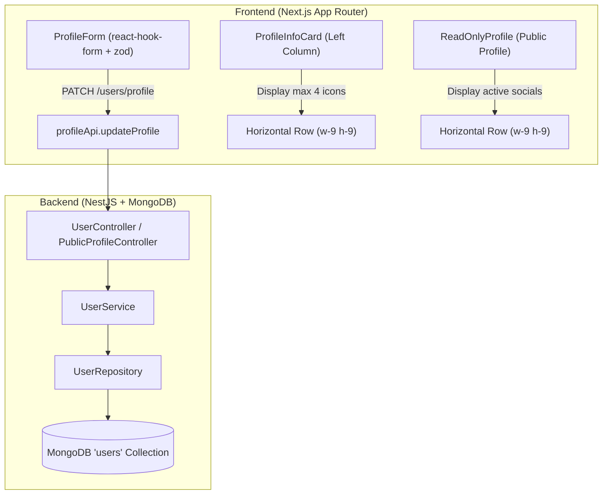

# Kế hoạch Triển khai: Phần "Liên kết trực tuyến" trên Hồ sơ Cá nhân Mindly

> **Mục tiêu**: Bổ sung tính năng liên kết mạng xã hội (Facebook, LinkedIn, YouTube, GitHub) vào trang hồ sơ cá nhân (`/profile`) và trang hồ sơ công khai (`/profile/[username]`), cho phép người dùng cấu hình đường dẫn mạng xã hội, tự động ẩn các kênh để trống, và hiển thị tối đa 4 nút icon vuông (`w-9 h-9`) xếp thành 1 hàng ngang căn giữa ở cột thông tin bên trái.

---

## 1. Phân Tích Hiện Trạng & Yêu Cầu

### Yêu cầu người dùng (dựa trên ảnh thiết kế & mô tả):
1. **Cột phải (Form Thông tin cá nhân - `ProfileForm`)**:
   - Thêm section **"Liên kết trực tuyến"** bên dưới ô "Giới thiệu bản thân".
   - Bao gồm 4 trường tương ứng:
     - **Facebook**: Icon Facebook màu xanh thương hiệu, placeholder `facebook.com/`, nút xóa nhanh (x) khi có giá trị.
     - **LinkedIn**: Icon LinkedIn màu xanh thương hiệu, placeholder `linkedin.com/in/`, nút xóa nhanh (x) khi có giá trị.
     - **YouTube**: Icon YouTube màu đỏ thương hiệu, placeholder `youtube.com/`, nút xóa nhanh (x) khi có giá trị.
     - **GitHub**: Icon GitHub màu đen/trắng, placeholder `github.com/`, nút xóa nhanh (x) khi có giá trị.
   - Thao tác: Kênh nào có link thì dán vào ô đó, kênh nào để trống thì không hiển thị.
   - Các nút **Đặt lại** và **Lưu thay đổi** tích hợp mượt mà với form state (`react-hook-form` + `isDirty`).

2. **Cột trái (Thẻ thông tin cá nhân - `ProfileInfoCard` & `ReadOnlyProfile`)**:
   - Nằm ngay dưới nút **Sao chép liên kết**.
   - Cân đối chiều ngang: Tối đa 4 nút icon vuông (`w-9 h-9`, tức `36px x 36px`), bo góc tinh tế (`rounded-lg`), viền nhẹ, nền hài hòa, xếp thành 1 hàng ngang căn giữa (`flex items-center justify-center gap-2`).
   - Tự động ẩn những nút không có dữ liệu (chỉ render nút của kênh đã nhập).
   - Khi click vào nút: mở liên kết trong tab mới (`target="_blank" rel="noopener noreferrer"`).
   - Tự động chuẩn hóa link (nếu người dùng nhập `facebook.com/abc` hay `abc`, hệ thống tự động sinh URL hợp lệ `https://facebook.com/abc` để tránh lỗi điều hướng relative path).

3. **Backend & Data Persistence**:
   - `UserEntity` (Mongoose Schema): Thêm trường sub-document `socialLinks` gồm `{ facebook?: string, linkedin?: string, youtube?: string, github?: string }`.
   - `UpdateProfileDto`: Thêm validation DTO `UpdateSocialLinksDto` có trim whitespace, kiểm tra độ dài tối đa (255 ký tự).
   - `UserService`: Cập nhật `updateProfile`, `toUserProfile`, và `getPublicProfileByUsername` để trả về `socialLinks`.
   - `share-lib`: Khai báo `ISocialLinks` và cập nhật các interface `IUser`, `IUserProfile`, `IPublicUserProfile`.

---

## 2. User Review Required

> [!IMPORTANT]
> **Quy tắc Chuẩn hóa Đường dẫn (URL Normalization)**:
> - Người dùng có thể paste nhiều định dạng: `facebook.com/cuong`, `https://facebook.com/cuong`, hoặc chỉ nhập username `cuong`.
> - Khi hiển thị icon link ở cột trái, hệ thống sẽ tự động format thành URL tuyệt đối có `https://` để đảm bảo khi click luôn mở đúng trang mạng xã hội bên ngoài mà không bị lỗi dẫn hướng nội bộ `http://localhost:3000/profile/...`.

> [!NOTE]
> **Hiển thị trên Trang Công Khai (`/profile/[username]`)**:
> - Đối với người xem công khai (khách vãng lai, học viên khác xem hồ sơ), hàng nút mạng xã hội này cũng sẽ hiển thị ở phần thông tin đại diện nếu người dùng có nhập, và ẩn hoàn toàn nếu người dùng để trống.

---

## 3. Kiến Trúc & Chi Tiết Thay Đổi



---

## 4. Chi Tiết File Thay Đổi

### A. Shared Library (`share-lib`)
#### [MODIFY] `share-lib/src/interfaces/user.interface.ts`
- Định nghĩa interface `ISocialLinks`:
  ```typescript
  export interface ISocialLinks {
    facebook?: string | null;
    linkedin?: string | null;
    youtube?: string | null;
    github?: string | null;
  }
  ```
- Cập nhật `IUser`, `IUserProfile`, `IPublicUserProfile` bổ sung `socialLinks?: ISocialLinks | null;`.
- Chạy `pnpm --filter share-lib build` để đồng bộ types cho cả Backend & Frontend.

---

### B. Backend (`backend/`)
#### [MODIFY] `backend/src/modules/user/schemas/user.schema.ts`
- Bổ sung trường `socialLinks` vào `UserEntity`:
  ```typescript
  @Prop({
    type: {
      facebook: { type: String, default: null, trim: true },
      linkedin: { type: String, default: null, trim: true },
      youtube: { type: String, default: null, trim: true },
      github: { type: String, default: null, trim: true },
    },
    _id: false,
    default: null,
  })
  socialLinks?: ISocialLinks | null;
  ```

#### [MODIFY] `backend/src/modules/user/dto/update-profile.dto.ts`
- Thêm `UpdateSocialLinksDto` và validate lồng trong `UpdateProfileDto`:
  ```typescript
  export class UpdateSocialLinksDto {
    @IsOptional()
    @Transform(({ value }) => typeof value === 'string' ? value.trim() || undefined : value)
    @IsString()
    @MaxLength(255)
    facebook?: string;

    @IsOptional()
    @Transform(({ value }) => typeof value === 'string' ? value.trim() || undefined : value)
    @IsString()
    @MaxLength(255)
    linkedin?: string;

    @IsOptional()
    @Transform(({ value }) => typeof value === 'string' ? value.trim() || undefined : value)
    @IsString()
    @MaxLength(255)
    youtube?: string;

    @IsOptional()
    @Transform(({ value }) => typeof value === 'string' ? value.trim() || undefined : value)
    @IsString()
    @MaxLength(255)
    github?: string;
  }
  ```

#### [MODIFY] `backend/src/modules/user/services/user.service.ts`
- Trong `updateProfile`: Ghi nhận `dto.socialLinks` vào `updatePayload`.
- Trong `toUserProfile`: Map `socialLinks: user.socialLinks || null`.
- Trong `getPublicProfileByUsername`: Trả về `socialLinks: user.socialLinks || null`.

#### [MODIFY] `backend/src/modules/user/tests/user.public-profile.spec.ts` & `user.service.spec.ts`
- Bổ sung unit test kiểm tra việc lưu trữ, chuẩn hóa và trích xuất `socialLinks`.

---

### C. Frontend (`frontend/`)
#### [MODIFY] `frontend/src/features/profile/schemas/profile.schema.ts`
- Cập nhật Zod schema `updateProfileSchema` hỗ trợ `socialLinks`:
  ```typescript
  socialLinks: z.object({
    facebook: z.string().trim().max(255).optional().or(z.literal('')),
    linkedin: z.string().trim().max(255).optional().or(z.literal('')),
    youtube: z.string().trim().max(255).optional().or(z.literal('')),
    github: z.string().trim().max(255).optional().or(z.literal('')),
  }).optional(),
  ```

#### [MODIFY] `frontend/src/features/profile/types/profile.types.ts`
- Bổ sung `socialLinks?: ISocialLinks` vào `IUpdateProfilePayload`.

#### [NEW] `frontend/src/features/profile/components/profile-social-buttons.tsx`
- Component hiển thị tối đa 4 nút icon vuông (`w-9 h-9`, bo góc `rounded-lg`, border `border-border/70`, nền nhẹ hover, căn giữa).
- Tự động lọc chỉ hiển thị các kênh có link hợp lệ.
- Hỗ trợ chuẩn hóa URL ra link ngoài (`https://...`).
- Icon chuẩn xác theo ảnh thiết kế:
  - Facebook: `logos:facebook` (hoặc icon Facebook thương hiệu)
  - LinkedIn: `logos:linkedin-icon`
  - YouTube: `logos:youtube-icon`
  - GitHub: `mdi:github` (tương thích dark/light mode)

#### [MODIFY] `frontend/src/features/profile/components/profile-info-card.tsx`
- Đặt `<ProfileSocialButtons socialLinks={user.socialLinks} />` ngay dưới nút `CopyProfileLinkButton`.
- Căn giữa hoàn hảo, đảm bảo cân đối chiều ngang cột trái.

#### [MODIFY] `frontend/src/features/profile/components/profile-form.tsx`
- Bổ sung section **"Liên kết trực tuyến"**:
  - 4 ô input riêng biệt cho Facebook, LinkedIn, YouTube, GitHub.
  - Mỗi ô có icon logo tương ứng ở bên trái, placeholder gợi ý `facebook.com/`, `linkedin.com/in/`, `youtube.com/`, `github.com/`.
  - Nút `X` nhanh ở bên phải mỗi ô để xóa nhanh link khi đang nhập.
  - Liên kết chặt chẽ với logic `Đặt lại` và `Lưu thay đổi`.

#### [MODIFY] `frontend/src/features/profile/components/profile-page-view.tsx`
- Đưa hàng nút mạng xã hội vào `ReadOnlyProfile` để khi người khác xem trang công khai của user, họ cũng có thể click vào các mạng xã hội của user đó.

---

## 5. Verification Plan

### Automated Tests
1. Chạy unit tests backend:
   ```bash
   npm --prefix backend test -- user.public-profile
   npm --prefix backend test -- user.service
   ```
2. Chạy unit tests frontend:
   ```bash
   npx --prefix frontend vitest run -c frontend/vitest.config.mts frontend/src/features/profile/tests/profile.spec.ts
   ```
3. Chạy lint kiểm tra type checking:
   ```bash
   npm --prefix frontend run lint
   ```

### Manual Verification
1. Mở `http://localhost:3000/profile`.
2. Kiểm tra giao diện cột trái:
   - Khi chưa có link nào: Không hiển thị icon rác/trống.
   - Khi nhập link Facebook và LinkedIn: Cột trái lập tức hiển thị 2 nút vuông `w-9 h-9` căn giữa.
   - Khi nhập đủ 4 link: Hiển thị đủ 4 nút icon vuông `w-9 h-9` xếp thành 1 hàng ngang căn giữa.
3. Kiểm tra tính năng trong form:
   - Nút `X` xóa nhanh link hoạt động chính xác.
   - Nút `Đặt lại` khôi phục lại dữ liệu ban đầu.
   - Nút `Lưu thay đổi` gửi dữ liệu lên backend thành công, thông báo toast hiển thị, giao diện cập nhật ngay lập tức không cần F5.
4. Kiểm tra trang công khai `/profile/{username}`:
   - Các nút mạng xã hội hiển thị đúng các kênh đã nhập.
   - Nhấp vào từng nút sẽ mở đúng trang mạng xã hội tương ứng trong tab mới.
