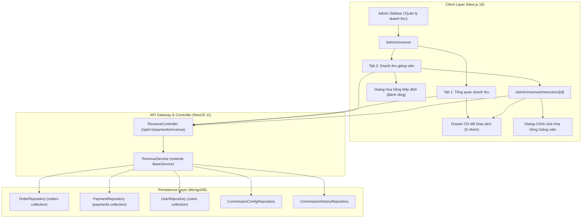

# Kế hoạch Triển khai: Quản lý Doanh thu & Hoa hồng Admin Mindly

> **Tài liệu Kế hoạch Kỹ thuật (Technical Implementation Plan)**
> Phê duyệt trước khi tiến hành viết mã nguồn.

---

## 1. Goal Description (Mục tiêu dự án)

Triển khai hoàn chỉnh phân hệ **Quản lý doanh thu & Hoa hồng** dành cho Admin hệ thống Mindly, đảm bảo tính chuẩn xác tuyệt đối của số liệu tài chính, hiệu năng truy vấn cao, và trải nghiệm UI/UX nhất quán với thiết kế hiện tại của Mindly Admin.

Phân hệ bao gồm 2 tab chính duy nhất:
1. **Tổng quan doanh thu**: Thống kê 4 KPI toàn hệ thống, biểu đồ doanh thu theo thời gian, danh sách giao dịch thành công hiển thị dạng **card ngang** (không hiển thị badge trạng thái thanh toán trên card), tìm kiếm tổng hợp, sắp xếp, phân trang theo từng trang, và Drawer chi tiết giao dịch trượt từ bên phải với 5 nhóm thông tin.
2. **Doanh thu giảng viên**: Bảng danh sách giảng viên kèm thống kê bán hàng theo thời gian, tìm kiếm, sắp xếp, phân trang, cấu hình hoa hồng mặc định qua biểu tượng bánh răng ở góc trên bên phải (mặc định 30% cho Mindly, 70% cho giảng viên), trang chi tiết doanh thu của từng giảng viên với quản lý tỷ lệ hoa hồng riêng và xem lịch sử điều chỉnh hoa hồng.

---

## 2. User Review Required (Các quyết định thiết kế quan trọng)

> [!IMPORTANT]
> **Định tuyến Sidebar & URL:**
> Trong mục navigation của Admin (`frontend/src/features/admin/constants/admin-navigation.ts`), mục hiện tại *"Quản lý Đơn hàng, Giao dịch & Doanh thu"* (`/admin/orders`) sẽ được hoàn thiện thành *"Quản lý doanh thu"* tại đường dẫn `/admin/revenue`. Đồng thời `/admin/orders` sẽ tự động redirect sang `/admin/revenue` để tương thích các liên kết cũ.

> [!IMPORTANT]
> **Quy tắc chốt hoa hồng và bảo toàn lịch sử:**
> - Tỷ lệ hoa hồng nền tảng mặc định ban đầu là **30%** (nền tảng 30%, giảng viên 70%).
> - Tỷ lệ hoa hồng được chốt ngay tại thời điểm học viên tạo đơn hàng (`createOrder`) và lưu cố định vào bản ghi `Order`.
> - Khi Admin thay đổi hoa hồng của giảng viên, chỉ áp dụng cho các đơn hàng tạo sau thời điểm cập nhật. Các đơn hàng trước đó (kể cả đang chờ thanh toán hay đã thanh toán) đều giữ nguyên tỷ lệ đã chốt.
> - Công thức phân chia:
>   $$\text{Tiền nền tảng} = \text{round}\left(\frac{T \times R}{100}\right)$$
>   $$\text{Tiền giảng viên} = T - \text{Tiền nền tảng}$$
>   *(Trong đó $T$ là số tiền thanh toán thực tế hợp lệ, $R$ là tỷ lệ hoa hồng nền tảng \%. Đảm bảo tổng 2 phần luôn chính xác bằng $T$, không lệch xu nào).*

> [!WARNING]
> **Điều kiện ghi nhận doanh thu từ SePay:**
> - Chỉ những đơn hàng có trạng thái `OrderStatusEnum.PAID` và giao dịch SePay có trạng thái đối soát hợp lệ (`MATCHED` hoặc `OVERPAID`) mới được ghi nhận vào doanh thu và xuất hiện trong danh sách card giao dịch.
> - Các đơn `PENDING`, `EXPIRED`, `CANCELLED` hoặc giao dịch `UNDERPAID` (chuyển thiếu tiền), thừa tiền chưa đối soát không được tính vào doanh thu.
> - Khi giao dịch chuyển thừa tiền (`OVERPAID`): Hệ thống kích hoạt khóa học theo giá chốt của đơn, nhưng doanh thu chỉ ghi nhận đúng số tiền của đơn (`order.amount`), phần tiền thừa (`excessAmount`) được ghi nhận đối soát riêng chứ không thổi phồng doanh thu khóa học.

---

## 3. Open Questions & Edge Cases (Xử lý các tình huống biên)

> [!NOTE]
> **Phương án xử lý các tình huống đặc biệt đã được thiết kế sẵn:**
> 1. **Giảng viên chưa có bất kỳ giao dịch nào:** Vẫn hiển thị đầy đủ trong Tab 2 với Doanh thu = 0đ, Lượt bán = 0, Tỷ lệ hoa hồng = 30% (hoặc tỷ lệ riêng đã cấu hình), Giao dịch gần nhất = "Chưa có".
> 2. **Giảng viên có đơn hàng cũ trước khi có module hoa hồng:** Sẽ có giá trị fallback an toàn là 30% nền tảng / 70% giảng viên để hiển thị nhất quán mà không làm sai lệch schema.
> 3. **Hai Admin cùng lúc cập nhật hoa hồng của 1 giảng viên:** Sử dụng atomic update trong MongoDB kèm ghi nhận `updatedAt` và `updatedById` để tránh race condition, mỗi lần cập nhật đều tạo 1 bản ghi lịch sử `CommissionHistoryEntity`.
> 4. **Tìm kiếm tổng hợp không phân biệt hoa thường và không dấu:** Backend dùng regex case-insensitive hoặc MongoDB text search cho `orderCode`, tên học viên, email học viên, tên khóa học, tên giảng viên, email giảng viên.

---

## 4. Proposed Architecture & System Design



---

## 5. Proposed Changes (Chi tiết các thay đổi)

### A. Shared Library (`share-lib/`)

#### [MODIFY] `share-lib/src/interfaces/order.interface.ts`
- Bổ sung các trường snapshot phân chia tài chính chuẩn mực vào `IOrder`:
  - `instructorId?: string;`
  - `platformCommissionRate?: number;` (Tỷ lệ nền tảng %, ví dụ 30)
  - `platformEarnings?: number;` (Tiền nền tảng nhận VND, ví dụ 150000)
  - `instructorEarnings?: number;` (Tiền giảng viên nhận VND, ví dụ 350000)

#### [MODIFY] `share-lib/src/interfaces/user.interface.ts`
- Bổ sung thông tin hoa hồng của Giảng viên vào `IUser` và `IUserProfile`:
  - `commissionRate?: number;` (Tỷ lệ nền tảng %, mặc định kế thừa config hệ thống)
  - `commissionRateUpdatedAt?: Date | string;`
  - `commissionRateUpdatedById?: string;`

#### [NEW] `share-lib/src/interfaces/revenue.interface.ts`
- Định nghĩa các contract DTO dùng chung giữa frontend và backend:
  - `IRevenueOverviewKpi`: `totalRevenue`, `platformCommission`, `instructorEarnings`, `successfulOrders`.
  - `IRevenueChartItem`: `date`, `label`, `totalRevenue`, `platformCommission`, `instructorEarnings`, `orderCount`.
  - `IRevenueTransactionItem`: card ngang format (`id`, `orderCode`, `courseTitle`, `studentName`, `instructorName`, `paidAt`, `amount`, `paymentMethod`).
  - `IRevenueTransactionDetail`: thông tin đầy đủ cho Drawer (5 nhóm: đơn hàng, học viên, khóa học, thanh toán, phân chia doanh thu).
  - `IInstructorRevenueSummary`: thống kê từng giảng viên cho Tab 2 (id, name, email, avatar, totalCourses, successfulSales, totalRevenue, commissionRate, lastTransactionDate).
  - `IInstructorRevenueDetail`: chi tiết doanh thu giảng viên (kpi, thông tin hoa hồng).
  - `ICommissionConfig`: `{ defaultRate: number; updatedAt: Date; updatedById?: string; updatedByName?: string }`.
  - `ICommissionHistoryItem`: `{ id: string; instructorId: string; oldRate: number; newRate: number; reason: string; createdAt: Date; adminName: string; adminEmail: string }`.

---

### B. Backend Persistence & Schemas (`backend/src/modules/`)

#### [NEW] `backend/src/modules/payment/schemas/commission-setting.schema.ts`
- Schema lưu cấu hình hoa hồng mặc định toàn hệ thống (collection: `commission_settings`).
- Kế thừa `BaseAbstractDocument`.
- Trường: `defaultRate: number` (mặc định 30, min: 0, max: 100), `isCurrent: boolean`.

#### [NEW] `backend/src/modules/payment/schemas/commission-history.schema.ts`
- Schema lưu lịch sử biến động hoa hồng của giảng viên (collection: `commission_histories`).
- Kế thừa `BaseAbstractDocument`.
- Trường: `instructorId: Types.ObjectId`, `oldRate: number`, `newRate: number`, `reason: string`, `appliedById: Types.ObjectId`.
- Index: `{ instructorId: 1, createdAt: -1 }`.

#### [MODIFY] `backend/src/modules/enrollment/schemas/order.schema.ts`
- Thêm trường `instructorId: Types.ObjectId` (ref `UserEntity`, index: true).
- Thêm `platformCommissionRate: number`, `platformEarnings: number`.
- Đảm bảo index `{ instructorId: 1, status: 1, paidAt: -1 }` và `{ status: 1, paidAt: -1 }`.

#### [MODIFY] `backend/src/modules/user/schemas/user.schema.ts`
- Thêm `commissionRate: number` (mặc định 30), `commissionRateUpdatedAt: Date`, `commissionRateUpdatedById: Types.ObjectId`.

---

### C. Backend Repositories & Services (`backend/src/modules/payment/`)

#### [NEW] `backend/src/modules/payment/repositories/commission-setting.repository.ts`
- Quản lý đọc và cập nhật tỷ lệ mặc định hệ thống. Đảm bảo luôn có 1 bản ghi hiện hành (seeding fallback 30%).

#### [NEW] `backend/src/modules/payment/repositories/commission-history.repository.ts`
- Quản lý ghi nhận lịch sử thay đổi hoa hồng và truy vấn lịch sử theo giảng viên.

#### [NEW] `backend/src/modules/payment/services/revenue.service.ts` (kế thừa `BaseService`)
- Xây dựng các nghiệp vụ doanh thu chính:
  1. `getRevenueOverview(timeRangeDto)`: Tính 4 KPI chính xác theo khoảng thời gian bằng aggregation tối ưu trên collection `orders` (`status: PAID`).
  2. `getRevenueChart(timeRangeDto)`: Nhóm dữ liệu theo ngày hoặc theo tháng tuỳ độ dài khoảng thời gian, tự động bù 0 cho các ngày không có doanh thu.
  3. `getSuccessfulTransactions(queryDto)`: Truy vấn danh sách giao dịch thành công dạng phân trang với tìm kiếm tổng hợp đa trường (`orderCode`, student, course, instructor) và sắp xếp đa dạng.
  4. `getTransactionDetail(orderCode)`: Trả về đầy đủ dữ liệu 5 nhóm cho Drawer, đối chiếu chính xác với `PaymentEntity` SePay.
  5. `getInstructorsRevenue(queryDto)`: Aggregation danh sách tất cả giảng viên (`role: INSTRUCTOR`), đếm tổng khóa học, tính tổng lượt bán và tổng doanh thu trong khoảng thời gian, sắp xếp theo doanh thu/lượt bán/khóa học/hoa hồng.
  6. `getInstructorDetail(instructorId, timeRangeDto)`: Lấy chi tiết thông tin, KPI và tỷ lệ hoa hồng hiện tại.
  7. `getInstructorCoursesRevenue(instructorId, queryDto)`: Thống kê doanh thu theo từng khóa học của giảng viên.
  8. `getInstructorTransactions(instructorId, queryDto)`: Lấy các giao dịch thành công của riêng giảng viên này.
  9. `getCommissionConfig()` & `updateCommissionConfig(dto, adminId)`: Đọc và cập nhật hoa hồng mặc định với validation chặt chẽ (0-100%, tối đa 2 chữ số thập phân).
  10. `updateInstructorCommission(instructorId, dto, adminId)`: Cập nhật hoa hồng riêng, lưu lịch sử vào `commission_histories`.

#### [MODIFY] `backend/src/modules/payment/services/payment.service.ts`
- Cập nhật logic `createOrder`:
  - Lấy thông tin giảng viên từ `course.instructorId`.
  - Lấy tỷ lệ hoa hồng hiện tại của giảng viên (nếu chưa có thì lấy tỷ lệ mặc định hệ thống từ `commission-setting`).
  - Tính snapshot:
    - `platformCommissionRate = instructorRate`
    - `platformEarnings = Math.round(order.amount * platformCommissionRate / 100)`
    - `instructorEarnings = order.amount - platformEarnings`
  - Lưu `instructorId`, `platformCommissionRate`, `platformEarnings`, `instructorEarnings` vào đơn hàng.

#### [NEW] `backend/src/modules/payment/revenue.controller.ts`
- Controller dành riêng cho quản lý doanh thu với `@Roles(RoleEnum.ADMIN)`:
  - `GET /payments/revenue/overview`
  - `GET /payments/revenue/chart`
  - `GET /payments/revenue/transactions`
  - `GET /payments/revenue/transactions/:orderCode`
  - `GET /payments/revenue/instructors`
  - `GET /payments/revenue/instructors/:id`
  - `GET /payments/revenue/instructors/:id/courses`
  - `GET /payments/revenue/instructors/:id/transactions`
  - `GET /payments/revenue/instructors/:id/commission-history`
  - `GET /payments/revenue/commission-config`
  - `PATCH /payments/revenue/commission-config`
  - `PATCH /payments/revenue/instructors/:id/commission`

#### [MODIFY] `backend/src/modules/payment/payment.module.ts`
- Đăng ký các entity mới (`CommissionSettingEntity`, `CommissionHistoryEntity`), các repository, `RevenueService`, và `RevenueController`.

---

### D. Frontend Implementation (`frontend/src/`)

#### [MODIFY] `frontend/src/features/admin/constants/admin-navigation.ts`
- Cập nhật menu:
  - Title: `Quản lý doanh thu`
  - Href: `/admin/revenue`
  - Icon: `lucide:circle-dollar-sign` (hoặc `lucide:receipt`)

#### [NEW] `frontend/src/app/(admin)/admin/revenue/page.tsx`
- Trang chính Quản lý doanh thu với 2 Tab:
  - Tab 1: Tổng quan doanh thu
  - Tab 2: Doanh thu giảng viên
  - Đồng bộ `tab` với URL search parameter (`?tab=overview` hoặc `?tab=instructors`).

#### [NEW] `frontend/src/app/(admin)/admin/revenue/instructors/[instructorId]/page.tsx`
- Trang Chi tiết doanh thu của từng giảng viên với nút quay lại (giữ bộ lọc trước đó), 4 thẻ thống kê, card tỷ lệ hoa hồng với thanh phân chia trực quan, dialog chỉnh sửa hoa hồng, bảng doanh thu theo khóa học, danh sách giao dịch gần đây (card ngang) và bảng lịch sử điều chỉnh hoa hồng.

#### [MODIFY] `frontend/src/app/(admin)/admin/orders/page.tsx`
- Chuyển hướng (redirect) hoặc render liên kết trỏ thẳng tới `/admin/revenue`.

#### [NEW] `frontend/src/features/admin/revenue/`
Cấu trúc thư mục tính năng chuẩn theo kiến trúc dự án:
- `api/revenue-admin.api.ts`: TanStack Query hooks cho tất cả các endpoint doanh thu & hoa hồng.
- `components/revenue-view.tsx`: Component điều phối 2 tab, lưu giữ URL query params.
- `components/revenue-time-filter.tsx`: Bộ lọc thời gian (Hôm nay, Hôm qua, 7 ngày, 30 ngày, Tháng này, Tháng trước, Năm nay, Tùy chỉnh với từ ngày - đến ngày).
- `components/revenue-kpi-cards.tsx`: 4 thẻ thống kê (Tổng doanh thu, Hoa hồng nền tảng, Thu nhập giảng viên, Đơn hàng thành công) kèm skeleton loading.
- `components/revenue-chart.tsx`: Biểu đồ trực quan hóa dữ liệu (cột / đường kết hợp) hiển thị cả 3 dòng số liệu tài chính kèm chú giải (legend), tooltip tiền tệ VND, không dùng mock data.
- `components/transaction-card.tsx`: **Card ngang giao dịch thành công** tuân thủ nghiêm ngặt đặc tả:
  - Bố cục 3 phần: Trái (Khóa học, Mã đơn, Học viên, Giảng viên), Giữa (Ngày, Giờ thanh toán), Phải (Số tiền VND + mũi tên xem chi tiết).
  - Không hiển thị badge trạng thái thanh toán trên card.
  - Hover, focus state, pointer, click mở Drawer chi tiết.
- `components/transaction-cards-list.tsx`: Thanh công cụ với ô tìm kiếm tổng hợp (debounce 350ms, nút clear) + Select sắp xếp (Mới nhất, Cũ nhất, Số tiền cao nhất, thấp nhất) + Danh sách card + Pagination theo từng trang của dự án.
- `components/transaction-detail-drawer.tsx`: Slide-over Drawer bên phải hiển thị đầy đủ 5 nhóm thông tin chi tiết của giao dịch. Tái sử dụng cho cả Tab 1 và Trang chi tiết giảng viên.
- `components/instructors-revenue-table.tsx`: Bảng danh sách giảng viên (avatar, tên, email, tổng khóa học, lượt bán, tổng doanh thu, tỷ lệ hoa hồng hiện tại, giao dịch gần nhất, nút "Xem chi tiết").
- `components/default-commission-dialog.tsx`: Dialog mở từ biểu tượng bánh răng ở góc trên bên phải Tab 2, cho phép Admin xem và điều chỉnh tỷ lệ mặc định hệ thống.
- `components/instructor-commission-dialog.tsx`: Dialog chỉnh sửa tỷ lệ hoa hồng riêng của từng giảng viên với trường nhập tỷ lệ mới, tính trước ví dụ trên 1.000.000đ, lý do bắt buộc và hộp thoại xác nhận trước khi lưu.

---

## 6. Verification Plan (Kế hoạch Kiểm thử & Đối soát)

### Automated Unit Tests
- Chạy bộ test cho `RevenueService`:
  ```powershell
  cd backend; npx vitest run src/modules/payment/tests/revenue.service.spec.ts
  ```
- Chạy lại toàn bộ test thanh toán & SePay để đảm bảo không có regression:
  ```powershell
  cd backend; npx vitest run src/modules/payment/tests
  ```

### Code Quality & Type Safety Checks
- Backend linting:
  ```powershell
  cd backend; pnpm lint
  ```
- Frontend linting & build typecheck:
  ```powershell
  cd frontend; pnpm lint
  ```

### Manual Verification Scenarios (Quy trình xác minh thủ công)
1. **Kiểm tra Tab 1 (Tổng quan doanh thu):**
   - Đổi các mốc thời gian: Hôm nay, 7 ngày, 30 ngày, Tùy chỉnh -> Kiểm tra 4 KPI, biểu đồ và danh sách card cập nhật đồng bộ.
   - Kiểm tra card giao dịch: Không có badge trạng thái, bố cục ngang cân đối, hiển thị tên khóa học, mã đơn, học viên, giảng viên, ngày giờ, số tiền VND.
   - Nhập từ khóa tìm kiếm: Thử mã đơn `MD...`, tên học viên, email học viên, tên khóa học, tên giảng viên -> Danh sách lọc chính xác, KPI và biểu đồ không bị đổi.
   - Thử sắp xếp theo số tiền cao/thấp nhất, mới nhất/cũ nhất.
   - Click card -> Drawer mở ra từ bên phải, hiển thị đủ 5 nhóm thông tin (kèm tỷ lệ và số tiền phân chia đã chốt).
   - Chuyển trang qua thanh pagination -> Danh sách sang trang 2, giữ nguyên bộ lọc thời gian và từ khóa tìm kiếm.
2. **Kiểm tra Tab 2 (Doanh thu giảng viên):**
   - Danh sách hiển thị đủ các giảng viên (kể cả người chưa bán được khóa nào, hiển thị 0đ và 0 lượt bán).
   - Bấm vào bánh răng ở góc trên bên phải -> Mở dialog cấu hình hoa hồng mặc định, thử đổi tỷ lệ -> Lưu thành công.
   - Bấm "Xem chi tiết" 1 giảng viên -> Mở trang chi tiết doanh thu giảng viên.
3. **Kiểm tra Trang chi tiết giảng viên:**
   - 4 thẻ thống kê của giảng viên.
   - Card tỷ lệ hoa hồng hiện tại có thanh phân chia tỷ lệ (ví dụ: Mindly 30% - Giảng viên 70%).
   - Bấm "Thay đổi tỷ lệ hoa hồng" -> Mở dialog, nhập tỷ lệ mới kèm lý do bắt buộc -> Xác nhận -> Tỷ lệ cập nhật và ghi nhận vào bảng Lịch sử điều chỉnh.
   - Danh sách giao dịch gần đây của giảng viên hiển thị bằng card ngang -> Click mở Drawer.
4. **Kiểm tra tính an toàn của SePay & Dữ liệu:**
   - Webhook SePay thiếu tiền -> Không xác nhận, không ghi nhận doanh thu, không xuất hiện trên danh sách card.
   - Webhook SePay đúng tiền -> Xác nhận thành công, đơn `PAID`, hiển thị ngay trên card danh sách và cập nhật KPI.

